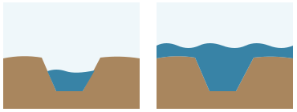

# Jeremiah 46 — Egypt’s army falls and the LORD promises to help Israel

**About this chapter**

Jeremiah describes Egypt’s army as a river in flood. Egypt expects to win. The LORD tells Jeremiah what will happen to Egypt and to Israel.

## A battle by the river

## Jeremiah 46:1

The LORD spoke to Jeremiah about several nations.

Jeremiah was a prophet. He brought people messages from God.

## Jeremiah 46:2

This message was about Egypt and its king, Pharaoh Neco.

Neco’s army fought at Carchemish, beside the Euphrates River.

Nebuchadnezzar, king of Babylon, defeated Neco’s army there.

It was the fourth year of King Jehoiakim’s rule in Judah.

Jehoiakim was Josiah’s son.

## Jeremiah 46:3

The message opens with a call to Egypt’s soldiers.

“Get your shields, both small and large!

March out to fight!”

## Jeremiah 46:4

“Fasten the horses to the chariots.

Riders, get on your horses. Put on your helmets.

Stand in your places. Polish your spears.

Put on the armor that protects your bodies.”

## Jeremiah 46:5

Then the LORD asked, “What do I see?

The soldiers are terrified. They are turning back.

Their strongest fighters have lost.

They run without looking back. Fear is everywhere.”

## Jeremiah 46:6

Even fast runners cannot get away.

Even strong soldiers cannot escape.

They stumble and fall in the north, beside the Euphrates River.

## Egypt boasts about its strength

## Jeremiah 46:7

Who is this, rising like the Nile River?

Who comes rushing like floodwater?

## Jeremiah 46:8

It is Egypt. Its army is like the rising Nile.

Egypt boasts, “I will cover the whole earth.

I will destroy cities and the people in them.”

Egypt expects its army to sweep everything away like a flood.

## Jeremiah 46:9

The call goes out to the army again.

“Forward, horses! Race ahead, chariots!”

A chariot was a cart that horses pulled in battle.

Soldiers from Cush and Put carry shields.

Soldiers from Lydia draw their bows.

## Jeremiah 46:10

Yet this day belongs to the Lord GOD.

He leads the armies of heaven.

He will punish his enemies beside the Euphrates River.

Jeremiah pictures a sword drinking until it has had enough.

Many soldiers will die there.

Jeremiah compares their deaths to a sacrifice before the LORD.

## Jeremiah 46:11

Jeremiah speaks to Egypt as if to a young woman.

“Go to Gilead for balm.”

Balm was something people put on wounds.

“Try every medicine you have. None will heal you.”

Egypt cannot undo this defeat.

## Jeremiah 46:12

Other nations hear of Egypt’s shame.

People far away hear Egypt cry out.

One soldier trips over another. Both fall together.

## The warning reaches Egypt

## Jeremiah 46:13

The LORD gave Jeremiah another message.

King Nebuchadnezzar of Babylon was coming to attack Egypt itself.

## Jeremiah 46:14

“Spread the news throughout Egypt!

Tell Migdol, Memphis, and Tahpanhes.

Get ready! People around you are already dying in battle.”

## Jeremiah 46:15

Why have Egypt’s strong fighters fallen?

They cannot stand because the LORD pushed them down.

## Jeremiah 46:16

The soldiers stumble and fall over each other.

They say, “Get up! Let’s go back to our own people.

Let’s go where we were born.

There we can get away from this cruel enemy.”

## Jeremiah 46:17

They will call out, “Pharaoh made a lot of noise!

Egypt’s king let his chance pass.”

## Jeremiah 46:18

The LORD who leads heaven’s armies is King.

He gave his word that a mighty ruler would come.

This ruler would stand out like Mount Tabor among the hills.

He would be like Mount Carmel high above the sea.

## Jeremiah 46:19

People of Egypt, pack what you can carry.

Enemies will take you away from home.

They will wreck Memphis. No one will live there.

## An army comes from the north

## Jeremiah 46:20

Egypt is like a beautiful young cow.

But a biting fly is coming from the north.

The fly stands for the enemy coming against Egypt.

## Jeremiah 46:21

Egypt pays soldiers to fight for it.

They are like well-fed calves.

When trouble comes, they will all turn and run.

The time has come for their punishment.

## Jeremiah 46:22

Egypt will hiss like a snake slipping away.

The enemy soldiers come with great force.

They carry axes like workers coming to cut down trees.

## Jeremiah 46:23

The LORD says the forest is thick.

Yet the enemy will cut it down.

The soldiers are like a swarm of locusts.

Locusts are insects that travel in huge groups.

There will be too many soldiers to count.

## Jeremiah 46:24

The people of Egypt will suffer shame.

The army from the north will take control of them.

## Jeremiah 46:25

Israel’s God leads the armies of heaven.

He will punish Amon, the god people worship in Thebes.

He will punish Pharaoh and Egypt, its gods and kings.

He will also punish those who trust in Pharaoh.

## Jeremiah 46:26

The LORD will hand them over to those who want them dead.

These enemies are Nebuchadnezzar and his officers.

Yet the LORD says people will live in Egypt again.

They will live there as they did long ago.

## The LORD promises to bring Israel home

## Jeremiah 46:27

The LORD calls Israel his servant Jacob.

Jacob was the ancestor of the people of Israel.

“Do not be afraid. Do not lose hope.

I will rescue you from far away.

I will rescue your children from the land that holds them captive.

You will come home and live in peace.

No one will frighten you.”

## Jeremiah 46:28

The LORD said, “Do not be afraid, my servant Jacob.

I am with you.

I scattered you among other nations.

I will bring those nations to an end.

You will still be my people.

I will punish you for doing wrong.

My punishment will be fair.”

**Think about it**

**Where did the LORD promise to bring the people of Israel?**
