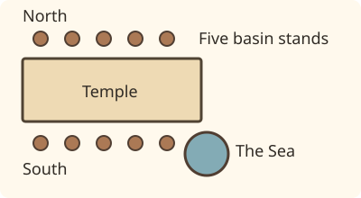

# Jeremiah 52 — Jerusalem falls and its people go into exile

**About this chapter**

Babylon's army surrounds Jerusalem. The soldiers destroy the temple and take people far from home. Years later, a new king in Babylon shows kindness to a prisoner from Judah.

## Babylon surrounds Jerusalem

## Jeremiah 52:1

Zedekiah became king when he was 21 years old.

He ruled in Jerusalem for 11 years.

His mother Hamutal came from Libnah.

Her father was named Jeremiah.

## Jeremiah 52:2

Zedekiah did what the LORD saw as evil.

King Jehoiakim before him had done the same.

## Jeremiah 52:3

The LORD was angry with Jerusalem and Judah.

In the end he sent them away from his presence.

Zedekiah rebelled against the king of Babylon.

## Jeremiah 52:4

In Zedekiah's ninth year, King Nebuchadnezzar brought his whole army to Jerusalem.

They came on the tenth day of the tenth month.

They camped outside and built a wall around the city.

## Jeremiah 52:5

The army held Jerusalem under siege until Zedekiah's eleventh year.

A siege meant that the army blocked the way in and out.

## Jeremiah 52:6

By the ninth day of the fourth month, the food had run out.

The people were starving.

## Zedekiah tries to escape

## Jeremiah 52:7

Babylon's soldiers broke through the city wall.

That night Judah's fighting men slipped out between two walls.

They used the gate by the king's garden.

Even with the city surrounded, they set off toward the Arabah plain.

## Jeremiah 52:8

Babylon's soldiers chased King Zedekiah.

They caught up with him on the plains of Jericho.

His whole army left him.

## Jeremiah 52:9

The soldiers captured Zedekiah and took him to Riblah in Hamath.

There the king of Babylon passed judgment on him.

## Jeremiah 52:10

At Riblah the king had Zedekiah's sons killed as Zedekiah watched.

He also had all Judah's officials killed.

## Jeremiah 52:11

Then the king had Zedekiah blinded and bound with bronze chains.

He took Zedekiah to Babylon.

Zedekiah stayed in prison until he died.

## The temple and walls come down

## Jeremiah 52:12

Nebuzaradan commanded the king of Babylon's guards.

He entered Jerusalem on the tenth day of the fifth month.

Nebuchadnezzar had been king for 19 years.

## Jeremiah 52:13

Nebuzaradan burned the LORD's temple and the royal palace.

He burned the houses and every important building in Jerusalem.

## Jeremiah 52:14

The whole Babylonian army under his command tore down Jerusalem's walls.

## Jeremiah 52:15

Nebuzaradan took people away to live in exile.

They included some of the poorest people and others still in Jerusalem.

He took the people who had gone over to Babylon's side.

He also took the skilled workers who remained.

## Jeremiah 52:16

He left some of the poorest people on the land.

They cared for the grapevines and worked the fields.

## The soldiers carry off the temple treasures

## Jeremiah 52:17

The soldiers broke up the bronze pillars and stands in the temple.

They also broke up the bronze basin called the Sea.

They carried all that metal to Babylon.

## Jeremiah 52:18

They took the bronze tools used in worship.

They took pots, shovels, dishes, and bowls for sprinkling.

They took the tools for trimming lamp wicks.

## Jeremiah 52:19

The captain took everything made of pure gold or fine silver.

He took basins, incense holders, pots, lampstands, and pans.

He took bowls for sprinkling and bowls for drink offerings.

## Jeremiah 52:20

King Solomon had made the two pillars and the Sea for the temple.

Twelve bronze bulls stood under the Sea.

There were stands that people could move.

There was too much bronze in all this to weigh.

## Jeremiah 52:21

Each hollow pillar stood 18 cubits tall.

A cubit was roughly the length from elbow to fingertip.

Each pillar measured 12 cubits around.

Its bronze wall was four fingers thick.

## Jeremiah 52:22

Each pillar had a bronze top five cubits high.

A bronze net with shapes like pomegranate fruit decorated the top.

Both pillars had the same design.

## Jeremiah 52:23

There were 96 fruit shapes on the sides of each top.

In all, 100 fruit shapes stood above each bronze net.

## Captives are taken to Riblah

## Jeremiah 52:24

The captain took Seraiah, the chief priest.

He took Zephaniah, the priest next in rank.

He also took the three doorkeepers.

## Jeremiah 52:25

He took an official in charge of soldiers and seven royal advisers.

He took the army secretary who signed men up to serve.

He also took 60 men he found in the city.

## Jeremiah 52:26

Nebuzaradan brought these prisoners to the king of Babylon at Riblah.

## Jeremiah 52:27

At Riblah in Hamath, the king had them put to death.

The people of Judah went into exile, far from their own land.

## A count of the people taken away

## Jeremiah 52:28

In his seventh year as king, Nebuchadnezzar took away 3,023 Jews.

## Jeremiah 52:29

In his eighteenth year he took 832 people from Jerusalem.

## Jeremiah 52:30

In his twenty-third year, his captain Nebuzaradan took away 745 Jews.

These three groups together numbered 4,600 people.

## Jehoiachin leaves prison

## Jeremiah 52:31

Jehoiachin, a king of Judah, was in his thirty-seventh year of exile.

Evil-merodach had just become king of Babylon.

On the twenty-fifth day of the twelfth month, he pardoned Jehoiachin.

He let him out of prison.

## Jeremiah 52:32

The new king spoke kindly to Jehoiachin.

He gave him a place of greater honor than the other kings in Babylon.

## Jeremiah 52:33

Jehoiachin changed out of his prison clothes.

For the rest of his life, he ate regularly at the king's table.

## Jeremiah 52:34

The king of Babylon gave Jehoiachin a daily allowance.

Jehoiachin received it until the day he died.

**Think about it**

**How did the new king of Babylon treat Jehoiachin?**
