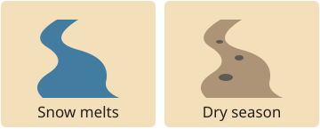

# Job 12 — Job says all life is in God’s hands

**About this chapter**

Job answers his friends after Zophar speaks. He asks them to consider the animals, the earth, and even the rulers of nations.

## Job challenges his friends

## Job 12:1

Job answered his friends.

## Job 12:2

You must be the only wise people alive!

When you die, wisdom will die with you!

**Reading help**

Job is using sharp humor. He thinks his friends speak as if they alone are wise.

## Job 12:3

I can think for myself too.

I understand as much as you do.

Who has not heard these things?

## Job sees who suffers and who lives safely

## Job 12:4

I called to God, and God answered me.

Yet my friends laugh at me.

They laugh at a man who tries to do right.

## Job 12:5

People who live in comfort look down on those in trouble.

They see someone slipping and think that person deserves to fall.

## Job 12:6

Yet robbers live safely in their tents.

Even people who make God angry live in safety.

They carry their god in their own hands.

**Pause and answer**

Who laughs at Job?

## Job points to living things

## Job 12:7

Ask the animals, and they will teach you.

Ask the birds, and they will tell you.

## Job 12:8

Speak to the earth, and it will teach you.

Even the fish in the sea can tell you.

## Job 12:9

Which of them does not know the LORD has done this?

## Job 12:10

God holds the life of every creature in his hand.

Every breath we take is in his hand too.

**Reading help**

Job pictures God holding every living thing. He means that every life depends on God.

## Job 12:11

Your tongue tastes food.

In the same way, your ear tests words.

You listen and judge what you hear.

## Job 12:12

Older people have wisdom.

Living many years brings understanding.

**Pause and answer**

What does Job compare listening to words with?

## Job describes God’s power

## Job 12:13

God has wisdom and strength.

God understands and knows what advice to give.

## Job 12:14

If God tears something down, no one can rebuild it.

If God locks someone up, no one can free that person.

## Job 12:15

When God holds water back, the streams dry up.

When he lets water loose, it floods the land.

## Job 12:16

True wisdom and power belong to God.

Both the person who lies and the person who believes the lie belong to him.

**Pause and answer**

What happens when God lets the waters loose?

## What happens to people in power

## Job 12:17

God leads advisers away barefoot.

He makes judges look foolish.

## Job 12:18

God unties the ropes that kings used to bind others.

Then he ties a belt around the kings themselves.

## Job 12:19

God leads priests away barefoot.

He brings down people who seemed secure in power.

## Job 12:20

People once trusted for their words can no longer speak.

God takes away the good judgment of the elders.

## Job 12:21

God lets nobles suffer shame.

He takes weapons away from the powerful.

**Pause and answer**

What do the elders lose?

## Even nations are in God’s hands

## Job 12:22

God uncovers what lies hidden deep in the dark.

He brings even the darkest things into the light.

## Job 12:23

God makes nations great and then brings them down.

He makes nations grow and then scatters their people.

## Job 12:24

God takes away the good sense of the world’s leaders.

They wander through empty country without a path.

## Job 12:25

They feel their way in the dark without a light.

God makes them stumble like people who are drunk.

**Pause and answer**

Where do the leaders wander?
