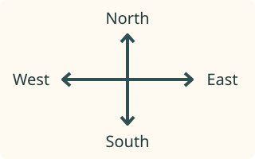

# Job 23 — Job longs for God to hear him

**About this chapter**

Job wants to explain himself to God and hear God’s answer. He looks in every direction. Even when he cannot find God, he believes God knows him.

## Job wants to bring his case to God

## Job 23:1

Then Job answered Eliphaz.

## Job 23:2

Even today I speak out of deep pain.

I groan, but God’s hand still weighs heavily on me.

## Job 23:3

If only I knew where to find God!

I would go to the place where he sits as judge.

## Job 23:4

I would tell God my side of the case.

I would give him all my reasons.

## Job 23:5

I want to hear how God would answer me.

I would think carefully about his words.

## Job 23:6

Would God use his great power to argue me down?

No.

I believe he would listen to me.

## Job 23:7

An honest person could speak freely with him there.

Then my judge would clear me of the charges for good.

**Pause and answer**

What does Job want God to hear?

## Job looks in every direction

## Job 23:8

I go east, but God is not there.

I go west, but I cannot find him.

## Job 23:9

When God works in the north, I cannot see him.

When he turns south, I still cannot see him.

**Pause and answer**

Where does Job look for God?

## God knows Job’s path

## Job 23:10

Yet God knows the path I have taken.

When he has tested me, I will come out like gold.

**Reading help**

People test metal to see whether it is gold. Job believes a test will show that he has been faithful.

## Job 23:11

I have followed in God’s footsteps.

I have stayed on his path without turning aside.

## Job 23:12

I have kept the commands God spoke.

His words mean more to me than my daily food.

**Pause and answer**

What does Job value more than his daily food?

## Job is afraid and still speaks

## Job 23:13

God does not change.

Who can stand against him?

He does what he chooses.

## Job 23:14

God will carry out what he has decided about me.

He has many other plans like this.

## Job 23:15

That is why I tremble in his presence.

When I think about what he can do, I am afraid.

## Job 23:16

God has made me lose heart.

The Almighty fills me with fear.

## Job 23:17

Thick darkness covers my face.

Yet even in this darkness, I still speak.

**Pause and answer**

What does Job keep doing even in darkness?
