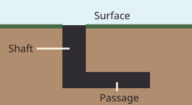

# Job 28 — Where can we find wisdom?

**About this chapter**

Miners find treasures buried deep in rock. This poem asks whether people can find wisdom in the same way.

## Miners go deep into the earth

## Job 28:1

People know where to mine silver.

They know where to make gold pure.

## Job 28:2

They dig iron out of the earth.

They heat rock called ore to get copper from it.

## Job 28:3

Miners bring light into dark places.

They search for ore in the farthest, darkest corners.

## Job 28:4

Far from anyone’s home, a miner digs a deep shaft.

It leads down where no one walks.

Far from others, the miner hangs and swings.

## Job 28:5

Food grows at the surface of the earth.

Deep below, the earth changes as if a fire had swept through it.

## Job 28:6

The rocks hold sapphires, precious blue stones.

There are tiny bits of gold there too.

**Pause and answer**

What blue stones do miners find underground?

## A path even a falcon cannot see

## Job 28:7

No hunting bird knows the miner’s path.

Even the sharp-eyed falcon has never seen it.

## Job 28:8

No proud wild animal has walked there.

No lion has prowled along that path.

## Job 28:9

The miner strikes hard rock called flint.

He turns mountains over from underneath.

## Job 28:10

He cuts channels through rock.

His eyes spot every treasure.

## Job 28:11

He blocks the streams where they begin.

He brings hidden things out into the light.

**Pause and answer**

What do miners bring into the light?

## Can anyone buy wisdom?

## Job 28:12

But where can we find wisdom?

Where does understanding live?

## Job 28:13

No one knows what wisdom is worth.

People cannot find it in the land of the living.

## Job 28:14

The deep water says, “Wisdom is not in me.”

The sea says, “Wisdom is not here with me.”

**Reading help**

The poem gives the sea a voice. Even the deepest water has no wisdom to offer for sale or discovery.

## Job 28:15

No amount of gold can buy wisdom.

No one can weigh out enough silver to pay for it.

## Job 28:16

Even the gold of Ophir cannot match its worth.

Neither can precious stones like onyx and sapphire.

## Job 28:17

Neither gold nor clear crystal can compare with wisdom.

Even fine gold jewelry cannot buy it.

## Job 28:18

Coral and quartz are hardly worth mentioning beside wisdom.

Wisdom is worth more than rubies.

## Job 28:19

Even topaz, a precious stone from Cush, cannot match wisdom.

Pure gold cannot measure its worth.

**Pause and answer**

How much gold would be enough to buy wisdom?

## Who knows the way to wisdom?

## Job 28:20

Where, then, does wisdom come from?

Where does understanding live?

## Job 28:21

No living creature can see where wisdom is.

Even birds in the sky cannot see it.

## Job 28:22

Abaddon, the place of destruction, and Death say, “We have only heard people speak of it.”

## Job 28:23

God knows the way to wisdom.

He knows where it is.

## Job 28:24

God looks to the ends of the earth.

He sees everything under the sky.

**Pause and answer**

Who knows where wisdom is?

## What God tells people

## Job 28:25

God set the weight of the wind.

He measured out the waters.

## Job 28:26

He set limits for the rain.

He marked out a path for the lightning.

## Job 28:27

Then God looked at wisdom and saw its worth.

He set wisdom firmly in place and examined it fully.

## Job 28:28

God said to people, “To stand in awe of the Lord is wisdom.

To turn away from evil is understanding.”

**Reading help**

To stand in awe of the Lord means to honor him with deep respect.

**Pause and answer**

What action does God call understanding?
