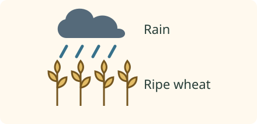

# Job 36 — Elihu points to the storm

**About this chapter**

Elihu tells Job how he thinks God teaches people through trouble. Then Elihu asks Job to think about rain and thunder.

## Elihu asks Job to listen

## Job 36:1

Elihu kept speaking.

## Job 36:2

Job, listen a little longer.

I have more to say in God’s defense.

## Job 36:3

I have looked far for what I know.

I will show that my Maker is fair.

## Job 36:4

I am telling you the truth.

Here with you is someone who understands this fully.

## God watches over people

## Job 36:5

God is strong, and God looks down on no one.

God has great power to understand.

## Job 36:6

God does not keep evil people alive.

God acts fairly for people who suffer.

## Job 36:7

God watches over people who do right.

God seats them on thrones beside kings.

God gives them lasting honor.

## Elihu says God teaches through trouble

## Job 36:8

Suppose chains hold people fast.

Their troubles are like ropes around them.

## Job 36:9

Then God shows them what they have done.

God shows them how their pride led them into sin.

## Job 36:10

God helps them hear what they must change.

God tells them to turn away from evil.

## Job 36:11

If they obey and serve God, they live well.

They spend their remaining years in happiness.

## Job 36:12

If they refuse to listen, they die by the sword.

They die without understanding.

## Job 36:13

People who reject God hold on to their anger.

Even when God binds them, they never ask for help.

## Job 36:14

They die young, among men who sell sex at places of worship.

## Job 36:15

God uses suffering to rescue people who suffer.

In their trouble, God helps them hear.

**Pause and answer**

What does Elihu say God helps suffering people do?

## Elihu warns Job about riches

## Job 36:16

Job, trouble had you in its jaws.

God drew you out into a wide, open place.

God gave you a table full of rich food.

**What does Elihu mean by jaws?**

Think of an animal holding something in its teeth. Elihu says trouble held Job that tightly.

## Job 36:17

Now the judgment evil people deserve weighs on you.

God’s fair judgment has taken hold of you.

## Job 36:18

Be careful when someone offers you riches.

Someone might pay you to do wrong.

Even a large payment should never turn you aside.

## Job 36:19

Can your wealth keep you out of trouble?

Can all your strength and effort save you?

## Job 36:20

Do not wish for the night.

That is when people vanish from their homes.

## Job 36:21

Take care, Job.

You have chosen to do wrong rather than suffer.

Do not turn to evil.

## People sing about God’s work

## Job 36:22

Think how great God’s power is.

Who can teach the way God does?

## Job 36:23

Who has ever told God which way to go?

Who can say to God, ‘You have done wrong’?

## Job 36:24

Remember to praise the things God has done.

People have sung about them.

## Job 36:25

Everyone has seen what God has done.

People see God’s work even from far away.

## Job 36:26

God is greater than we can understand.

Who can count the years God has lived?

## Elihu describes a storm

## Job 36:27

God draws up drops of water.

The mist forms drops of rain.

## Job 36:28

Then the clouds pour out the rain.

Showers fall on people in great streams.

## Job 36:29

Who understands how the clouds spread across the sky?

Who understands the roar of thunder from God’s tent?

## Job 36:30

Look how God spreads lightning all around.

God covers even the depths of the sea.

## Job 36:31

Through these storms God judges whole nations.

Through them God gives people plenty of food.

**Look at the wheat**

Rain waters the plants people grow for food.

## Job 36:32

God takes lightning in his hands.

God tells it where to strike.

## Job 36:33

The thunder tells us God is near.

Even the cattle notice the storm coming.

**Pause and answer**

Tell in your own words how Elihu connects rain with food.
