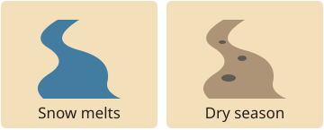

# Job 6 — Job asks his friends for kindness

**About this chapter**

Job tells his friends how heavy his grief feels. He had counted on their kindness. Now he asks them to listen and judge him fairly.

## Job describes the weight of his grief

## Job 6:1

Then Job answered Eliphaz.

## Job 6:2

If only someone could weigh my grief!

Put it on the scales with all my troubles.

## Job 6:3

Together they would weigh more than all the sand by the seas.

That is why I spoke without thinking.

## Job 6:4

I feel as if the Almighty has shot arrows into me.

Their poison seems to spread deep inside me.

All around me I see things from God that terrify me.

**Pause and answer**

What does Job say his grief and troubles would outweigh?

## Job speaks about food

## Job 6:5

Does a wild donkey cry out when it has fresh grass?

Does an ox call out when it has food?

## Job 6:6

Who wants to eat tasteless food without salt?

What flavor is there in the white of an egg?

## Job 6:7

I cannot bring myself to touch such food.

Even the thought of eating it disgusts me.

## Job says what he longs for

## Job 6:8

If only God would give me what I ask!

Here is what I long for.

## Job 6:9

I wish God would reach out his hand and crush me.

I wish he would end my life.

## Job 6:10

Even in this constant pain, one thing brings me comfort and joy.

I have held to the words of the Holy One.

The Holy One is God.

## Job 6:11

What strength have I left to keep hoping?

What future can I look forward to as I wait?

## Job 6:12

Am I as strong as stone?

Is my body made of bronze?

## Job 6:13

How can I help myself now?

Every chance of getting through this seems gone.

**Pause and answer**

What still gives Job comfort in his pain?

## Streams that dry up

## Job 6:14

A friend should show kindness to someone who has lost hope.

Even someone who stops honoring the Almighty needs a friend’s kindness.

## Job 6:15

But my friends are like streams I cannot count on.

Sometimes those streams overflow.

## Job 6:16

Ice darkens the water.

Melting snow rushes into the streams.

## Job 6:17

Then the dry season comes.

In the heat the water disappears.

Only the dry streambeds remain.

**Pause and answer**

What happens to the streams in the heat?

## Travelers look for water

## Job 6:18

Groups of travelers leave their usual paths to find water.

They go into the empty desert and die there.

## Job 6:19

Travelers from Tema look for water.

Travelers from Sheba hope to find it too.

## Job 6:20

They were counting on that water.

When they arrive and find none, their hopes fall apart.

## Job 6:21

My friends, that is how little help you give me now.

You see what has happened to me, and you are afraid.

## Job 6:22

Did I ask you for a gift?

Did I ask you to pay anyone off with your money?

## Job 6:23

Did I ask you to save me from an enemy?

Did I ask you to buy my freedom from cruel people?

**Pause and answer**

Why does Job compare his friends to a dry stream?

## Job asks his friends to listen

## Job 6:24

Teach me, and I will be quiet.

Show me what I have done wrong.

## Job 6:25

Honest words can hurt!

But what do your arguments prove?

## Job 6:26

Do you mean to correct everything I say?

I cry out because I have lost hope.

Do you treat my words like wind that blows away?

## Job 6:27

You would even draw lots to see who gets a child without parents.

You would trade away your own friend.

## Job 6:28

Please look at me now.

Would I lie to your face?

## Job 6:29

Think again.

Treat me fairly.

Think again, because you are judging whether I have done right.

## Job 6:30

Have I said anything evil?

Can I not tell when words are meant to hurt?

**Pause and answer**

What does Job ask his friends to show him?
