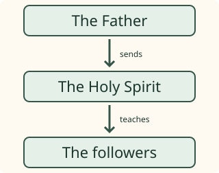

# John 14 — Jesus promises his followers help and peace

**About this chapter**

Jesus tells his followers he is going to his Father.

He promises them the Holy Spirit and gives them his peace.

## A place with Jesus

## John 14:1

Jesus told his followers, “Do not let worry fill your hearts.

You trust God.

Trust me too.

## John 14:2

“My Father’s house has many rooms.

Would I tell you I am going to prepare a place for you if that were not true?

## John 14:3

“I will go and prepare a place for you.

Then I will come back and take you to be with me.

You will be where I am.

## John 14:4

“You know the way to the place I am going.”

**Pause and answer**

What does Jesus promise to do after he prepares a place?

## Thomas asks about the way

## John 14:5

Thomas said, “Lord, we do not know where you are going.

How can we know the way?”

## John 14:6

Jesus answered, “I am the way, the truth, and the life.

No one comes to the Father except through me.

**Help with these words**

When Thomas asks about the way, he is thinking about a journey.

Jesus tells Thomas that people come to know the Father through Jesus himself.

## John 14:7

“If you had known me, you would know my Father too.

From now on, you do know him.

You have seen him.”

**Pause and answer**

Who does Jesus say is the way to the Father?

## Philip asks to see the Father

## John 14:8

Philip said, “Lord, show us the Father.

That will be enough for us.”

## John 14:9

Jesus answered, “Philip, I have been with you all this time.

Do you still not know me?

Anyone who has seen me has seen the Father.

Why do you ask me to show you the Father?

## John 14:10

“Do you believe that I am in the Father and the Father is in me?

The words I speak do not come from me alone.

The Father lives in me and does his work.

## John 14:11

“Believe me when I say this.

I am in the Father, and the Father is in me.

Or believe because of the work you have seen.

**Pause and answer**

What did Philip ask Jesus to show them?

## Jesus speaks about work and prayer

## John 14:12

“I tell you the truth.

People who trust me will do the work I do.

They will do even greater things because I am going to the Father.

## John 14:13

“I will do whatever you ask in my name.

In this way the Son brings honour to the Father.

## John 14:14

“If you ask me for anything in my name, I will do it.

**Pause and answer**

In whose name does Jesus tell his followers to ask?

## Jesus promises another Helper

## John 14:15

“If you love me, you will do what I command.

## John 14:16

“I will ask my Father to give you another Helper.

This Helper will be with you forever.

**Help with these words**

An advocate is someone who speaks for you and helps you.

Jesus calls this Helper the Spirit of truth.

## John 14:17

“He is the Spirit of truth.

The world cannot receive him because it neither sees nor knows him.

But you know him.

He lives with you and will be in you.

**Pause and answer**

How long will the Helper stay with the followers?

## Jesus promises to come to his followers

## John 14:18

“I will not leave you like children without parents.

I will come to you.

## John 14:19

“Soon the world will no longer see me.

But you will see me.

Because I live, you will live too.

## John 14:20

“On that day you will know that I am in my Father.

You will know that you are in me and I am in you.

## John 14:21

“People who love me accept my commands and obey them.

My Father will love them.

I will love them and show myself to them.”

**Pause and answer**

How do people show that they love Jesus?

## Judas asks whom Jesus will show himself to

## John 14:22

Another follower named Judas spoke.

This was a different man from Judas Iscariot.

He asked, “Lord, why will you show yourself to us and not to the world?”

## John 14:23

Jesus answered, “Anyone who loves me will do what I say.

My Father will love that person.

My Father and I will come and make our home with them.

**Help with these words**

Making a home with someone means coming to stay.

Jesus promises that he and his Father will stay close to those who love him.

## John 14:24

“Anyone who does not love me does not do what I say.

The message you hear comes from the Father who sent me.

**Pause and answer**

Whose message does Jesus give his followers?

## The Holy Spirit will remind them

## John 14:25

“I have told you all this while I am still with you.

## John 14:26

“The Helper is the Holy Spirit.

My Father will send him in my name.

The Holy Spirit will teach you all things.

He will remind you of everything I have told you.

**About the picture**

Start with the Father.

Follow the arrows to see who sends the Helper and whom the Helper teaches.

## John 14:27

“I leave you my peace.

I give you my own peace.

I give differently from the way the world gives.

Do not let worry fill your hearts.

Do not be afraid.

**Pause and answer**

What will the Holy Spirit help the followers remember?

## Jesus tells his followers before he leaves

## John 14:28

“You heard me say that I am going away and coming back to you.

If you loved me, you would be glad I am going to the Father.

The Father is greater than I am.

## John 14:29

“I have told you before it happens.

Then, when it happens, you will believe.

## John 14:30

“I will not talk with you much longer.

The ruler of this world is coming.

He has no power over me.

**Help with these words**

Here Jesus calls the devil the ruler of this world.

## John 14:31

“I do exactly what my Father commands.

Then the world can know that I love my Father.

Get up. Let us go.”

**Pause and answer**

Why does Jesus tell his followers what will happen ahead of time?
