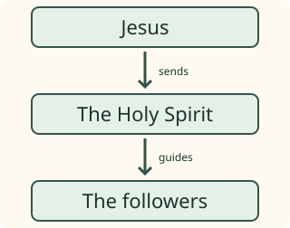

# John 16 — Jesus promises that grief will turn to joy

**About this chapter**

Jesus tells his followers he is going back to his Father.

He promises to send the Helper and to see his followers again.

## Jesus warns his followers

## John 16:1

Jesus told his followers, “I have warned you about these things so you will keep trusting me.

## John 16:2

“People will put you out of their synagogues.

A time will come when people will kill you and think they are serving God.

**Help with these words**

A synagogue is a Jewish meeting place for worship.

## John 16:3

“They will do this because they have never known my Father or me.

## John 16:4

“When that time comes, remember that I warned you.

I did not tell you this at first because I was with you.

**Pause and answer**

Why did Jesus warn his followers ahead of time?

## Jesus will send the Helper

## John 16:5

“Now I am going to the one who sent me.

Yet none of you asks me, ‘Where are you going?’

## John 16:6

“What I have told you has made you very sad.

## John 16:7

“But I tell you the truth.

It is good for you that I am going away.

Unless I go, the Helper will not come to you.

When I go, I will send him to you.

**Help with these words**

The Helper is the Holy Spirit.

**Pause and answer**

Whom will Jesus send when he goes away?

## What the Helper will show

## John 16:8

“When the Helper comes, he will show the world where it is wrong about sin, about what is right, and about God’s judgment.

## John 16:9

“He will show people their sin because they do not trust me.

## John 16:10

“He will show what is right because I am going to the Father.

You will no longer see me.

## John 16:11

“He will show that God has already judged the ruler of this world guilty.

**Help with these words**

Jesus calls the devil the ruler of this world.

**Pause and answer**

What has God decided about the ruler of this world?

## The Spirit will guide the followers

## John 16:12

“I have much more to tell you.

It is too much for you to hear now.

## John 16:13

“When the Spirit of truth comes, he will guide you into all truth.

He will tell you what he hears rather than speak on his own.

He will tell you what is to come.

**About the picture**

Find the Holy Spirit in the picture.

Follow the arrow to the people he will guide.

## John 16:14

“He will bring me honour.

He will take what is mine and make it known to you.

## John 16:15

“Everything my Father has is mine.

That is why I said the Spirit will take what is mine and make it known to you.

**Pause and answer**

Who will guide the followers into all truth?

## What does “a little while” mean?

## John 16:16

“In a little while you will no longer see me.

Then, after a little while, you will see me again.”

## John 16:17

Some followers asked each other, “What does Jesus mean?

He says we will stop seeing him for a little while and then see him again.

He also says he is going to the Father.”

## John 16:18

They kept asking, “What does he mean by ‘a little while’?

We do not understand.”

## John 16:19

Jesus knew they wanted to ask him a question.

He said, “Are you asking each other what my words mean?

I said you would stop seeing me in a little while.

Then, after a little while, you would see me again.

**Pause and answer**

What words did the followers keep asking about?

## Grief will turn to joy

## John 16:20

“I tell you the truth.

You will cry out in grief while the world celebrates.

But your grief will turn to joy.

## John 16:21

“A woman feels pain when it is time to give birth.

When her child is born, she is so glad that she forgets the pain.

**Help with these words**

Jesus uses childbirth to explain a change.

The mother’s pain gives way to joy.

The followers will be glad when they see Jesus again.

## John 16:22

“You too are sad now.

But I will see you again.

You will be glad, and no one will take your joy away.

**Pause and answer**

Why will the followers be glad again?

## The followers can ask the Father

## John 16:23

“On that day you will no longer ask me questions.

I tell you the truth.

My Father will give you whatever you ask in my name.

## John 16:24

“Until now you have asked for nothing in my name.

Ask and you will receive.

Then your joy will be complete.

## John 16:25

“I have used word pictures to teach you.

Soon I will speak plainly to you about the Father.

## John 16:26

“On that day you will ask in my name.

I am not saying that I will have to ask my Father for you.

## John 16:27

“My Father himself loves you because you love me and trust that I came from God.

## John 16:28

“I came from the Father into the world.

Now I am leaving the world and going back to the Father.”

**Pause and answer**

Who loves the followers and will hear them when they ask?

## The Father stays with Jesus

## John 16:29

His followers said, “Now you are speaking plainly.

You are no longer using word pictures.

## John 16:30

“Now we know you understand everything.

You do not need anyone to ask you a question.

This is why we believe you came from God.”

## John 16:31

Jesus answered, “Do you believe now?

## John 16:32

“The time is coming. In fact, it is here.

You will scatter, each to your own home.

You will leave me alone.

Yet my Father is with me, so I am not alone.

## John 16:33

“I tell you this so you can have peace in me.

In this world you will have trouble.

Take courage! I have overcome the world.”

**Pause and answer**

Who will stay with Jesus when his followers leave?
