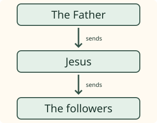

# John 17 — Jesus prays for his followers

**About this chapter**

Jesus speaks to his Father.

He prays for his followers and for the people who will trust him through their words.

## Jesus asks his Father to show his glory

## John 17:1

After speaking to his followers, Jesus looked up to heaven.

He prayed, “Father, the time has come.

Show the glory of your Son so that your Son may show your glory.

**Help with these words**

Jesus is the Son.

Showing someone’s glory means showing how great they are.

## John 17:2

“You gave your Son authority over everyone.

He can give life that lasts forever to everyone you gave him.

## John 17:3

“This is what it means to have life that lasts forever.

It means knowing you, the only true God, and knowing Jesus Christ, whom you sent.

## John 17:4

“I finished the work you gave me to do on earth.

In this way I showed people your glory.

## John 17:5

“Father, bring me into your presence now.

Give me the glory I shared with you before the world began.

**Pause and answer**

What work did Jesus finish on earth?

## The followers accept the Father’s words

## John 17:6

“You gave me these people from the world.

I showed them who you are.

They belonged to you, and you gave them to me.

They have obeyed your word.

## John 17:7

“Now they know that everything I have received comes from you.

## John 17:8

“I gave them the words you gave me.

They accepted those words.

They know for sure that I came from you.

They trust that you sent me.

**Pause and answer**

Whose words did Jesus give his followers?

## Jesus asks his Father to keep his followers safe

## John 17:9

“I pray for these people you gave me.

Here I am praying for them rather than for the whole world.

They belong to you.

## John 17:10

“Everything I have is yours.

Everything you have is mine.

My followers have shown my glory.

## John 17:11

“Father, I am coming to you.

I am leaving this world, but my followers are staying here.

Holy Father, protect them by the power of your name, the name you gave me.

May they be one as we are one.

## John 17:12

“While I was with them, I kept them safe by the name you gave me.

I lost none of them except the one who was headed for destruction.

In this way the words of Scripture came true.

**Help with these words**

Jesus is speaking about Judas, the follower who would hand him over.

**Pause and answer**

Who will stay in the world when Jesus returns to his Father?

## Jesus prays for joy and protection

## John 17:13

“Now I am coming to you.

I say these things while I am still here so my followers can share my joy fully.

## John 17:14

“I gave them your word, and the world hated them.

They do not belong to the world, just as I do not belong to it.

## John 17:15

“I am not asking you to take them out of the world.

I ask you to keep them safe from the evil one.

**Help with these words**

The evil one is the devil.

## John 17:16

“They do not belong to this world, just as I do not belong to it.

**Pause and answer**

Whom does Jesus ask his Father to protect his followers from?

## Jesus sends his followers

## John 17:17

“Set them apart for you through the truth.

Your word is truth.

**Help with these words**

To sanctify someone means to set that person apart for God.

## John 17:18

“You sent me into the world.

In the same way, I have sent them into the world.

**About the picture**

Start with the Father.

Follow the arrows to see who sends whom.

## John 17:19

“For their sake, I set myself apart for you.

Then the truth can set them apart for you too.

**Pause and answer**

Where does Jesus send his followers?

## Jesus prays for people who will believe later

## John 17:20

“I also pray for people who will hear my followers’ message and trust me.

## John 17:21

“Father, may they all be one.

You are in me, and I am in you.

May they be in us too.

Then the world may believe that you sent me.

**Help with these words**

Here “be one” means to belong together, joined in love.

## John 17:22

“I gave them the glory you gave me.

I did this so they may be one as we are one.

## John 17:23

“I am in them, and you are in me.

May they be joined together completely.

Then the world may know that you sent me.

It may know that you love them just as you love me.

**Pause and answer**

What does Jesus want the world to know about the Father’s love?

## Jesus asks for his followers to be with him

## John 17:24

“Father, I want the people you gave me to be with me where I am.

I want them to see the glory you gave me.

You loved me before the world began.

## John 17:25

“Father, you always do what is right.

The world does not know you, but I know you.

My followers know you sent me.

## John 17:26

“I have shown them who you are.

I will keep showing them.

Then the love you have for me will be in them.

I too will be in them.”

**Pause and answer**

Where does Jesus want his followers to be?
