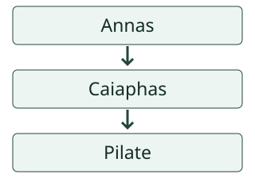

# John 18 — Jesus is arrested and Peter denies following him

**About this chapter**

Judas leads soldiers to the garden where Jesus is staying.

Peter follows Jesus to the courtyard.

Later, Pilate asks Jesus whether he is a king.

## Judas comes to the garden

## John 18:1

When Jesus finished speaking, he went out with his followers.

They crossed the Kidron Valley and entered a garden.

## John 18:2

Judas knew the garden well.

Jesus had often met his followers there.

Judas was about to hand Jesus over to his enemies.

## John 18:3

Judas brought soldiers to the garden.

Officers sent by the chief priests and Pharisees came too.

They carried lanterns, torches, and weapons.

**Pause and answer**

How did Judas know where to find Jesus?

## Jesus asks the men to let his followers go

## John 18:4

Jesus knew everything that was about to happen to him.

He stepped forward and asked, “Who are you looking for?”

## John 18:5

They answered, “Jesus of Nazareth.”

Jesus said, “I am he.”

Judas stood there with the men he had brought.

## John 18:6

When Jesus said, “I am he,” they stepped back and fell to the ground.

## John 18:7

Jesus asked again, “Who are you looking for?”

They answered, “Jesus of Nazareth.”

## John 18:8

Jesus said, “I told you I am he.

If you are looking for me, let my followers go.”

## John 18:9

So the words Jesus had spoken came true.

He had said to his Father, “I have lost none of the people you gave me.”

**Pause and answer**

Whom did Jesus ask the men to let go?

## The soldiers take Jesus to Annas

## John 18:10

Simon Peter pulled out his sword.

He struck Malchus, a servant of the high priest.

Peter cut off the man’s right ear.

## John 18:11

Jesus told Peter, “Put your sword away!

Shouldn’t I drink the cup my Father has given me?”

**Help with these words**

Jesus uses the cup as a picture of the suffering ahead of him.

He is willing to go through it.

## John 18:12

The soldiers, their commander, and the temple officers arrested Jesus.

They tied him up.

## John 18:13

First they took Jesus to Annas.

Annas was the father of Caiaphas’s wife.

Caiaphas was the high priest that year.

## John 18:14

Earlier, Caiaphas had told the Jewish leaders it would be better for one man to die for the people.

**Pause and answer**

To whom did the soldiers first take Jesus?

## Peter enters the courtyard

## John 18:15

Simon Peter and another follower went after Jesus.

The high priest knew the other follower.

So that follower went with Jesus into the high priest’s courtyard.

## John 18:16

Peter waited outside the door.

The other follower came back out and spoke to the doorkeeper.

Then he brought Peter inside.

**Help with these words**

A courtyard is an open space inside the walls of a building.

## John 18:17

The servant girl at the door asked Peter, “Aren’t you one of this man’s followers too?”

Peter answered, “I am not.”

## John 18:18

It was cold.

The servants and officers had made a charcoal fire.

Peter stood with them to keep warm.

**Pause and answer**

What did Peter tell the servant girl?

## The high priest questions Jesus

## John 18:19

Meanwhile, the high priest asked Jesus about his followers and his teaching.

## John 18:20

Jesus answered, “I spoke where anyone could hear me.

I always taught in the synagogues and at the temple, where Jewish people gather.

I said nothing in secret.

## John 18:21

“Why ask me?

Ask the people who heard me teach.

They know what I said.”

## John 18:22

An officer nearby slapped Jesus in the face.

He said, “Is that how you answer the high priest?”

## John 18:23

Jesus replied, “If I said something wrong, tell us what was wrong.

If what I said was right, why did you hit me?”

## John 18:24

Then Annas sent Jesus to Caiaphas, the high priest.

Jesus was still tied up.

**Pause and answer**

Whom did Jesus tell the high priest to ask about his teaching?

## Peter answers by the fire

## John 18:25

Peter was still keeping warm by the fire.

People there asked him, “Aren’t you one of Jesus’ followers too?”

Again Peter said, “I am not.”

## John 18:26

Another servant of the high priest spoke to Peter.

He was a relative of Malchus, whose ear Peter had cut off.

He asked, “Didn’t I see you with Jesus in the garden?”

## John 18:27

Again Peter said it was not true.

At once a rooster crowed.

**Pause and answer**

What did Peter hear after his last answer?

## Pilate comes outside to hear the charge

## John 18:28

Early in the morning they took Jesus from Caiaphas to the Roman governor’s headquarters.

The Jewish leaders stayed outside.

They wanted to remain clean for worship so they could eat the Passover meal.

**About the picture**

Start with Annas.

Follow the arrows to find who sees Jesus next.

## John 18:29

Pilate, the governor, came outside.

He asked, “What crime do you accuse this man of?”

## John 18:30

They answered, “We would not have handed him over to you unless he were a criminal.”

## John 18:31

Pilate said, “Take him and judge him by your own law.”

The leaders answered, “We are not allowed to put anyone to death.”

## John 18:32

So the words Jesus had spoken came true.

He had told people how he would die.

**Help with these words**

Earlier, Jesus spoke about people lifting him up.

He meant that he would die on a cross.

**Pause and answer**

Why did the Jewish leaders stay outside?

## Pilate asks Jesus about his kingdom

## John 18:33

Pilate went back inside and called Jesus to him.

He asked, “Are you the King of the Jews?”

## John 18:34

Jesus asked, “Is that your own question?

Or did other people tell you about me?”

## John 18:35

Pilate answered, “Am I Jewish?

Your own people and chief priests handed you over to me.

What have you done?”

## John 18:36

Jesus said, “My kingdom does not come from this world.

If it did, my servants would fight to stop the leaders from arresting me.

But my kingdom comes from elsewhere.”

## John 18:37

Pilate said, “Then you are a king!”

Jesus answered, “You say I am a king.

I was born and came into the world to speak the truth.

Everyone who belongs to the truth listens to me.”

**Pause and answer**

What did Jesus say he came into the world to do?

## The people ask for Barabbas

## John 18:38

Pilate asked, “What is truth?”

Then he went outside and told the people, “I find no reason to charge Jesus with a crime.

## John 18:39

“At Passover you have a custom.

I set one prisoner free for you.

Do you want me to free the King of the Jews?”

## John 18:40

They shouted, “Not him! Give us Barabbas!”

Barabbas had taken part in a revolt against the rulers.

**Pause and answer**

Which prisoner did the people ask Pilate to free?
