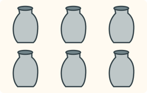

# John 2 — Jesus turns water into wine and speaks about the temple

**About this chapter**

At a wedding, servants do what Jesus asks.

Later, in Jerusalem, people ask Jesus for a sign.

## The wine runs out

## John 2:1

On the third day, there was a wedding in Cana.

Cana was a town in Galilee.

Jesus’ mother was there.

## John 2:2

The people giving the wedding feast had invited Jesus and his followers too.

## John 2:3

The wine ran out.

Jesus’ mother told him, “They have no more wine.”

## John 2:4

Jesus answered, “Woman, what does this have to do with you and me?

My time has not yet come.”

## John 2:5

His mother told the servants, “Do whatever Jesus tells you.”

**Pause and answer**

What did Jesus’ mother tell the servants to do?

## The servants fill six jars

## John 2:6

Six stone water jars stood there.

Jewish people used the water for special washings.

Each jar could hold twenty to thirty gallons.

## John 2:7

Jesus told the servants, “Fill the jars with water.”

They filled each jar right to the top.

**About the picture**

Point to each jar as you count the six jars the servants filled.

## John 2:8

Jesus said, “Now take some out.

Bring it to the man in charge of the feast.”

The servants did what Jesus said.

**Pause and answer**

What did the servants put in the jars?

## The man in charge tastes the wine

## John 2:9

The man tasted what the servants brought him.

The water had become wine.

He did not know where the wine came from.

The servants who had taken it from the jars knew.

The man called the bridegroom aside.

**Help with these words**

The bridegroom is the man getting married.

## John 2:10

He told the bridegroom, “Everyone serves the good wine first.

When the guests have drunk too much, people bring out the cheaper wine.

But you kept the good wine until now!”

## John 2:11

Jesus did this in Cana in Galilee.

It was his first sign.

It showed his glory, and his followers put their trust in him.

**Help with these words**

A sign here is something Jesus does that shows people who he is.

His glory is his greatness for people to see.

## John 2:12

Afterwards Jesus went down to Capernaum.

His mother, his brothers, and his followers went with him.

They stayed there a few days.

**Pause and answer**

Who knew where the wine came from?

## Jesus visits his Father’s house

## John 2:13

The Jewish feast of Passover was near.

Jesus went up to Jerusalem.

**Help with these words**

At Passover, Jewish families remember how God freed their people from slavery in Egypt.

## John 2:14

In the temple courts, men were selling cattle, sheep, and doves.

Others sat at tables exchanging money.

## John 2:15

Jesus made a whip from cords.

He drove them all out of the courts, including the sheep and cattle.

He scattered the coins of the men who exchanged money.

He turned their tables over.

## John 2:16

Jesus told the dove sellers, “Take these birds away!

How dare you turn my Father’s house into a market!”

## John 2:17

His followers remembered words from the Scriptures.

“My love for your house will burn within me and consume me.”

**Help with these words**

These words describe how deeply Jesus cares about the temple, the place where people worship his Father.

**Pause and answer**

What did Jesus call the temple?

## Jesus speaks about raising the temple

## John 2:18

The Jewish people who challenged Jesus asked, “What sign can you show us?

Show us that you have the right to do this.”

## John 2:19

Jesus answered, “Destroy this temple.

In three days I will raise it up again.”

## John 2:20

They replied, “People took forty-six years to build this temple.

Will you raise it up in three days?”

## John 2:21

When Jesus said “this temple,” he meant his own body.

## John 2:22

Later, Jesus rose from the dead.

Then his followers remembered what he had said.

They believed the Scriptures and the words Jesus had spoken.

**Pause and answer**

What did Jesus mean by “this temple”?

## Jesus knows the people at the feast

## John 2:23

Jesus stayed in Jerusalem for the Passover feast.

Many people saw the signs he did.

They put their trust in him.

## John 2:24

But Jesus did not put himself in their hands.

He knew them all.

## John 2:25

Jesus did not need anyone to tell him what people were like.

He already knew what was in each person’s heart.

**Pause and answer**

What did the people see that led them to trust Jesus?
