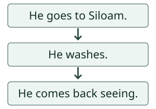

# John 9 — A man born blind tells how Jesus gave him sight

**About this chapter**

Jesus meets a man who has been blind since birth.

When people ask what happened, the man speaks for himself.

## The followers ask why the man was born blind

## John 9:1

As Jesus walked along, he saw a man.

The man had been blind since birth.

## John 9:2

His followers asked, “Rabbi, why was this man born blind?

Was it because he sinned, or because his parents sinned?”

**Help with these words**

Rabbi means teacher.

## John 9:3

Jesus answered, “Neither the man nor his parents caused his blindness by sinning.

This happened so people could see God’s work in his life.

## John 9:4

“While it is day, we must do the work God sent me to do.

Night is coming, when no one can work.

## John 9:5

“While I am in the world, I am the light of the world.”

**Help with these words**

Daylight gives people time to work.

Jesus uses day and night to explain why his followers should do God’s work now.

**Pause and answer**

Whose work did Jesus say people would see?

## The man goes to Siloam

## John 9:6

Jesus spat on the ground and made some mud.

He put the mud on the man’s eyes.

## John 9:7

Jesus told him, “Go and wash in the pool of Siloam.”

Siloam means “Sent.”

The man went and washed.

When he came back, he could see.

**About the picture**

Follow the arrows as you tell what the man did.

**Pause and answer**

Where did Jesus send the man to wash?

## The neighbours ask what happened

## John 9:8

His neighbours and others had seen him asking for money.

They asked, “Isn’t this the man who used to sit and beg?”

## John 9:9

Some said, “Yes, it is.”

Others said, “No, he just looks like him.”

The man kept saying, “I am that man.”

## John 9:10

They asked, “How did you come to see?”

## John 9:11

He answered, “The man called Jesus made some mud.

He put it on my eyes.

He told me to go to Siloam and wash.

I went and washed, and then I could see.”

## John 9:12

They asked, “Where is Jesus?”

The man answered, “I do not know.”

**Pause and answer**

What did the man tell his neighbours happened after he washed?

## The Pharisees disagree about Jesus

## John 9:13

They took the man who had been blind to the Pharisees.

## John 9:14

It was on the Sabbath that Jesus had made the mud and given the man sight.

**Help with these words**

The Sabbath is the Jewish day of rest.

## John 9:15

The Pharisees also asked how he came to see.

The man said, “Jesus put mud on my eyes.

I washed, and now I can see.”

## John 9:16

Some Pharisees said, “Jesus does not keep the Sabbath.

He cannot be from God.”

Others asked, “How could a sinner do such signs?”

The Pharisees disagreed.

## John 9:17

They asked the man again, “He gave you sight.

What do you say about him?”

The man answered, “He is a prophet.”

**Help with these words**

A prophet speaks for God.

**Pause and answer**

What did the man call Jesus?

## The leaders question the parents

## John 9:18

The Jewish leaders still doubted that the man had been blind and could now see.

They called his parents.

## John 9:19

They asked, “Is this your son?

Do you say he was born blind?

How can he see now?”

## John 9:20

His parents answered, “We know he is our son.

We know he was born blind.

## John 9:21

“We do not know how he can see now.

We do not know who gave him sight.

Ask him.

He is old enough to speak for himself.”

## John 9:22

His parents were afraid of the leaders.

The leaders had agreed to put people out of the synagogue if they said Jesus was the Christ.

**Help with these words**

A synagogue is a Jewish meeting place for worship.

The Christ is the King God chose.

## John 9:23

That was why his parents said, “He is old enough.

Ask him.”

**Pause and answer**

Whom did the parents tell the leaders to ask?

## The man tells what he knows

## John 9:24

The leaders called the man back a second time.

They said, “Give glory to God!

We know Jesus is a sinner.”

## John 9:25

The man answered, “I do not know whether he is a sinner.

One thing I do know.

I was blind, and now I can see!”

## John 9:26

They asked, “What did he do to you?

How did he give you sight?”

## John 9:27

The man answered, “I told you already.

You did not listen.

Why do you want to hear it again?

Do you want to follow him too?”

**Pause and answer**

What was the one thing the man knew for sure?

## The man speaks up for Jesus

## John 9:28

They insulted him and said, “You follow Jesus.

We follow Moses.

## John 9:29

“We know God spoke to Moses.

We do not know where Jesus comes from.”

## John 9:30

The man answered, “That surprises me!

You do not know where he comes from.

Yet he gave me sight.

## John 9:31

“We know God does not listen to sinners.

God listens to someone who worships him and does what he wants.

## John 9:32

“No one has ever heard of anyone giving sight to a person born blind.

## John 9:33

“If Jesus did not come from God, he could not do this.”

## John 9:34

The leaders answered, “You were full of sin from birth!

Are you trying to teach us?”

Then they threw him out.

**Pause and answer**

Where did the man believe Jesus came from?

## Jesus finds the man again

## John 9:35

Jesus heard that they had thrown the man out.

Jesus found him and asked, “Do you trust the Son of Man?”

**Help with these words**

Son of Man is a name Jesus uses for himself.

## John 9:36

The man answered, “Sir, who is he?

Tell me so I can trust him.”

## John 9:37

Jesus said, “You have seen him.

He is speaking to you now.”

## John 9:38

The man said, “Lord, I trust you.”

Then he worshipped Jesus.

**Pause and answer**

What did the man do after he told Jesus he trusted him?

## The Pharisees ask about seeing

## John 9:39

Jesus said, “I came into this world to judge.

I came so that those who are blind may see, and those who see may become blind.”

## John 9:40

Some Pharisees nearby heard him.

They asked Jesus, “Are we blind too?”

## John 9:41

Jesus answered, “If you were blind, you would not be guilty of sin.

But you say you can see.

So your guilt remains.”

**Help with these words**

Here Jesus uses seeing as a picture of understanding.

The man came to trust Jesus.

The leaders claimed to understand, yet refused to believe what the man told them.

**Pause and answer**

What did the Pharisees claim they could do?
