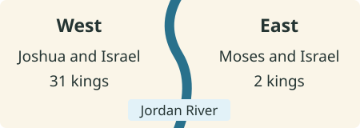

# Joshua 12 — Kings on both sides of the Jordan

**About this chapter**

The Jordan River divides the list into two parts. Moses led Israel in the east. Joshua led Israel in the west.

## Sihon’s land east of the river

## Joshua 12:1

Israel defeated two kings east of the Jordan River.

Israel took their land from the Arnon Valley to Mount Hermon.

This included all the Arabah plain on the east.

## Joshua 12:2

One king was Sihon, king of the Amorites.

He lived in Heshbon and ruled half of Gilead.

His land began at Aroer beside the Arnon Valley.

It reached from the middle of that valley to the Jabbok River.

The Ammonites’ land began at that river.

## Joshua 12:3

Sihon also ruled part of the Arabah plain.

It ran east of the Sea of Chinnereth to the Salt Sea.

The Salt Sea was also called the Sea of the Arabah.

His land reached east through Beth-jeshimoth and south below the slopes of Pisgah.

## Og’s land east of the river

## Joshua 12:4

The other king was Og, king of Bashan.

He was one of the last of a people called the Rephaim.

Og lived in Ashtaroth and Edrei.

## Joshua 12:5

Og ruled Mount Hermon, Salecah, and all of Bashan.

Bashan reached the lands of the Geshurites and Maacathites.

Og also ruled half of Gilead.

His land met the land of Sihon, king of Heshbon.

## Joshua 12:6

Moses, the LORD’s servant, and Israel defeated both kings.

They gave the land to the tribes of Reuben and Gad and half the tribe of Manasseh.

Those families could pass the land on to their children.

**Pause and answer**

Which two kings did Moses and Israel defeat?

## The land west of the river

## Joshua 12:7

Joshua and Israel defeated other kings west of the Jordan.

Their land stretched from Baal-gad in the Valley of Lebanon to Mount Halak.

That mountain rises toward Seir.

Joshua gave Israel’s tribes their shares of this land.

## Joshua 12:8

They received the hill country, the lower hills, and the Arabah plain.

They also received the slopes, the wilderness, and the dry southern region called the Negev.

The Hittites, Amorites, and Canaanites had lived in these lands.

So had the Perizzites, Hivites, and Jebusites.

Point to the Jordan River. Then find the side where Moses led Israel.

## The list begins with Jericho

## Joshua 12:9

One king ruled Jericho.

One king ruled Ai, near Bethel.

## Joshua 12:10

One king ruled Jerusalem.

One king ruled Hebron.

## Joshua 12:11

One king ruled Jarmuth.

One king ruled Lachish.

## Joshua 12:12

One king ruled Eglon.

One king ruled Gezer.

## Joshua 12:13

One king ruled Debir.

One king ruled Geder.

## Joshua 12:14

One king ruled Hormah.

One king ruled Arad.

## The list continues with Libnah

## Joshua 12:15

One king ruled Libnah.

One king ruled Adullam.

## Joshua 12:16

One king ruled Makkedah.

One king ruled Bethel.

## Joshua 12:17

One king ruled Tappuah.

One king ruled Hepher.

## Joshua 12:18

One king ruled Aphek.

One king ruled Lasharon.

## Joshua 12:19

One king ruled Madon.

One king ruled Hazor.

## Joshua 12:20

One king ruled Shimron-meron.

One king ruled Achshaph.

## The list ends with Tirzah

## Joshua 12:21

One king ruled Taanach.

One king ruled Megiddo.

## Joshua 12:22

One king ruled Kedesh.

One king ruled Jokneam in Carmel.

## Joshua 12:23

One king ruled Dor in Naphath-dor.

One king ruled Goiim in Gilgal.

## Joshua 12:24

One king ruled Tirzah.

Joshua and Israel defeated thirty-one kings west of the Jordan.

**Pause and answer**

How many kings does the list west of the river name?
