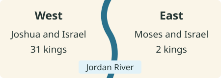

# Joshua 13 — Land for the tribes of Israel

**About this chapter**

The LORD asks Joshua to divide the land. Some families already have land east of the Jordan River.

## Land that Israel still had to take

## Joshua 13:1

Joshua was now an old man.

The LORD told Joshua that much land remained.

Israel still had to take possession of it.

## Joshua 13:2

The LORD named the lands that remained.

They included all the land of the Philistines and the Geshurites.

## Joshua 13:3

This land stretched from the Shihor, east of Egypt, north to Ekron.

People counted it as part of Canaan.

Five Philistine rulers governed Gaza, Ashdod, Ashkelon, Gath, and Ekron.

The land of the Avvites also remained.

## Joshua 13:4

To the south, all the Canaanite land remained.

It stretched from Mearah, which belonged to the Sidonians, to Aphek.

It reached the border of the Amorites.

## Joshua 13:5

The land of the Gebalites also remained.

So did all Lebanon to the east.

It stretched from Baal-gad below Mount Hermon to Lebo-hamath.

## Joshua must divide the land

## Joshua 13:6

The Sidonians lived in the hills from Lebanon to Misrephoth-maim.

The LORD said he himself would drive them out ahead of Israel.

Joshua must divide the land by lot, as the LORD had commanded.

Israel’s families would receive the land to keep.

**Reading help**

Drawing lots was a way to decide who received each share.

## Joshua 13:7

The LORD told Joshua who should receive this land.

Nine tribes and half the tribe of Manasseh would share it.

## Land that Moses had already given

## Joshua 13:8

The other half of Manasseh had already received land.

So had the tribes of Reuben and Gad.

Moses, the LORD’s servant, had given them land east of the Jordan River.

Find Moses on the east side of the river.

That is the side where he gave these families land.

## Joshua 13:9

Their land began at Aroer, on the edge of the Arnon Valley.

It included the city in the middle of the valley.

It included the whole high plain of Medeba as far as Dibon.

## Joshua 13:10

They received all the cities of Sihon, the Amorite king.

Sihon had ruled from Heshbon.

This land reached the Ammonite border.

## Joshua 13:11

Their land included Gilead and the lands of the Geshurites and Maacathites.

It included all Mount Hermon and all Bashan as far as Salecah.

## People who lived east of the Jordan

## Joshua 13:12

They received the whole kingdom of Og in Bashan.

Og had ruled from Ashtaroth and Edrei.

He was one of the last of a people called the Rephaim.

Moses had defeated these kings and taken their lands.

## Joshua 13:13

Israel did not drive out the Geshurites or the Maacathites.

When this account was written, both peoples still lived among the Israelites.

## Joshua 13:14

Moses gave the tribe of Levi no region of its own.

Its share came from the food people offered to the LORD, Israel’s God.

The LORD had promised this to Levi.

**Pause and answer**

What did Levi receive from the gifts people brought to God?

## Reuben’s share

## Joshua 13:15

Moses gave the families of Reuben the following land.

## Joshua 13:16

Their land began at Aroer, on the edge of the Arnon Valley.

It included the city in the middle of the valley.

It reached across the whole high plain beyond Medeba.

## Joshua 13:17

Reuben received Heshbon and its cities on the high plain.

These included Dibon, Bamoth-baal, and Beth-baal-meon.

## Joshua 13:18

Reuben also received Jahaz, Kedemoth, and Mephaath.

## Joshua 13:19

Reuben received Kiriathaim and Sibmah.

Reuben also received Zereth-shahar, on the hill in the valley.

## Joshua 13:20

Reuben received Beth-peor, the slopes of Pisgah, and Beth-jeshimoth.

## Reuben’s border

## Joshua 13:21

Reuben received all the cities on the high plain.

This was the whole kingdom of Sihon, the Amorite king.

Sihon had ruled from Heshbon until Moses killed him.

Moses also killed five Midianite chiefs who ruled there under Sihon.

Their names were Evi, Rekem, Zur, Hur, and Reba.

## Joshua 13:22

Among those the Israelites killed with swords was Balaam, son of Beor.

Balaam tried to learn hidden things through divination.

**Reading help**

Divination means looking for signs to learn what is hidden or what might happen.

## Joshua 13:23

The bank of the Jordan River marked Reuben’s border.

Reuben’s families received the cities and villages in this land.

## Gad’s share

## Joshua 13:24

Moses gave the families of Gad the following land.

## Joshua 13:25

Gad received the land around Jazer and all the cities of Gilead.

Gad also received half the Ammonites’ land, as far as Aroer near Rabbah.

## Joshua 13:26

Gad’s land stretched from Heshbon to Ramath-mizpeh and Betonim.

It also stretched from Mahanaim to the border of Debir.

## Joshua 13:27

In the valley Gad received Beth-haram, Beth-nimrah, Succoth, and Zaphon.

Gad received the rest of Sihon’s kingdom east of the Jordan.

It reached the shore of the Sea of Chinnereth.

## Joshua 13:28

Gad’s families received the cities and villages in this land.

## A share for half of Manasseh

## Joshua 13:29

Moses also gave land to half the tribe of Manasseh.

These families were descendants of Manasseh.

## Joshua 13:30

Their land stretched from Mahanaim through all Bashan.

This had been the whole kingdom of Og.

It included all sixty towns of Jair in Bashan.

## Joshua 13:31

They also received half of Gilead and Og’s royal cities, Ashtaroth and Edrei.

These lands went to families descended from Machir, Manasseh’s son.

Half of Machir’s descendants received this share.

**Pause and answer**

Who was Machir’s father?

## What Levi received

## Joshua 13:32

Moses gave out these shares on the plains of Moab.

Those plains were across the Jordan, east of Jericho.

## Joshua 13:33

Moses gave Levi no region of its own.

The LORD, Israel’s God, was Levi’s share.

That was what the LORD had promised.

**Reading help**

A family’s inheritance is what it receives to keep and pass on.

For Levi, the LORD himself was that inheritance.
