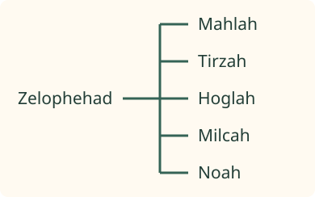

# Joshua 17 — Manasseh’s families receive their land

**About this chapter**

Five sisters ask for their family’s land. Later, two tribes ask Joshua for more room.

## The families of Manasseh

## Joshua 17:1

Manasseh was Joseph’s oldest son.

Manasseh’s tribe received a share of land.

Machir was Manasseh’s oldest son and the ancestor of the Gileadites.

Machir was a warrior, so his family had received Gilead and Bashan.

## Joshua 17:2

The rest of Manasseh’s families also received land.

Their ancestors were Abiezer, Helek, Asriel, Shechem, Hepher, and Shemida.

All these men came from the family of Joseph’s son Manasseh.

## Five sisters ask for land

## Joshua 17:3

One branch of Manasseh’s family went from father to son like this.

Machir was Gilead’s father.

Gilead was Hepher’s father.

Hepher was Zelophehad’s father.

Zelophehad had five daughters and no sons.

His daughters were Mahlah, Noah, Hoglah, Milcah, and Tirzah.

Find Zelophehad’s name.

Follow a line from his name to one daughter’s name.

## Joshua 17:4

The sisters came to Eleazar the priest, Joshua son of Nun, and the leaders.

They said, “The LORD told Moses to give us land among our relatives.” Joshua obeyed the LORD.

He gave the sisters land alongside their father’s brothers.

**Reading help**

The land was the sisters’ inheritance.

They could keep it and pass it on to their families.

**Pause and answer**

Why did Joshua give the sisters a share of land?

## Joshua 17:5

Manasseh’s tribe received ten shares of land.

These were in addition to Gilead and Bashan, east of the Jordan River.

## Joshua 17:6

There were ten shares because women from Manasseh’s family received land alongside the men.

Other families of Manasseh received Gilead.

## The border near Tappuah

## Joshua 17:7

Manasseh’s border ran from Asher to Michmethath, near Shechem.

It turned south and included the people of En-tappuah.

## Joshua 17:8

The land around Tappuah belonged to Manasseh.

The town itself stood on Manasseh’s border and belonged to Ephraim.

**Pause and answer**

Which tribe received the town of Tappuah?

## Joshua 17:9

The border continued south to the stream called Kanah.

Some towns among Manasseh’s towns belonged to Ephraim.

Manasseh’s border followed the north side of the stream to the sea.

## Joshua 17:10

Ephraim’s land lay south of the stream.

Manasseh’s land lay north of it and reached the sea.

Manasseh’s land met Asher in the north and Issachar in the east.

## Towns in neighboring lands

## Joshua 17:11

Manasseh also received towns in the lands of Issachar and Asher.

These were Beth-shean, Ibleam, Dor, Endor, Taanach, and Megiddo.

Another name for Dor was Naphath.

Each town came with the smaller places around it.

## Joshua 17:12

The Canaanites were determined to stay in those towns.

So Manasseh’s families could not take them over.

## Joshua 17:13

Later the Israelites grew stronger.

They forced the Canaanites to work for them.

They did not drive all the Canaanites out.

## Joseph’s descendants ask for more room

## Joshua 17:14

Joseph’s descendants asked Joshua, “Why give us just one share? The LORD has blessed us.

Now there are many of us.”

## Joshua 17:15

Joshua answered, “Are there too many of you for Ephraim’s hills? Then clear space in the forest for yourselves.

The forest is in the land of the Perizzites and the Rephaim.”

## Joshua 17:16

Joseph’s descendants said, “The hills are too small for us.

The Canaanites in the valley have iron chariots.

They have them in Beth-shean and its towns.

They also have them in the Valley of Jezreel.”

**Reading help**

A chariot was a cart that horses pulled in battle.

## Joshua 17:17

Joshua answered both tribes of Joseph, Ephraim and Manasseh.

“There are many of you, and you are strong.

You will have more than one share.”

## Joshua 17:18

“The wooded hills will also be yours.

Clear the forest, and the land will be yours to its farthest edge.

The Canaanites are strong and have iron chariots.

Even so, you can drive them out.”

**Pause and answer**

In your own words, how could the families make more room in the hills?
