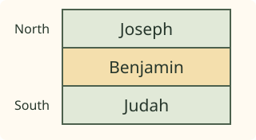

# Joshua 18 — Benjamin receives land

**About this chapter**

Seven tribes are waiting for land. At Shiloh, Joshua gives Benjamin’s families their share.

## Seven tribes wait for land

## Joshua 18:1

All Israel gathered at Shiloh.

The people set up the Tent of Meeting there.

Israel now controlled the land.

**Reading help**

The Tent of Meeting was the special tent where Israel worshiped the LORD.

## Joshua 18:2

Seven tribes still had no share of land to call their own.

## Joshua 18:3

Joshua asked the Israelites, “Why are you waiting? The LORD, the God of your ancestors, has given you this land.

When will you go and take it?”

## Joshua asks for a map

## Joshua 18:4

Joshua told them to choose three men from each tribe.

He would send the men to look over the land.

They would map out shares for the tribes.

Then they would come back to Joshua.

## Joshua 18:5

They were to divide the land into seven shares.

Judah would keep its land in the south.

Joseph’s family would keep its land in the north.

## Joshua 18:6

Joshua wanted the men to bring him their map of the seven shares.

Then he would draw lots for the tribes before the LORD their God.

**Reading help**

Drawing lots was a way to choose which share each tribe would receive.

## Joshua 18:7

Levi would receive no share of land with these tribes.

The work of serving the LORD as priests was Levi’s share.

Gad, Reuben, and half of Manasseh already had their shares.

Moses, the LORD’s servant, had given them land east of the Jordan River.

## The men bring back their record

## Joshua 18:8

As the men set out, Joshua reminded them what to do.

They must look over the land and map it out.

Then they must return to Joshua at Shiloh.

There he would draw lots before the LORD.

## Joshua 18:9

The men went through the land and recorded each city.

They grouped the cities into seven shares.

They brought their written record to Joshua at the camp in Shiloh.

**Pause and answer**

What did the men bring back to Joshua?

## Joshua 18:10

At Shiloh, Joshua drew lots before the LORD.

In this way Joshua gave each tribe its land.

## Benjamin receives the first share

## Joshua 18:11

The first lot gave land to Benjamin’s families.

Their land lay between Judah’s land and Joseph’s land.

Find Benjamin in the middle.

Move your finger north to Joseph’s land.

## Joshua 18:12

Benjamin’s northern border started at the Jordan River.

It climbed past the north side of Jericho.

It went west through the hills to the wilderness of Beth-aven.

## Joshua 18:13

The border crossed the southern slope of Luz, also called Bethel.

Then it went down to Ataroth-addar.

This place was on the hill south of Lower Beth-horon.

## Joshua 18:14

From the hill south of Beth-horon, the western border curved south.

It ended at Kiriath-baal, also called Kiriath-jearim.

That city belonged to Judah’s families.

## Benjamin’s southern border

## Joshua 18:15

The southern border began at the edge of Kiriath-jearim.

It ran west to the spring at the Waters of Nephtoah.

## Joshua 18:16

The border ran down to the bottom of a hill.

The hill faced the Valley of Ben-hinnom, at the north end of the Valley of Rephaim.

The border followed the Valley of Hinnom down toward the Jebusites’ southern slope.

It continued down to En-rogel.

## Joshua 18:17

The border turned north to En-shemesh and then to Geliloth.

Geliloth faced the road up to Adummim.

The border went down to the Stone of Bohan.

Bohan was Reuben’s son.

## Joshua 18:18

The border reached the northern slope of Beth-arabah.

Then it went down into the valley.

## Joshua 18:19

The border followed the northern slope of Beth-hoglah.

It ended at the northern bay of the Salt Sea.

The Jordan River flows into the sea there.

That was Benjamin’s southern border.

## The river and the first twelve cities

## Joshua 18:20

The Jordan River marked the eastern border.

These borders enclosed the land that Benjamin’s families received.

**Pause and answer**

What marked Benjamin’s eastern border?

## Joshua 18:21

Benjamin’s families received these cities.

The list begins with Jericho, Beth-hoglah, and Emek-keziz.

## Joshua 18:22

They also received Beth-arabah, Zemaraim, and Bethel.

## Joshua 18:23

They received Avvim, Parah, and Ophrah.

## Joshua 18:24

They received Chephar-ammoni, Ophni, and Geba.

This group had twelve cities and their villages.

## Fourteen more cities

## Joshua 18:25

The next group included Gibeon, Ramah, and Beeroth.

## Joshua 18:26

It also included Mizpeh, Chephirah, and Mozah.

## Joshua 18:27

Rekem, Irpeel, and Taralah belonged to this group too.

## Joshua 18:28

The last cities were Zelah, Haeleph, Jebus, Gibeah, and Kiriath-jearim.

Another name for Jebus was Jerusalem.

This group had fourteen cities and their villages.

These were the places Benjamin’s families received to keep.
