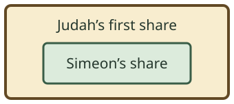

# Joshua 19 — Six tribes and Joshua receive land

**About this chapter**

Six more tribes receive their land. Then Joshua asks for a city where he can live.

## Simeon receives land inside Judah

## Joshua 19:1

The second lot gave land to Simeon’s families.

Their land lay inside Judah’s land.

**Reading help**

The leaders drew lots to decide which tribe received each share.

In the previous chapter, Benjamin received the first share.

## Joshua 19:2

They received Beersheba, also called Sheba.

They also received Moladah.

## Joshua 19:3

Simeon received Hazar-shual, Balah, and Ezem.

## Joshua 19:4

Simeon received Eltolad, Bethul, and Hormah.

## Joshua 19:5

Simeon received Ziklag, Beth-marcaboth, and Hazar-susah.

## Joshua 19:6

Beth-lebaoth and Sharuhen completed this group.

It had thirteen cities with their villages.

## Joshua 19:7

Simeon also received Ain, Rimmon, Ether, and Ashan.

These four cities came with their villages.

## Joshua 19:8

The villages around these cities reached as far as Baalath-beer.

People also called it Ramah of the Negev.

All this land belonged to Simeon’s families.

## Joshua 19:9

Judah’s share was too large for its people.

That is why Simeon’s families received land inside Judah’s share.

Trace the outside line for Judah’s first share.

Point to Simeon’s share inside it.

**Pause and answer**

Why did Simeon receive land inside Judah?

## Zebulun’s land

## Joshua 19:10

The third lot gave land to Zebulun’s families.

Their border reached Sarid.

## Joshua 19:11

Going west, the border climbed to Maralah and reached Dabbesheth.

It met the stream east of Jokneam.

## Joshua 19:12

Going east from Sarid, the border followed the edge of Chisloth-tabor.

It went on to Daberath and climbed to Japhia.

## Joshua 19:13

It crossed east to Gath-hepher and Eth-kazin.

It reached Rimmon and curved toward Neah.

## Joshua 19:14

It curved around the north side of Neah to Hannathon.

It ended at the Valley of Iphtah-el.

## Joshua 19:15

Zebulun also received Kattath, Nahalal, Shimron, Idalah, and Bethlehem.

Zebulun had twelve cities with their villages.

## Joshua 19:16

These cities and villages were the share that Zebulun’s families received.

## Issachar’s land

## Joshua 19:17

The fourth lot gave land to Issachar’s families.

## Joshua 19:18

Issachar received Jezreel, Chesulloth, and Shunem.

## Joshua 19:19

Issachar received Hapharaim, Shion, and Anaharath.

## Joshua 19:20

Issachar received Rabbith, Kishion, and Ebez.

## Joshua 19:21

Issachar received Remeth, En-gannim, En-haddah, and Beth-pazzez.

## Joshua 19:22

The border reached Tabor, Shahazumah, and Beth-shemesh.

It ended at the Jordan River.

Issachar had sixteen cities with their villages.

## Joshua 19:23

These cities and villages were the share that Issachar’s families received.

## Asher’s land

## Joshua 19:24

The fifth lot gave land to Asher’s families.

## Joshua 19:25

Asher received Helkath, Hali, Beten, and Achshaph.

## Joshua 19:26

Asher also received Allammelech, Amad, and Mishal.

In the west, the border reached Carmel and Shihor-libnath.

## Joshua 19:27

The border turned east toward Beth-dagon.

It reached Zebulun and the Valley of Iphtah-el.

It went north to Beth-emek and Neiel, passing Cabul on the left.

## Joshua 19:28

It continued to Ebron, Rehob, Hammon, and Kanah.

It reached as far as Greater Sidon.

## Joshua 19:29

The border turned back toward Ramah and reached Tyre.

Strong walls protected Tyre.

The border turned toward Hosah and reached the sea near Achzib.

## Joshua 19:30

The land included Ummah, Aphek, and Rehob.

Asher had twenty-two cities with their villages.

## Joshua 19:31

These cities and villages were the share that Asher’s families received.

## Naphtali’s land

## Joshua 19:32

The sixth lot gave land to Naphtali’s families.

## Joshua 19:33

Their border began at Heleph and the great tree of Zaanannim.

It passed Adami-nekeb and Jabneel and reached Lakkum.

It ended at the Jordan River.

## Joshua 19:34

The border turned west to Aznoth-tabor and continued to Hukkok.

Naphtali’s land met Zebulun in the south and Asher in the west.

In the east it met Judah at the Jordan.

## Joshua 19:35

Strong walls protected several of Naphtali’s cities.

These included Ziddim, Zer, Hammath, Rakkath, and Chinnereth.

## Joshua 19:36

Adamah, Ramah, and Hazor also had strong walls.

## Joshua 19:37

So did Kedesh, Edrei, and En-hazor.

## Joshua 19:38

The list ends with Iron, Migdal-el, Horem, Beth-anath, and Beth-shemesh.

Naphtali had nineteen cities with their villages.

## Joshua 19:39

These cities and villages were the share that Naphtali’s families received.

## Dan’s land

## Joshua 19:40

The seventh lot gave land to Dan’s families.

## Joshua 19:41

Dan received Zorah, Eshtaol, and Ir-shemesh.

## Joshua 19:42

Dan received Shaalabbin, Aijalon, and Ithlah.

## Joshua 19:43

Dan received Elon, Timnah, and Ekron.

## Joshua 19:44

Dan received Eltekeh, Gibbethon, and Baalath.

## Joshua 19:45

Dan received Jehud, Bene-berak, and Gath-rimmon.

## Joshua 19:46

Dan received Me-jarkon and Rakkon.

Dan’s land included the area across from Joppa.

## Joshua 19:47

Later, Dan’s families lost their land.

They fought against Leshem, took the city, and killed its people.

They settled there and named the city Dan after their ancestor.

## Joshua 19:48

These cities and villages were the share that Dan’s families received.

## Joshua receives a city

## Joshua 19:49

After dividing the land, the Israelites gave Joshua a share among them.

Joshua was the son of Nun.

## Joshua 19:50

The LORD had told them to do this.

Joshua asked for Timnath-serah in the hills of Ephraim.

Israel gave him the city.

Joshua rebuilt it and lived there.

## Joshua 19:51

Eleazar the priest, Joshua, and Israel’s family leaders drew the lots.

They did this before the LORD at Shiloh.

They stood at the entrance to the Tent of Meeting.

In this way they finished dividing the land among the tribes.

**Reading help**

The Tent of Meeting was a special tent where Israel worshiped the LORD.

**Pause and answer**

What did Joshua do with the city he received?
