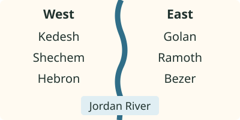

# Joshua 20 — Six cities of refuge

**About this chapter**

Israel chooses six cities where people can find safety after causing a death by accident.

## A place of safety

## Joshua 20:1

The LORD spoke to Joshua.

## Joshua 20:2

The LORD told Joshua to speak to Israel.

The people must choose cities of refuge.

The LORD had already given this instruction through Moses.

## Joshua 20:3

Someone might kill another person by accident.

That person could run to a city of refuge.

There the person could find safety from the avenger of blood.

**Reading help**

Refuge means a place where someone can find safety.

The avenger of blood was a relative of the person who died.

That relative might seek to kill the person who caused the death.

## The elders hear what happened

## Joshua 20:4

At the city gate, the person must tell the elders what happened.

The elders must welcome the person into the city.

They must give the person a place to live.

**Reading help**

The elders were leaders of the city.

## Joshua 20:5

The avenger might follow the person to the city.

The elders must refuse to hand the person over.

The person had killed a neighbor by accident.

The person had not hated that neighbor beforehand.

## Joshua 20:6

The person must stay there for a trial.

The community would gather to hear the case.

The person must stay until the high priest then serving died.

After that, the person could go back home.

**Pause and answer**

Who would gather to hear the case?

## Israel chooses six cities

## Joshua 20:7

Israel chose Kedesh in Galilee, in the hills of Naphtali.

Israel chose Shechem in the hills of Ephraim.

Israel also chose Kiriath-arba in the hills of Judah.

Another name for Kiriath-arba was Hebron.

## Joshua 20:8

Across the Jordan River, east of Jericho, Israel chose three more cities.

Bezer stood on high, flat land in Reuben’s wilderness.

Ramoth was in Gilead, in Gad’s land.

Golan was in Bashan, in Manasseh’s land.

Find Hebron on the west side.

Trace across the river to the names on the east side.

## Joshua 20:9

These cities were for Israelites and foreigners living among them.

Anyone who killed someone by accident could go there.

The avenger could not kill that person before the community heard the case.

**Pause and answer**

In your own words, why did Israel set these cities apart?
