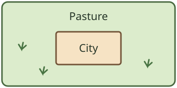

# Joshua 21 — The Levites receive forty-eight cities

**About this chapter**

The other tribes share their cities with the families of Levi. The families also receive land for their animals.

## The Levites ask for homes

## Joshua 21:1

The leaders of Levi’s families came to Eleazar the priest.

They also came to Joshua, son of Nun, and the leaders of Israel’s other tribes.

## Joshua 21:2

They met at Shiloh in Canaan.

The Levites said, “The LORD gave Moses instructions about us.

We need cities to live in.

We also need pasture for our animals.”

## Joshua 21:3

So the Israelites obeyed the LORD.

From their own lands they gave the Levites cities and pasture.

**Reading help**

Pasture is land where animals can eat grass.

## How the families shared the cities

## Joshua 21:4

The first lot went to Kohath’s families.

Aaron the priest belonged to this branch of Levi’s family.

His descendants received thirteen cities by lot.

The cities came from Judah, Simeon, and Benjamin.

**Reading help**

Drawing lots was a way to decide which family received each share.

## Joshua 21:5

Kohath’s other families received ten cities by lot.

Ephraim, Dan, and half the tribe of Manasseh gave them these cities.

## Joshua 21:6

Gershon’s families received thirteen cities by lot.

Issachar, Asher, and Naphtali gave some of them.

The half of Manasseh in Bashan gave the others.

## Joshua 21:7

Merari’s families received twelve cities.

These came from Reuben, Gad, and Zebulun.

## Joshua 21:8

The Israelites gave the Levites these cities with their pasture.

This was what the LORD had told Moses to do.

## Cities for Aaron’s family

## Joshua 21:9

Judah and Simeon named the cities they would give.

## Joshua 21:10

These cities went to Aaron’s descendants, who belonged to Kohath’s branch of Levi’s family.

They had received the first lot.

## Joshua 21:11

They received Kiriath-arba, also called Hebron, in Judah’s hills.

They received the pasture around it too.

Arba was the father of Anak.

## Joshua 21:12

The fields and villages around Hebron belonged to Caleb.

Israel had already given them to Caleb, son of Jephunneh.

**Pause and answer**

Who kept the fields and villages around Hebron?

## Joshua 21:13

Aaron’s family received Hebron and Libnah with their pasture.

Hebron was also a city of refuge.

Someone who killed another person by accident could find safety there.

## Joshua 21:14

Aaron’s family received Jattir and Eshtemoa.

## Joshua 21:15

They received Holon and Debir.

## Joshua 21:16

They also received Ain, Juttah, and Beth-shemesh.

Judah and Simeon gave nine cities in all, with pasture.

## Four cities from Benjamin

## Joshua 21:17

Benjamin gave Aaron’s family Gibeon and Geba.

## Joshua 21:18

Benjamin also gave Anathoth and Almon.

All four cities came with pasture.

## Joshua 21:19

The priests descended from Aaron received thirteen cities in all.

Each city came with pasture.

## Cities for Kohath’s other families

## Joshua 21:20

The other families of Kohath received their cities by lot.

Some of those cities came from Ephraim.

## Joshua 21:21

Ephraim gave them Shechem in the hills of Ephraim.

Shechem was a city of refuge.

Ephraim also gave them Gezer.

## Joshua 21:22

Ephraim gave Kibzaim and Beth-horon too.

These four cities came with pasture.

## Joshua 21:23

Dan gave these families Elteke and Gibbethon.

## Joshua 21:24

Dan also gave Aijalon and Gath-rimmon.

These four cities came with pasture.

## Joshua 21:25

Half the tribe of Manasseh gave Taanach and Gath-rimmon.

Both cities came with pasture.

## Joshua 21:26

Kohath’s other families received ten cities in all.

Each city came with pasture.

## Cities for Gershon’s families

## Joshua 21:27

Gershon’s families received two cities from half the tribe of Manasseh.

Golan in Bashan was a city of refuge.

The other city was Beeshterah.

Both came with pasture.

## Joshua 21:28

Issachar gave Gershon’s families Kishion and Daberath.

## Joshua 21:29

Issachar also gave Jarmuth and En-gannim.

These four cities came with pasture.

## Joshua 21:30

Asher gave Gershon’s families Mishal and Abdon.

## Joshua 21:31

Asher also gave Helkath and Rehob.

These four cities came with pasture.

## Joshua 21:32

Naphtali gave Kedesh in Galilee, Hammoth-dor, and Kartan.

Kedesh was a city of refuge.

All three cities came with pasture.

## Joshua 21:33

Gershon’s families received thirteen cities in all.

Each city came with pasture.

## Cities for Merari’s families

## Joshua 21:34

The remaining Levites belonged to Merari’s family.

Zebulun gave them Jokneam and Kartah.

## Joshua 21:35

Zebulun also gave Dimnah and Nahalal.

These four cities came with pasture.

## Joshua 21:36

Reuben gave Merari’s families Bezer and Jahaz.

## Joshua 21:37

Reuben also gave Kedemoth and Mephaath.

These four cities came with pasture.

## Joshua 21:38

Gad gave them Ramoth in Gilead and Mahanaim.

Ramoth was a city of refuge.

## Joshua 21:39

Gad also gave Heshbon and Jazer.

These four cities came with pasture.

## Joshua 21:40

Merari’s families received twelve cities in all.

## Pasture around every city

## Joshua 21:41

The Levites had forty-eight cities in the lands of Israel.

The Levites also had pasture for their animals.

## Joshua 21:42

Each of the forty-eight cities had its own pasture around it.

Find the city.

Move your finger out to the pasture.

## The LORD keeps his promises

## Joshua 21:43

The LORD had promised this land to Israel’s ancestors.

Now the LORD gave Israel all that land.

The Israelites took it and made their homes there.

## Joshua 21:44

The LORD gave Israel peace on every side.

He had promised their ancestors this peace.

No enemy could stand against Israel.

The LORD gave Israel victory over all its enemies.

## Joshua 21:45

The LORD kept every good promise he had made to Israel.

Everything he promised came true.

**Pause and answer**

In your own words, how did the LORD keep his promise about the land?
