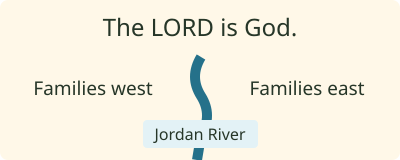

# Joshua 22 — An altar called Witness

**About this chapter**

Some Israelites build an altar on their way home. The other tribes send leaders to ask why.

## Joshua sends the eastern tribes home

## Joshua 22:1

Joshua called together the people of Reuben and Gad.

He also called the half of Manasseh whose homes lay east of the Jordan River.

## Joshua 22:2

Joshua said, “You did everything Moses, the LORD’s servant, commanded.

You also did everything I asked.”

## Joshua 22:3

“You stayed with the other Israelites all this time.

You did the work the LORD your God gave you.”

## Joshua 22:4

“The LORD promised your fellow Israelites rest.

Now he has kept that promise.

Go home across the Jordan to the land Moses gave you.”

## Joshua 22:5

“Remember the law that Moses, the LORD’s servant, gave you.

Love the LORD your God.

Live as he teaches you.

Obey his commands and stay close to him.

Serve him with all your heart and soul.”

**Reading help**

Serving God with all your heart and soul means giving yourself fully to him.

## Joshua 22:6

Joshua blessed them and sent them home.

## The people take their wealth home

## Joshua 22:7

Moses had given half of Manasseh land in Bashan.

Joshua had given the other half land west of the Jordan, among the other Israelites.

Joshua blessed the people who were going home.

## Joshua 22:8

Joshua said, “Go home with your wealth and your large herds.

Take the silver, gold, bronze, iron, and all those clothes.

Share what you took from your enemies with your relatives.”

## Joshua 22:9

Reuben, Gad, and half of Manasseh left the other Israelites at Shiloh in Canaan.

They set out for their own land in Gilead.

The LORD had told Moses to give them that land.

## A large altar beside the Jordan

## Joshua 22:10

On the way, they reached Geliloth in Canaan.

There they built a large altar beside the Jordan River.

**Reading help**

An altar was a place where people brought gifts to God.

## Joshua 22:11

Word reached the other Israelites about the altar.

The people going home had built it at Geliloth.

It stood on Israel’s side of the river, at Canaan’s border.

## Joshua 22:12

The Israelites gathered at Shiloh.

They were ready to go to war against the people who built the altar.

## Israel sends leaders to Gilead

## Joshua 22:13

Israel sent Phinehas, son of Eleazar the priest, to Gilead.

He went to speak with Reuben, Gad, and half of Manasseh.

## Joshua 22:14

Ten leaders went with Phinehas.

Each led a family and spoke for one tribe of Israel.

## Joshua 22:15

Phinehas and the leaders reached the people in Gilead.

They gave them this message.

## Joshua 22:16

“We speak for all the LORD’s people.

Why have you turned against the God of Israel? Why have you built an altar of your own?”

## The leaders remember Peor and Achan

## Joshua 22:17

“Remember how we sinned at Peor.

A deadly sickness spread among the LORD’s people.

Even now that sin still stains us.”

**Reading help**

A stain usually means a mark on something.

Here the leaders mean their sin still affects them.

## Joshua 22:18

“Would you turn away from the LORD now? If you turn against him today, he will be angry with all Israel tomorrow.”

## Joshua 22:19

“If your land is unfit for worship, come across the river.

Share our land where the LORD’s sacred tent stands.

We have the altar of the LORD our God.

Do not build another altar and turn against him and us.”

## Joshua 22:20

“Remember Achan from Zerah’s family.

He took things the LORD had set apart for destruction.

The LORD was angry with all Israel.

Other people died because of Achan’s sin too.”

## The eastern tribes answer

## Joshua 22:21

The people of Reuben, Gad, and half of Manasseh answered Israel’s leaders.

## Joshua 22:22

“The LORD, the Mighty One, is God! The LORD, the Mighty One, is God! He knows why we did this.

We want Israel to know too.

If we have turned against him, do not spare us today.”

## Joshua 22:23

“Did we build this altar to turn away from him? Did we mean to give burnt offerings, grain offerings, or peace offerings here? If so, let the LORD himself judge us.”

## A fear about their children

## Joshua 22:24

“We built it because we were afraid for our children.

One day your children might ask ours, ‘What have you to do with Israel’s God?’”

**Pause and answer**

Who were the eastern tribes worried about?

## Joshua 22:25

“They might tell Reuben and Gad that the LORD put the Jordan between us.

They might say, ‘You have no share in the LORD.’ Then our children might stop honoring him.”

## Joshua 22:26

“So we decided to build this altar.

We would never burn offerings or give sacrifices on it.”

## What the altar would show

## Joshua 22:27

“It would remind both our peoples and their children that we worship the same LORD.

We bring our burnt offerings, sacrifices, and peace offerings before him.

Then your children cannot tell ours that they have no share in the LORD.”

## Joshua 22:28

“If anyone says that, we or our children can point to this altar.

Our fathers made a copy of the LORD’s altar.

Nobody makes sacrifices on the copy.

It shows what our peoples have in common.”

Find the river between the two groups.

Read the words both groups shared.

## Joshua 22:29

“We would never turn against the LORD.

His altar stands in front of his sacred tent.

That is where we bring burnt offerings, grain offerings, and sacrifices.”

## The tribes make peace

## Joshua 22:30

Phinehas and the family leaders listened.

The answer from Reuben, Gad, and Manasseh satisfied them.

## Joshua 22:31

Phinehas said, “Today we know the LORD is among us.

You have stayed faithful to him.

You have spared Israel from his punishment.”

## Joshua 22:32

Phinehas and the other leaders went back to Canaan.

They told the Israelites what they had heard from Reuben and Gad in Gilead.

## Joshua 22:33

The Israelites welcomed the news and praised God.

They stopped talking about going to war to destroy the land of Reuben and Gad.

## Joshua 22:34

Reuben and Gad named the altar Witness.

They said, “It shows us all that the LORD is God.”

**Reading help**

A witness gives evidence that something is true.

The altar reminded both groups that they belonged to the LORD.

**Pause and answer**

In your own words, why did the tribes call the altar Witness?
