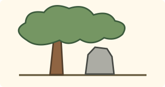

# Joshua 24 — Israel chooses to serve the LORD

**About this chapter**

At Shechem, Joshua asks Israel whom they will serve. He sets up a stone to remind them of their answer.

## Israel gathers at Shechem

## Joshua 24:1

Joshua gathered all Israel’s tribes at Shechem.

He called their elders, leaders, judges, and officers.

They came before God.

## Joshua 24:2

Joshua gave the people this message from the LORD, Israel’s God.

“Long ago your ancestors lived beyond the Euphrates River.

They worshiped other gods.

Terah lived there with his sons Abraham and Nahor.”

## Joshua 24:3

“I brought Abraham from beyond the river.

I led him through all of Canaan.

I gave him many descendants.

I gave him a son named Isaac.”

## Joshua 24:4

“I gave Isaac two sons, Jacob and Esau.

I gave Esau the land of Mount Seir.

Jacob and his sons went down to Egypt.”

## The LORD remembers bringing Israel out of Egypt

## Joshua 24:5

“I sent Moses and Aaron.

I brought suffering on the Egyptians.

Then I brought you out of Egypt.”

## Joshua 24:6

“When I led your ancestors out, you reached the Red Sea.

The Egyptians chased them all the way to the sea.

They came with chariots and men on horses.”

## Joshua 24:7

“Your ancestors cried to the LORD for help.

I put darkness between you and the Egyptians.

I brought the sea over the Egyptians, and it covered them.

You saw what I did.

Then you lived in the wilderness for a long time.”

## Joshua 24:8

“I brought you to the Amorites’ land beyond the Jordan River.

The Amorites fought you.

I gave you victory and destroyed them before you.

You took their land.”

## The LORD describes the land he gave Israel

## Joshua 24:9

“Balak, son of Zippor, was king of Moab.

He set out to fight Israel.

He sent for Balaam, son of Beor, to curse you.”

## Joshua 24:10

“I would not listen to Balaam.

Again and again Balaam blessed you.

I rescued you from him.”

**Reading help**

To curse someone is to call for harm to come to them.

To bless someone is to speak good over them.

## Joshua 24:11

“You crossed the Jordan and reached Jericho.

The people of Jericho fought you.

So did the Amorites, Perizzites, Canaanites, and Hittites.

The Girgashites, Hivites, and Jebusites fought you too.

I gave you victory over them.”

## Joshua 24:12

“I sent the hornet ahead of you.

It drove out the two Amorite kings.

Your own swords and bows did not do this.”

**Reading help**

A hornet is a large insect that can sting.

## Joshua 24:13

“I gave you land you had not worked.

You live in cities you did not build.

You eat grapes and olives you did not plant.”

## Joshua asks the people to choose

## Joshua 24:14

Then Joshua spoke to the people.

“Honor the LORD deeply and serve him honestly and faithfully.

Put away the gods your ancestors served beyond the Euphrates and in Egypt.

Serve the LORD.”

## Joshua 24:15

“If you are unwilling to serve the LORD, choose today whom you will serve.

Will you serve the gods your ancestors served beyond the river? Or the gods the Amorites served here? My family and I will serve the LORD.”

**Pause and answer**

Whom did Joshua and his family choose to serve?

## Joshua 24:16

The people answered, “We would never leave the LORD to serve other gods!”

## Joshua 24:17

“The LORD our God freed us and our ancestors from slavery in Egypt.

We saw the great signs he did there.

He protected us throughout our journey.

He kept us safe among the nations we passed through.”

## Joshua 24:18

“The LORD drove the nations out ahead of us.

They included the Amorites who lived here.

We too will serve the LORD.

He is our God.”

## Joshua warns the people

## Joshua 24:19

Joshua warned them, “You cannot serve the LORD.

He is holy.

He is a jealous God.

He will not forgive you for rebelling and sinning against him.”

**Reading help**

Holy means God is set apart from all others.

Here “jealous” means God requires his people to worship him alone.

## Joshua 24:20

“The LORD has done good things for you.

But if you leave him to serve foreign gods, he will bring disaster on you.

He will destroy you.”

## Joshua 24:21

The people answered, “No! We will serve the LORD!”

## Joshua 24:22

Joshua said, “You heard yourselves choose to serve the LORD.

Your own words are evidence against you.” The people answered, “Yes, we are witnesses.”

## Joshua 24:23

Joshua said, “Then get rid of the foreign gods among you.

Give your whole heart to the LORD, Israel’s God.”

## Joshua 24:24

The people told Joshua, “We will serve the LORD our God.

We will obey what he says.”

## A stone helps Israel remember

## Joshua 24:25

That day Joshua made a covenant for the people at Shechem.

There he set down rules for them to follow.

**Reading help**

A covenant is a solemn agreement.

## Joshua 24:26

Joshua wrote these things in the Book of the Law of God.

He set a large stone under an oak tree.

The tree stood near the LORD’s holy place.

## Joshua 24:27

Joshua told everyone, “Look at this stone.

It has heard everything the LORD said to us.

It will be a witness against us.

If you deny your God, it will be a witness against you.”

**Reading help**

Joshua spoke about the stone as if it could hear.

When people saw it, they could remember what they had promised.

Point to the stone under the tree.

**Pause and answer**

In your own words, what did Joshua want Israel to remember?

## Joshua 24:28

Joshua sent the people home.

Each went back to the land their family had received.

## Joshua dies

## Joshua 24:29

Some time later Joshua died.

Joshua was the son of Nun and the LORD’s servant.

He was 110 years old.

## Joshua 24:30

The people buried Joshua on his own land at Timnath-serah.

It lay in the hills of Ephraim, north of Mount Gaash.

## Joshua 24:31

Israel served the LORD as long as Joshua lived.

Israel also served him while the elders who outlived Joshua were alive.

Those elders had seen all the LORD did for Israel.

## Joseph’s bones and Eleazar’s burial

## Joshua 24:32

The Israelites had brought Joseph’s bones out of Egypt.

They buried his bones at Shechem.

Jacob had bought that field from the sons of Hamor, Shechem’s father.

Jacob paid a hundred pieces of silver.

The land passed to Joseph’s descendants.

## Joshua 24:33

Eleazar, Aaron’s son, also died.

The people buried him at Gibeah in the hills of Ephraim.

His son Phinehas had received that land.
