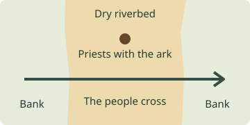

# Joshua 3 — Israel crosses the Jordan River

**About this chapter**

The Jordan River is in flood. Joshua tells Israel to watch the priests who carry the ark.

## The people camp beside the river

## Joshua 3:1

Joshua got up early the next morning.

He and all the Israelites left Shittim.

They camped beside the Jordan River before crossing it.

## Joshua 3:2

After three days the officers went through the camp.

## Joshua 3:3

The officers told the people to watch for the ark of the LORD’s covenant.

Priests from Levi’s tribe would carry it.

When the people saw it, they must leave camp and follow.

**Reading help**

The ark was a special chest. It held the stone tablets of the covenant, the LORD’s solemn agreement with Israel.

## Joshua 3:4

The people must stay about 2,000 cubits behind the ark.

They had never been that way before.

Keeping their distance would help them see where to go.

**Reading help**

A cubit was the length from an elbow to a fingertip. Two thousand cubits was about 900 meters.

**Pause and answer**

What would show the people which way to go?

## The priests go first

## Joshua 3:5

Joshua told the people to set themselves apart for the LORD.

The next day the LORD would do amazing things among them.

## Joshua 3:6

Joshua told the priests to pick up the ark and go first.

The priests carried it ahead of the people.

## Joshua 3:7

The LORD told Joshua he would begin to honor him before all Israel that day.

Israel would see that the LORD was with Joshua, just as he had been with Moses.

## Joshua 3:8

The LORD told Joshua what to say to the priests carrying the ark.

At the river’s edge, they must step into the Jordan and stand there.

**Pause and answer**

Where did the LORD tell the priests to stand?

## Joshua tells Israel what to expect

## Joshua 3:9

Joshua called the Israelites closer.

He asked them to listen to the LORD their God.

## Joshua 3:10

Joshua said they would see that the living God was with them.

God would drive out the Canaanites, Hittites and Hivites ahead of Israel.

He would also drive out the Perizzites, Girgashites, Amorites and Jebusites.

## Joshua 3:11

The Lord of all the earth had made a covenant with Israel.

His ark would go into the Jordan ahead of them.

## Joshua 3:12

Joshua told Israel to choose 12 men, one from each tribe.

**Pause and answer**

How many men would each tribe choose?

## Joshua 3:13

Joshua said the priests would carry the ark of the LORD, the Lord of all the earth.

As soon as their feet touched the Jordan, the river would stop flowing.

The water coming from upstream would pile up.

## The water stops

## Joshua 3:14

The people left camp to cross the Jordan.

The priests went first, carrying the ark.

## Joshua 3:15

It was harvest time, when the Jordan floods its banks.

The priests carrying the ark reached the river.

Their feet touched the water at its edge.

## Joshua 3:16

At that moment the water stopped flowing.

It backed up as far as the town of Adam, near Zarethan.

No more water flowed down toward the Sea of the Arabah, also called the Salt Sea.

The people crossed the river opposite Jericho.

## Joshua 3:17

The priests carrying the ark stood on dry ground in the middle of the Jordan.

They stayed there while the people walked across on dry ground.

They stayed until everyone had crossed.

Trace the people’s path from one bank to the other.

**Pause and answer**

How long did the priests stay in the riverbed?
