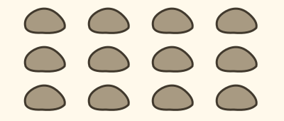

# Joshua 4 — Twelve stones at Gilgal

**About this chapter**

Twelve men carry stones from the Jordan River. The stones will help families remember how Israel crossed.

## Twelve men carry stones to camp

## Joshua 4:1

All Israel had crossed the Jordan River.

Then the LORD spoke to Joshua.

## Joshua 4:2

“Choose twelve men.

Choose one man from each tribe.”

**Reading help**

A tribe was a large family group in Israel.

## Joshua 4:3

“Tell them to take twelve stones from the riverbed.

Take them from where the priests are standing.

Carry them to your camp for the night.

Put them down there.”

## Joshua 4:4

Joshua called the twelve men he had chosen.

Each man came from a different tribe of Israel.

## Joshua 4:5

Joshua said, “Go into the middle of the Jordan.

Go in front of the ark of the LORD your God.

Each man must carry one stone on his shoulder.

There will be one stone for each tribe.”

**Reading help**

The ark was a special chest. It held the stone tablets of the covenant, the LORD’s solemn agreement with Israel.

## Joshua 4:6

“These stones will help you remember.

One day your children will ask about them.

They will ask, ‘What do these stones mean to you?’”

## Joshua 4:7

“Tell them the water stopped flowing when the ark crossed the Jordan.

It was the ark of the LORD’s covenant.

These stones will remind Israel of that day forever.”

## Joshua 4:8

The men did what Joshua told them.

They took twelve stones from the riverbed, one per tribe.

That was what the LORD had told Joshua.

The men carried the stones to camp.

They put them down there.

**Pause and answer**

Where did the men carry the stones?

## Joshua places stones in the river

## Joshua 4:9

Joshua also set up twelve stones in the riverbed.

He put them where the priests stood with the ark.

Those stones were still there when this account was written.

## Joshua 4:10

The priests stood with the ark in the riverbed.

They stayed until the people finished all their tasks.

The LORD had given Joshua these orders for the people.

Joshua followed the instructions Moses had given him.

The people hurried across.

## Joshua 4:11

When everyone had crossed, the people watched the priests.

The priests carried the LORD’s ark across the river.

## The people honor Joshua

## Joshua 4:12

Men from Reuben, Gad, and half the tribe of Manasseh went ahead of the other Israelites.

They carried their weapons, as Moses had told them.

## Joshua 4:13

About 40,000 men crossed before the LORD.

They reached the flat land near Jericho, ready for battle.

## Joshua 4:14

That day the LORD gave Joshua honor before all Israel.

The people respected Joshua for the rest of his life.

They had shown Moses that same respect.

## The river flows again

## Joshua 4:15

Then the LORD spoke to Joshua.

## Joshua 4:16

“Tell the priests carrying the ark of the Testimony to come up out of the Jordan.”

**Reading help**

The ark of the Testimony is another name for the same chest. The tablets inside recorded what the LORD had told Israel.

## Joshua 4:17

Joshua told the priests, “Come up out of the Jordan.”

## Joshua 4:18

The priests carried the ark up out of the riverbed.

Their feet touched dry land on the bank.

Then the Jordan flowed again.

The water spilled over its banks as before.

**Pause and answer**

What happened to the water when the priests reached the bank?

## The stones at Gilgal

## Joshua 4:19

The people left the Jordan on day ten of the first month.

They camped at Gilgal, on the eastern edge of Jericho.

## Joshua 4:20

At Gilgal, Joshua set up the twelve stones the men had carried from the Jordan.

Point to one stone for each of the twelve tribes.

## Joshua 4:21

Joshua told the Israelites, “One day your children will ask their fathers what these stones mean.”

## Joshua 4:22

“Tell them Israel crossed the Jordan on dry ground.”

## Joshua 4:23

“The LORD your God dried up the Jordan for you.

It stayed dry until you had crossed.

The LORD did the same for us at the Red Sea.

He kept it dry until we had crossed.”

## Joshua 4:24

“The LORD did this so people everywhere would know his great power.

He also wanted you always to fear the LORD your God.”

**Reading help**

The strong hand of the LORD means his power to act. To fear the LORD here means to take his power seriously and honor him.

**Pause and answer**

What were the fathers to tell their children about the Jordan?
