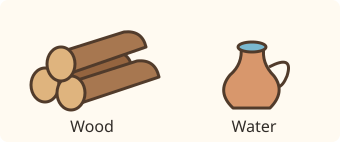

# Joshua 9 — Israel makes peace with Gibeon

**About this chapter**

Visitors ask Joshua for peace. They bring old bread to make Joshua believe their story.

## Kings hear what happened at Ai

## Joshua 9:1

The kings west of the Jordan River heard the news about Ai.

Some ruled in the hills or on the lower slopes.

Others ruled along the Great Sea toward Lebanon.

These were kings of the Hittites, Amorites, and Canaanites.

They also included kings of the Perizzites, Hivites, and Jebusites.

## Joshua 9:2

The kings joined together to fight Joshua and Israel.

## Visitors bring old bread

## Joshua 9:3

The people of Gibeon also heard the news.

They knew what Joshua had done to Jericho and Ai.

## Joshua 9:4

The people of Gibeon decided to trick Israel.

They sent men to speak for them.

The men loaded old sacks onto their donkeys.

They took old wineskins with cracks someone had patched.

**Reading help**

A wineskin was a bag made from animal skin.

People kept wine in it.

## Joshua 9:5

The men wore old sandals with patches.

Their clothes had worn thin.

All their bread was dry and moldy.

## Joshua 9:6

The men came to Joshua’s camp at Gilgal.

They told Joshua and the Israelites, “We come from far away.

Please make a peace treaty with us.”

**Reading help**

A peace treaty is an agreement between groups.

They promise to live at peace with each other.

## Joshua asks where the men come from

## Joshua 9:7

The visitors from Gibeon were Hivites.

The Israelites asked them, “What if you live near us? How could we make a treaty with you then?”

## Joshua 9:8

The visitors told Joshua, “We are your servants.” Joshua asked who they were and where they came from.

## Joshua 9:9

The visitors said their home was very far away.

News about the LORD, Israel’s God, had brought them here.

They had heard what the LORD did in Egypt.

## Joshua 9:10

They had also heard about two Amorite kings across the Jordan.

The LORD had defeated Sihon, king of Heshbon.

He had also defeated Og, king of Bashan.

Og had ruled from Ashtaroth.

## The visitors tell their story

## Joshua 9:11

The visitors said their leaders and people had sent them.

Their orders were to pack food and meet Israel.

They were to offer to serve Israel and ask for a treaty.

## Joshua 9:12

The visitors showed their bread to the Israelites.

They said it was still warm when they packed it at home.

Now it was dry and moldy.

## Joshua 9:13

They said the wineskins were new when they filled them.

Now the skins had cracks.

The men blamed the long journey for their worn clothes and sandals.

**Pause and answer**

What did the visitors want Israel to believe about their journey?

## Israel promises peace

## Joshua 9:14

The Israelites tried some of the visitors’ food.

But they did not ask the LORD what to do.

## Joshua 9:15

Joshua made a peace treaty with the people of Gibeon.

He agreed to let them live.

Israel’s leaders gave them their solemn promise.

**Pause and answer**

What did Joshua promise the people of Gibeon?

## Joshua 9:16

Three days after making the treaty, Israel learned the truth.

The people of Gibeon were their neighbors.

They lived right there in the land.

## Joshua 9:17

The Israelites set out.

On the third day of travel, they reached their neighbors’ cities.

These were Gibeon, Chephirah, Beeroth, and Kiriath-jearim.

## The leaders keep their promise

## Joshua 9:18

The Israelites did not attack those cities.

Their leaders had made a promise in the name of the LORD, Israel’s God.

All the people complained to their leaders.

## Joshua 9:19

The leaders answered, “We promised them in the name of the LORD, Israel’s God.

Now we cannot harm them.”

## Joshua 9:20

“We will let them live.

Otherwise God will be angry with us for breaking our promise.”

## Joshua 9:21

The leaders said the people of Gibeon would live.

They would cut wood and carry water for all Israel.

So the leaders kept their promise.

## Joshua asks why the visitors lied

## Joshua 9:22

Joshua called the people of Gibeon to him.

He asked, “Why did you trick us? You said you lived far away.

Yet you live right here among us.”

## Joshua 9:23

Joshua said, “Because of this, you are under a curse.

You will always have to serve at my God’s house.

You will cut wood and carry water.”

## Joshua 9:24

The people of Gibeon answered Joshua.

They had heard what the LORD had commanded Moses, his servant.

Israel would receive all the land.

Everyone already living there would die as Israel advanced.

The people of Gibeon said, “We were afraid you would kill us.

That is why we tricked you.”

## Joshua 9:25

They said, “You can decide what happens to us.

Do what you believe is good and right.”

**Reading help**

The visitors said they were in Joshua’s hands.

They meant Joshua had power over their lives.

## The people of Gibeon live

## Joshua 9:26

Joshua protected the people of Gibeon from the Israelites.

The Israelites let them live.

## Joshua 9:27

That day Joshua gave the people of Gibeon their work.

They cut wood and carried water for the LORD’s people.

They also served the altar wherever the LORD chose.

They still did this work when this account was written.

**Reading help**

An altar is a place to offer gifts to God.

Point to what the people cut.

**Pause and answer**

In your own words, why did Israel let its neighbors live?
