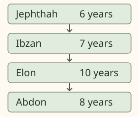

# Judges 12 — Jephthah and the judges who followed him

**About this chapter**

The men of Ephraim and Gilead fight each other. After Jephthah dies, three more judges lead Israel.

## Ephraim argues with Jephthah

## Judges 12:1

The men of Ephraim gathered and crossed the Jordan River to Zaphon.

They asked Jephthah, “Why did you fight the Ammonites without calling us?” They threatened to burn his house with him inside.

## Judges 12:2

Jephthah answered, “My people and I were in serious trouble with the Ammonites.

I called for your help.

You did not come to rescue me.”

## Judges 12:3

“So I risked my life and crossed over to fight.

The LORD gave me victory over the Ammonites.

Why have you come to fight me now?”

**Pause and answer**

What did Jephthah say happened when he asked Ephraim for help?

## Men die at the Jordan River

## Judges 12:4

The men of Ephraim had insulted the people of Gilead.

They called them runaways living in Ephraim and Manasseh.

Jephthah gathered the men of Gilead.

They fought and defeated the men of Ephraim.

## Judges 12:5

Gilead’s men took control of the Jordan River crossings back to Ephraim.

Men from Ephraim fled the battle and asked to cross.

Gilead’s men asked where they came from.

Some denied coming from Ephraim.

**Reading help**

A ford is a shallow place where people can cross a river.

## Judges 12:6

The men from Ephraim said “Sibboleth” when asked to say “Shibboleth.” Gilead’s men recognized them by the sound of the word.

They killed them at the river crossings.

At that time forty-two thousand men of Ephraim died.

## Ibzan follows Jephthah

## Judges 12:7

Jephthah led Israel as judge for six years.

When he died, people buried him in a city of Gilead.

**Reading help**

Here a judge is a leader of Israel.

## Judges 12:8

After Jephthah, Ibzan from Bethlehem became Israel’s judge.

## Judges 12:9

Ibzan had thirty sons and thirty daughters.

His daughters married men outside their family group.

Ibzan found thirty wives for his sons outside the family group too.

He led Israel for seven years.

## Judges 12:10

When Ibzan died, people buried him in Bethlehem.

## Elon leads Israel

## Judges 12:11

After Ibzan, Elon became Israel’s judge.

Elon came from the tribe of Zebulun.

He led Israel for ten years.

## Judges 12:12

When Elon died, people buried him in Aijalon.

That town was in the land of Zebulun.

## Abdon leads Israel

## Judges 12:13

After Elon, Abdon became Israel’s judge.

Abdon was the son of Hillel and came from Pirathon.

## Judges 12:14

Abdon had forty sons and thirty grandsons.

They rode seventy donkeys.

Abdon led Israel for eight years.

## Judges 12:15

When Abdon died, people buried him in his hometown of Pirathon.

It was in Ephraim, in the hills of the Amalekites.

Start at Jephthah and follow the arrows.

**Pause and answer**

Who led Israel after Ibzan?
