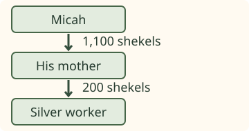

# Judges 17 — Micah chooses a priest

**About this chapter**

Micah returns silver to his mother. Later, a young man looking for a home becomes Micah’s priest.

## Micah returns his mother’s silver

## Judges 17:1

Micah lived in the hills of Ephraim.

## Judges 17:2

Micah told his mother, “I took your silver.

It weighed 1,100 shekels.

I heard you call down a curse on whoever took it.

I have it here.” His mother said, “May the LORD bless you, my son!”

## Judges 17:3

Micah returned all 1,100 shekels of silver.

His mother said, “I set this silver apart for the LORD, for my son’s sake.

I want a carved image and a metal idol made from it.

Now I will give it back to you.”

## Judges 17:4

After Micah returned the silver, his mother took 200 shekels of it.

She gave that silver to a worker who shaped silver.

He made a carved image and an idol from melted metal.

Both went into Micah’s house.

**Reading help**

A shekel was a unit of weight.

An idol is an object people worship.

Follow the silver from Micah to his mother.

**Pause and answer**

How much silver did she give the worker?

## Micah has a place for worship

## Judges 17:5

Micah had a shrine, a place for worship.

He made an ephod and some idols for his household.

He appointed one of his sons to serve as his priest.

**Reading help**

An ephod was an object used in worship.

## Judges 17:6

Israel had no king in those days.

Each person did what seemed right to them.

## A Levite looks for a home

## Judges 17:7

A young Levite lived in Bethlehem in Judah.

He lived among the families of Judah.

**Reading help**

A Levite was someone from the tribe of Levi.

## Judges 17:8

The young man left Bethlehem to find a place to settle.

On his journey he came to Micah’s house in the hills of Ephraim.

## Judges 17:9

Micah asked where he came from.

The young man said, “I am a Levite from Bethlehem in Judah.

I am looking for a place to live.”

## Micah asks the Levite to stay

## Judges 17:10

Micah said, “Stay here.

Be a father and a priest to me.

Each year I will pay you ten shekels of silver.

I will also give you clothes and food.” The Levite went inside.

## Judges 17:11

The young man agreed to stay.

He became like a son to Micah.

**Reading help**

Micah asked the priest to be a father to him.

He wanted someone to guide him.

The young man also became part of Micah’s household, like a son.

## Judges 17:12

Micah appointed the Levite as his priest.

The young man lived in Micah’s house and served there.

## Judges 17:13

Micah said, “Now a Levite is my priest.

So I know the LORD will be good to me.”

**Pause and answer**

In your own words, why did Micah expect the LORD to be good to him?
