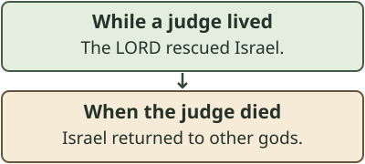

# Judges 2 — The LORD sends judges to help Israel

**About this chapter**

Israel turns away from the LORD. When the people suffer, the LORD sends leaders to rescue them.

## Israel hears a warning at Bochim

## Judges 2:1

The angel of the LORD went from Gilgal to Bochim.

He said, “I brought you out of Egypt.

I led you into the land I promised your ancestors.

I promised never to break my covenant with you.”

## Judges 2:2

“I told you to make no covenant with the people here.

I told you to tear down their altars.

You did not obey me.

What have you done?”

**Reading help**

A covenant is a solemn agreement.

An altar is a place where people give offerings to a god.

## Judges 2:3

“Now I will let those people stay in the land.

They will be like thorns in your sides.

Their gods will be like a trap for you.”

**Reading help**

A thorn pricks and hurts. A trap catches and holds.

The people would bring Israel trouble.

Their gods would draw Israel away from the LORD.

## Judges 2:4

All the Israelites heard what the angel of the LORD said.

They began to cry out loud.

## Judges 2:5

They named the place Bochim.

There they offered sacrifices to the LORD.

**Reading help**

Bochim means “weepers.”

The name recalls how the people cried there.

## The people who remembered Joshua

## Judges 2:6

Earlier, Joshua had sent the people home.

Each family went to take the land it had received.

## Judges 2:7

The Israelites served the LORD while Joshua lived.

They also served him while the elders who outlived Joshua were alive.

Those elders had seen the great things the LORD did for Israel.

## Judges 2:8

Joshua, son of Nun, was the LORD’s servant.

He died at the age of 110.

## Judges 2:9

The people buried Joshua on his own land at Timnath-heres.

It was in Ephraim’s hills, north of Mount Gaash.

## A new generation worships other gods

## Judges 2:10

In time, all the people of that generation died.

A new generation grew up.

They did not know the LORD.

They did not know what he had done for Israel.

## Judges 2:11

The Israelites did what the LORD saw as evil.

They worshiped gods called the Baals.

## Judges 2:12

The LORD, the God of their ancestors, had led them out of Egypt.

Now the Israelites left him.

They followed the gods of the peoples around them.

They bowed down to those gods.

This made the LORD angry.

## Judges 2:13

They left the LORD to worship Baal and the Ashtoreths.

**Reading help**

Baal and Ashtoreth were gods that Israel’s neighbors worshiped.

## Israel’s enemies gain power

## Judges 2:14

The LORD was very angry with Israel.

He let raiders take what belonged to the Israelites.

He gave their enemies power over them on every side.

Israel could no longer stand against them.

## Judges 2:15

Whenever Israel went out to fight, the LORD stood against them.

Disaster came, just as the LORD had warned.

The people suffered greatly.

## The LORD chooses judges

## Judges 2:16

Then the LORD chose leaders called judges.

The judges rescued the Israelites from the people who robbed them.

## Judges 2:17

Still, the Israelites refused to listen to their judges.

They were unfaithful to the LORD.

They bowed down to other gods.

Their ancestors had obeyed the LORD’s commands.

The people quickly turned away from that way of life.

## Judges 2:18

Whenever the LORD chose a judge, he stayed with that judge.

The LORD rescued Israel while the judge lived.

He heard the people groan under their enemies’ cruel rule.

He felt pity for them.

**Pause and answer**

Why did the LORD help the people when they groaned?

## Judges 2:19

When the judge died, the people did even worse than their ancestors.

They served other gods and bowed down to them again.

They stubbornly kept doing what was wrong.

Point to what happened while a judge lived.

**Pause and answer**

In your own words, what changed after a judge died?

## The LORD explains why nations remain

## Judges 2:20

The LORD was very angry with Israel.

He said, “These people have broken the covenant I gave their ancestors.

They have refused to listen to me.”

## Judges 2:21

“Some nations remained here when Joshua died.

I will no longer drive any of them out for Israel.”

## Judges 2:22

“I will use this to test Israel.

Will the people follow my ways as their ancestors did?”

## Judges 2:23

That is why the LORD had let those nations stay.

He had not given Joshua victory over them to drive them out at once.
