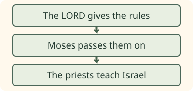

# Leviticus 10 — Aaron loses two sons

**About this chapter**

Two of Aaron’s sons die while serving at the holy tent. Moses speaks to the family. Later, Aaron explains what this day has meant for him.

## Nadab and Abihu bring fire

## Leviticus 10:1

Nadab and Abihu were sons of Aaron.

Each took a pan for burning incense.

They put fire and incense in their pans.

They offered fire before the LORD that went against his command.

## Leviticus 10:2

Fire came out from the LORD’s presence and burned them up.

Nadab and Abihu died there before the LORD.

## Leviticus 10:3

Moses told Aaron, “The LORD spoke about this.

He said, ‘I will show those who come near me how holy I am.

All the people will see my glory.’”

Aaron said nothing.

**Reading help**

Incense gives off a scent when it burns. The LORD’s glory is his greatness.

**Pause and answer**

What did Aaron say when Moses spoke to him?

## The family carries the bodies outside

## Leviticus 10:4

Moses called Mishael and Elzaphan.

Their father, Uzziel, was Aaron’s uncle.

Moses said, “Come and carry your cousins away from the front of the holy place.

Take them outside the camp.”

## Leviticus 10:5

Mishael and Elzaphan did what Moses told them.

They carried the bodies outside the camp.

Nadab and Abihu still wore their tunics.

## Leviticus 10:6

Moses spoke to Aaron and his sons Eleazar and Ithamar.

“Do not leave your hair untidy or tear your clothes in grief.

If you do, you will die.

The LORD will be angry with the whole community.

The rest of Israel may mourn what the LORD’s fire has done.

## Leviticus 10:7

Stay at the entrance to the Tent of Meeting.

If you leave, you will die.

The LORD’s anointing oil is on you.”

Aaron and his sons obeyed Moses.

**Reading help**

Tearing clothes was one way people showed their grief. The oil on Aaron and his sons marked them out to serve as priests.

**Pause and answer**

Who carried the bodies outside the camp?

## The LORD speaks to Aaron

## Leviticus 10:8

Then the LORD spoke to Aaron.

## Leviticus 10:9

“When you and your sons enter the Tent of Meeting, you must not drink wine or strong drink.

If you do, you will die.

This rule stands for every generation.

## Leviticus 10:10

You must tell what is holy and what is ordinary.

You must tell what is clean and what is unclean.

## Leviticus 10:11

Then you can teach the Israelites all the rules I gave them through Moses.”

The priests help Israel understand the rules.

**Reading help**

Holy means set apart for God. Here, clean means fit for worship under Israel’s law.

**Pause and answer**

What were the priests to teach Israel?

## Food for the priests and their family

## Leviticus 10:12

Moses spoke to Aaron and his surviving sons, Eleazar and Ithamar.

“Take what remains of the grain offering brought to the LORD.

Eat it without yeast beside the altar.

It is most holy.

## Leviticus 10:13

Eat it in a holy place.

It is your share and your sons’ share of the LORD’s food offerings.

This is what the LORD told me.

## Leviticus 10:14

You and your sons and daughters may eat the breast and the thigh from the peace offerings.

Eat them in a place that is clean for worship.

These parts of Israel’s offerings belong to you and your children.

## Leviticus 10:15

The Israelites must bring the thigh and breast with the fat for the food offering.

They must wave the offering before the LORD.

The thigh and breast will always be your family’s share.

The LORD has commanded this.”

| Which food? | Who could eat it? | Where? |
| --- | --- | --- |
| The remaining grain offering | Aaron and his sons | Beside the altar, in a holy place |
| Breast and thigh from the peace offerings | Aaron and his sons and daughters | In a place clean for worship |

**Pause and answer**

Which parts of the peace offerings could Aaron’s daughters eat?

## Moses asks about the goat

## Leviticus 10:16

Later, Moses looked carefully for the goat from the sin offering.

He found that it had already been burned up.

Moses was angry with Eleazar and Ithamar, Aaron’s surviving sons.

## Leviticus 10:17

He asked, “Why didn’t you eat the sin offering in the holy place?

It is most holy.

The LORD gave it to you to take away the people’s guilt.

You were to make atonement for them before the LORD.

**Reading help**

To make atonement means to deal with the sin that has come between people and God.

## Leviticus 10:18

No one took the goat’s blood inside the holy place.

You should have eaten the meat in the sanctuary area, as I told you.”

## Leviticus 10:19

Aaron answered Moses, “Today my sons brought their sin offering and their burnt offering before the LORD.

Think of what has happened to me today.

Would the LORD have been pleased if I had eaten the sin offering?”

## Leviticus 10:20

Moses heard Aaron’s explanation.

It satisfied him.

**Pause and answer**

In your own words, how did Moses respond after he listened to Aaron?
