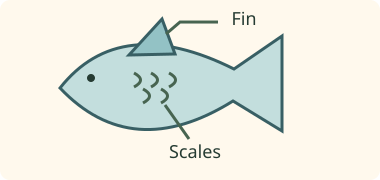

# Leviticus 11 — Clean and unclean animals

**About this chapter**

The LORD tells Israel which animals the people may eat. He also tells them what to do when they touch a dead animal.

## Land animals for food

## Leviticus 11:1

The LORD spoke to Moses and Aaron again.

## Leviticus 11:2

He told them to give the Israelites these rules about which land animals they could eat.

## Leviticus 11:3

The animal must have a hoof split completely in two.

It must also chew the cud.

You may eat an animal with both features.

**Reading help**

A hoof is the hard covering on an animal’s foot. Cud is food an animal brings back into its mouth to chew again.

## Leviticus 11:4

One feature alone is not enough.

The camel chews the cud, but its hoof is not divided.

The camel is unclean for you.

## Leviticus 11:5

The rock badger chews the cud, but its hoof is not divided.

The rock badger is unclean for you.

## Leviticus 11:6

The rabbit chews the cud, but its hoof is not divided.

The rabbit is unclean for you.

## Leviticus 11:7

The pig has a hoof split completely in two.

But it does not chew the cud.

The pig is unclean for you.

## Leviticus 11:8

Do not eat the meat of these animals.

Do not touch their dead bodies.

They are unclean for you.

**Reading help**

Here “unclean” describes an animal or a person under Israel’s rules for worship and daily life.

**Pause and answer**

What two features did a land animal need for Israel to eat it?

## Creatures in the water

## Leviticus 11:9

Some creatures live in the sea, others in streams.

You may eat those with both fins and scales.

Find both features named in the rule for creatures that live in water.

**Reading help**

Fins help a fish swim. Scales are the little plates that cover its skin.

## Leviticus 11:10

Among all the creatures in seas and streams, reject any that lack fins or scales.

## Leviticus 11:11

Treat them as things to keep away from.

Do not eat their meat.

Reject their dead bodies too.

## Leviticus 11:12

Reject every water creature that lacks fins or scales.

**Pause and answer**

What two features did a water creature need?

## Birds Israel must not eat

## Leviticus 11:13

These are birds you must reject as food.

Do not eat the eagle, bearded vulture or black vulture.

## Leviticus 11:14

Do not eat the kite or any kind of falcon.

## Leviticus 11:15

Do not eat any kind of raven.

## Leviticus 11:16

Do not eat the ostrich, screech owl or gull.

Do not eat any kind of hawk.

## Leviticus 11:17

Do not eat the little owl, cormorant or great owl.

## Leviticus 11:18

Do not eat the white owl, desert owl or osprey.

## Leviticus 11:19

Do not eat the stork or any kind of heron.

Do not eat the hoopoe or the bat.

**Pause and answer**

Name one bird the Israelites were to leave out of their meals.

## Insects that hop

## Leviticus 11:20

Reject flying insects that walk on all fours.

## Leviticus 11:21

There is an exception among these insects.

You may eat those with jointed legs for hopping on the ground.

## Leviticus 11:22

You may eat any kind of locust, katydid, cricket or grasshopper.

## Leviticus 11:23

Reject the other flying insects that walk on all fours.

**Pause and answer**

Name one hopping insect the people could eat.

## Touching or carrying a dead animal

## Leviticus 11:24

These creatures make you unclean.

If you touch one of their dead bodies, you are unclean until evening.

## Leviticus 11:25

If you pick up a dead body of this kind, wash your clothes.

You are unclean until evening.

## Leviticus 11:26

An animal whose hooves are not fully split is unclean for you.

So is one that does not chew the cud.

Anyone who touches one becomes unclean.

## Leviticus 11:27

Four-footed animals that walk on paws are unclean for you.

If you touch one when it is dead, you are unclean until evening.

## Leviticus 11:28

If you pick up its dead body, wash your clothes.

You are unclean until evening.

These animals are unclean for you.

**Pause and answer**

What did a person have to wash after picking up a dead animal?

## Small animals on the ground

## Leviticus 11:29

Some small animals that move along the ground are unclean for you.

They include the mole, the mouse and every kind of great lizard.

## Leviticus 11:30

They also include the gecko, monitor lizard, common lizard, skink and chameleon.

## Leviticus 11:31

These crawling animals are unclean for you.

Touching one after it dies makes you unclean until evening.

**Pause and answer**

How long was a person unclean after touching one of these dead animals?

## What happens to pots and tools

## Leviticus 11:32

Suppose one dies and falls on something you use.

That object becomes unclean.

Rinse wooden objects, clothes, leather, rough sackcloth and tools in water.

They stay unclean until evening.

Then they are clean.

## Leviticus 11:33

If the dead animal falls into a clay pot, everything inside becomes unclean.

Break the pot.

## Leviticus 11:34

Food becomes unclean if water from that pot touches it.

Any drink in such a pot is unclean too.

## Leviticus 11:35

Anything the dead animal falls on becomes unclean.

If it falls on an oven or cooking pot, break it.

It remains unclean for you.

**Pause and answer**

What did the people do with a clay pot if a dead animal fell inside?

## Water and seed

## Leviticus 11:36

A spring or water storage pit stays clean.

But touching the dead animal in the water makes a person unclean.

## Leviticus 11:37

If the dead animal falls on dry seed for planting, the seed stays clean.

## Leviticus 11:38

If you have already put water on the seed, the rule changes.

When the dead animal falls on it, the wet seed becomes unclean.

| What did the dead animal fall on? | What happened to the seed? |
| --- | --- |
| Dry seed for planting | It stayed clean. |
| Seed already wet with water | It became unclean. |

**Pause and answer**

How did water change the rule for seed?

## When an animal dies

## Leviticus 11:39

Suppose an animal you are allowed to eat dies.

Anyone who touches its dead body is unclean until evening.

## Leviticus 11:40

Anyone who eats from that dead body must wash their clothes.

Anyone who picks it up must wash their clothes too.

Both are unclean until evening.

## Leviticus 11:41

Reject every creature that crawls along the ground.

Do not eat it.

## Leviticus 11:42

This includes creatures that crawl on their bellies.

It also includes crawling creatures with four feet or many feet.

Reject them as food.

**Pause and answer**

What did someone have to do after carrying the body of an animal that had died?

## Why Israel follows these rules

## Leviticus 11:43

Do not make yourselves unclean through any of these crawling creatures.

## Leviticus 11:44

“I am the LORD your God.

Set yourselves apart for me.

Be holy because I am holy.

Do not make yourselves unclean through creatures that crawl on the ground.

**Reading help**

For the people, being holy means belonging to the LORD and living as he commands.

## Leviticus 11:45

I am the LORD who brought you out of Egypt to be your God.

Be holy because I am holy.”

## Leviticus 11:46

These rules cover land animals and birds.

They cover creatures in the water and creatures crawling on the ground.

## Leviticus 11:47

Israel must tell clean and unclean animals apart.

The people must know which animals they may eat.

**Pause and answer**

In your own words, why did the LORD tell Israel to be holy?
