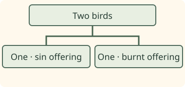

# Leviticus 12 — After a child is born

**About this chapter**

The LORD gives Israel a rule for worship after childbirth.
It tells a mother how long to wait.
It also tells her what offering to bring.

## After the birth of a son

## Leviticus 12:1

The LORD spoke to Moses.

## Leviticus 12:2

He told Moses to give the Israelites this rule.

When a woman gives birth to a son, she is unclean for seven days.

The same rule about being unclean applies during her monthly period.

**Reading help**

Here “unclean” describes a temporary limit on taking part in worship.

## Leviticus 12:3

On the eighth day, the boy must be circumcised.

**Reading help**

Circumcision means removing the fold of skin at the tip of the penis.

## Leviticus 12:4

The mother waits 33 more days for purification after bleeding.

During this time she must not touch anything holy.

She must wait until the days are over before entering the holy place.

**Pause and answer**

How many more days does the mother wait after the first seven days?

## After the birth of a daughter

## Leviticus 12:5

When a woman gives birth to a daughter, she is unclean for two weeks.

This is like the time of her monthly period.

Then she waits 66 more days for purification after bleeding.

| After the birth of | First period of waiting | Additional days |
| --- | --- | --- |
| A son | 7 days | 33 days |
| A daughter | 14 days | 66 days |

**Pause and answer**

After a daughter is born, how long is the first wait?

## The offerings after the wait

## Leviticus 12:6

When the waiting time ends, the mother brings two offerings.

She does this for either a son or a daughter.

She brings the gifts to the priest at the entrance to the Tent of Meeting.

She brings a year-old lamb for a burnt offering.

She brings a young pigeon or a turtledove for a sin offering.

## Leviticus 12:7

The priest presents both offerings to the LORD.

He makes atonement for the mother.

After her bleeding, she is now clean for worship.

This rule applies after the birth of a boy or a girl.

**Reading help**

Here the priest makes atonement by offering the gifts for the mother so she can take part in worship again.

## Leviticus 12:8

If the mother cannot afford a lamb, she brings two turtledoves or two young pigeons.

One bird is for the burnt offering.

The other is for the sin offering.

The priest makes atonement for her, and she is clean for worship.

The mother may bring two birds when she cannot afford a lamb.

**Pause and answer**

What can a mother bring if a lamb costs too much?
