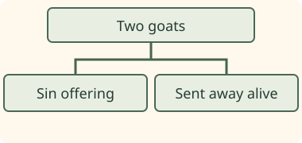

# Leviticus 16 — The Day of Atonement

**About this chapter**

Once a year, Aaron enters the room behind the curtain. He makes atonement for himself and the people. Two goats have different parts in what happens that day.

## Before Aaron enters

## Leviticus 16:1

Two of Aaron’s sons had come before the LORD and died.

After this, the LORD spoke to Moses.

## Leviticus 16:2

The LORD said, “Give your brother Aaron this warning.

He must not enter the Most Holy Place whenever he wants.

That room is behind the curtain.

Inside is the ark, a sacred chest.

Its cover is called the mercy seat.

I appear in a cloud above that cover.

If Aaron enters whenever he wants, he will die.”

## Leviticus 16:3

The LORD told Aaron how to enter the holy place.

Aaron must bring a young bull for a sin offering.

He must bring a ram for a burnt offering.

## Leviticus 16:4

First, Aaron must bathe in water.

Then he must put on the holy clothes.

These include a long shirt and clothes worn underneath.

Aaron ties a sash around his waist.

He wraps a turban around his head.

All these clothes are made of linen cloth.

**Pause and answer**

What does Aaron do before he puts on the linen clothes?

## Two goats at the tent

## Leviticus 16:5

The people of Israel give Aaron two male goats for a sin offering.

They also give him a ram for a burnt offering.

## Leviticus 16:6

Aaron presents the bull as his own sin offering.

He makes atonement for himself and his household.

**Reading help**

Atonement is the way God gives his people to deal with sin and uncleanness so they can come before him.

## Leviticus 16:7

Aaron brings both goats to the entrance of the Tent of Meeting.

There he presents them to the LORD.

## Leviticus 16:8

Aaron casts lots to choose between the goats.

One lot marks a goat for the LORD.

The other marks the goat called the scapegoat.

**Reading help**

Casting lots means using marked pieces to make a choice.

## Leviticus 16:9

Aaron gives the goat chosen for the LORD as a sin offering.

## Leviticus 16:10

Aaron presents the other goat alive before the LORD.

He makes atonement by sending this goat into the wilderness.

The two goats have different parts in the Day of Atonement.

**Follow the two goats**

| The goat chosen for the LORD | The live goat, called the scapegoat |
| --- | --- |
| Aaron offers this goat. | Aaron places his hands on this goat. |
| Aaron takes its blood behind the curtain. | A man leads it into the wilderness. |

**Pause and answer**

Which goat leaves the camp alive?

## Behind the curtain

## Leviticus 16:11

Aaron presents the bull for himself and his household.

To make atonement, Aaron kills the bull as his sin offering.

## Leviticus 16:12

Aaron fills a pan with burning coals from the altar before the LORD.

He takes two handfuls of finely ground incense.

He carries the pan and the incense behind the curtain.

## Leviticus 16:13

Aaron puts the incense on the coals before the LORD.

A cloud of smoke covers the mercy seat.

Beneath that cover are the tablets with God’s commands.

The smoke covers the mercy seat so Aaron will live.

**Reading help**

Incense gives off sweet-smelling smoke when it burns.

## Leviticus 16:14

Aaron dips his finger in the bull’s blood.

He sprinkles blood on the east side of the mercy seat.

Then he sprinkles blood seven times in front of it.

## Leviticus 16:15

Next, Aaron kills the goat for the people’s sin offering.

He takes its blood behind the curtain.

He uses it just as he used the bull’s blood.

He sprinkles it on the mercy seat and in front of it.

**Pause and answer**

Where does Aaron take the blood from the goat?

## Aaron cleanses the holy places

## Leviticus 16:16

This makes atonement for the Most Holy Place.

Israel’s people have been unclean and have rebelled against God.

Aaron does this because of all their sins.

He does the same for the Tent of Meeting.

The tent stands among the people even in their uncleanness.

## Leviticus 16:17

No one else may be in the tent when Aaron enters to make atonement.

Everyone stays out until Aaron leaves.

Aaron makes atonement for himself, his household and all Israel.

## Leviticus 16:18

Then Aaron goes out to the altar before the LORD.

He makes atonement for the altar.

He takes blood from the bull and the goat.

He puts blood on each horn of the altar.

**Reading help**

The horns are raised points at the corners of the altar.

## Leviticus 16:19

Aaron uses his finger to sprinkle blood on the altar seven times.

This cleanses the altar from Israel’s uncleanness.

It sets the altar apart for the LORD.

**Pause and answer**

How many times does Aaron sprinkle blood on the altar?

## The live goat goes away

## Leviticus 16:20

Aaron finishes cleansing the Most Holy Place, the tent and the altar.

Then he brings the live goat forward.

## Leviticus 16:21

Aaron lays both hands on the goat’s head.

He says aloud all the wrongs Israel’s people have done.

He tells how they have rebelled against God.

In this way he puts their sins on the goat’s head.

A man chosen for this job leads the goat into the wilderness.

## Leviticus 16:22

The goat carries all their wrongs to a lonely place.

There the man lets the goat go free.

**Reading help**

The goat walking away gives the people a picture. Their sins are being carried far away from them.

**Pause and answer**

What does Aaron say aloud over the goat?

## Washing and returning to camp

## Leviticus 16:23

Aaron goes back into the Tent of Meeting.

He takes off the linen clothes he wore behind the curtain.

He leaves them in the tent.

## Leviticus 16:24

Aaron bathes in water in a holy place.

He puts on his own clothes.

Then he goes out and gives two burnt offerings.

One is his own and one is the people’s.

He makes atonement for himself and the people.

## Leviticus 16:25

Aaron also burns the fat from the sin offering on the altar.

## Leviticus 16:26

The man who let the live goat go must wash his clothes.

He must also bathe in water.

Then he may come back into camp.

## Leviticus 16:27

Aaron took blood from the bull and the goat into the Most Holy Place to make atonement.

Someone must carry those animals outside the camp.

There the person burns their skins, flesh and dung.

## Leviticus 16:28

The person who burns them must wash their clothes and bathe in water.

Then that person may come back into camp.

**Pause and answer**

What must the person who burns the animals do before coming back?

## One day each year

## Leviticus 16:29

The LORD gave Israel a lasting rule.

On day ten of month seven, the people must humble themselves.

They must stop all work that day.

This includes people born in Israel and foreigners living among them.

**Reading help**

To humble yourself means to set aside your pride before God.

## Leviticus 16:30

On this day the priest makes atonement for the people.

Then they are clean before the LORD from all their sins.

## Leviticus 16:31

The day is a Sabbath, a day of complete rest.

The people must humble themselves before God.

This rule lasts for all time.

## Leviticus 16:32

In time another high priest will take his father’s place.

Oil is poured on him when he receives this work.

This high priest must wear the holy linen clothes and make atonement.

## Leviticus 16:33

He makes atonement for the Most Holy Place, the Tent of Meeting and the altar.

He also makes atonement for the priests and all the people.

## Leviticus 16:34

This rule lasts for all time.

Once a year the high priest makes atonement for all Israel’s sins.

The people did what the LORD had told Moses.

**Pause and answer**

How often does the high priest do this for Israel?
