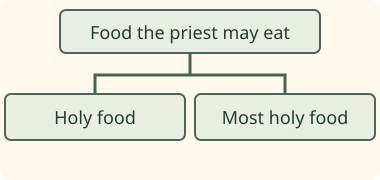

# Leviticus 21 — Rules for Aaron and the priests

**About this chapter**

The LORD tells Moses how the priests should live and serve. Some rules name the high priest. Others explain who may bring an offering and who may eat it.

## When someone in the family dies

## Leviticus 21:1

The LORD told Moses to speak to Aaron’s sons, the priests.

When someone died, a priest usually had to stay away from the body.

Going near it would make him unclean.

**Reading help**

Here, “unclean” means the priest must wait before he can take part in worship again.

## Leviticus 21:2

There was a different rule for the priest’s close family.

He could go near his mother or father after they died.

He could also go near his son, daughter or brother.

## Leviticus 21:3

The same rule applied to his unmarried sister.

She was close to him and had no husband.

## Leviticus 21:4

A priest must not make himself unclean for relatives by marriage.

Doing that would dishonor his holy role.

**Pause and answer**

Which sister could a priest go near after she died?

## How priests honor God

## Leviticus 21:5

Priests must not shave bare patches on their heads.

They must not shave off the edges of their beards.

They must not cut their bodies.

## Leviticus 21:6

Priests must be holy to their God.

They must honor God’s name.

They bring food offerings to the LORD their God.

That is why they must be holy.

## Leviticus 21:7

A priest must not marry a woman who had sold sex.

He must not marry a woman whose husband divorced her.

The priest was holy to his God.

## Leviticus 21:8

The Israelites must treat the priest as holy.

He brings food offerings to their God.

The LORD is holy.

He is the one who sets his people apart.

**Reading help**

Holy means set apart for God. A food offering is a gift of food for God.

## Leviticus 21:9

Suppose a priest’s daughter sold sex.

Under this law, she made herself unclean and dishonored her father.

The penalty in ancient Israel was death by fire.

**Pause and answer**

What did priests bring to the LORD?

## When the high priest mourns

## Leviticus 21:10

One priest held the highest place among the priests.

At his appointment, someone poured special oil on his head.

He had the right to wear the high priest’s clothes.

He must not let his hair hang loose.

He must not tear his clothes in grief.

## Leviticus 21:11

The high priest must not go near any dead body.

This included the body of his own father or mother.

He must keep himself clean even then.

**Reading help**

| When a parent died | What the law allowed |
| --- | --- |
| A priest | He could go near his parent’s body. |
| The high priest | He had to stay away from the body. |

## Leviticus 21:12

The high priest must not leave God’s holy place to mourn.

He must not dishonor that place.

His God had set him apart with special oil.

The LORD said, “I am the LORD.”

**Pause and answer**

What was poured on the high priest’s head?

## Whom the high priest may marry

## Leviticus 21:13

The high priest must marry a virgin.

A virgin here means a woman who has never had sex.

## Leviticus 21:14

He must not marry a widow or a divorced woman.

He must not marry a woman who had sold sex.

He must marry a virgin from his own people.

**Reading help**

A widow is a woman whose husband has died.

## Leviticus 21:15

This would keep his children holy among his people.

The LORD himself set the high priest apart.

**Pause and answer**

From which people was the high priest to choose his wife?

## Who may bring food offerings

## Leviticus 21:16

Then the LORD spoke to Moses again.

## Leviticus 21:17

He told Moses to give Aaron this rule for future generations.

It concerned men in Aaron’s family with certain physical conditions.

These men could not come forward to offer food to God.

## Leviticus 21:18

The rule included a man who was blind or had difficulty walking.

It included men whose face or body had an unusual shape.

## Leviticus 21:19

The rule also included a man with a broken foot or hand.

## Leviticus 21:20

It included a man with a curved back or dwarfism.

It included a man with an eye condition.

It also covered a rash with open sores, scabs or a crushed testicle.

**Pause and answer**

Whose family received this rule?

## Who may eat the holy food

## Leviticus 21:21

A man in Aaron’s family with one of these conditions could not bring food offerings to the LORD.

This rule applied when he came forward to offer the food.

## Leviticus 21:22

He could eat the holy food set apart for God.

He could eat the most holy food too.

The priest may eat from both groups of food.

## Leviticus 21:23

Because of his condition, he must stay away from the curtain and the altar.

In this way he would honor the holy places.

The LORD himself made those places holy.

**Reading help**

The curtain marked the entrance to the innermost holy room. The altar was where priests gave offerings.

## Leviticus 21:24

Moses told Aaron and his sons what the LORD said.

Moses also told all the people of Israel.

**Pause and answer**

What food could a man eat even if he could not bring an offering?
