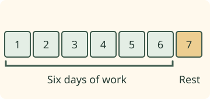

# Leviticus 23 — Times to rest and gather for worship

**About this chapter**

The LORD gives Israel a day of rest each week. He also chooses days each year for the people to gather, give thanks and remember.

## Rest on the seventh day

## Leviticus 23:1

The LORD spoke to Moses.

## Leviticus 23:2

He told Moses to speak to Israel.

The LORD had chosen times for his feasts.

The people were to announce these holy gatherings.

## Leviticus 23:3

The people could work for six days.

The seventh day was the Sabbath, a day of complete rest.

They must gather for worship and do no work.

Wherever they lived, this day belonged to the LORD.

The people gather for worship on the seventh day.

**Pause and answer**

Which day of the week was a day of complete rest?

## Passover and bread without yeast

## Leviticus 23:4

The LORD also chose times for these yearly feasts.

The people must announce each holy gathering at its proper time.

## Leviticus 23:5

Passover honors the LORD.

It begins as daylight fades on day fourteen of the first month.

## Leviticus 23:6

The next day is day fifteen.

The Feast of Unleavened Bread begins that day.

For seven days the people must eat bread made without yeast.

**Reading help**

Yeast makes bread dough rise. Unleavened bread is bread made without yeast.

## Leviticus 23:7

On the first day, everyone must gather for worship.

They must stop their regular work.

## Leviticus 23:8

Each of the seven days, they must bring the LORD a food offering.

On the seventh day, they must gather for worship again.

They must stop their regular work that day.

**Pause and answer**

What kind of bread did the people eat for seven days?

## The first bundle of grain

## Leviticus 23:9

The LORD spoke to Moses again.

## Leviticus 23:10

He gave Moses a message for Israel.

The LORD was giving the people a land.

When they gathered its harvest, they must bring the priest a bundle of the first grain they cut.

## Leviticus 23:11

The priest waves the bundle before the LORD.

He does this the day after the Sabbath.

Then the LORD can accept the gift on behalf of the people.

## Leviticus 23:12

That day the people also bring a lamb for a burnt offering to the LORD.

The lamb must be one year old and free of defects.

## Leviticus 23:13

They mix fine flour with oil for the grain offering.

They use two tenths of an ephah of flour.

The smell of this food offering pleases the LORD.

They also bring a quarter of a hin of wine as a drink offering.

**Reading help**

An ephah measures dry food like flour. A hin measures liquids like wine.

## Leviticus 23:14

They must wait until they bring the offering to God.

Only then may they eat bread from the harvest, roasted grain or fresh grain.

Every generation must keep this rule wherever the people live.

**Pause and answer**

Who waved the first bundle of grain?

## Count fifty days

## Leviticus 23:15

The people start counting on the day they bring the bundle of grain.

That is the day after the Sabbath.

They count seven full weeks.

## Leviticus 23:16

Day fifty comes the day after the seventh Sabbath.

On day fifty they bring new grain to the LORD.

## Leviticus 23:17

From their homes they bring two loaves to wave before the LORD.

For each loaf they use two tenths of an ephah of fine flour.

They bake these loaves with yeast.

These are gifts from the first of their harvest.

**Pause and answer**

How many loaves did the people bring?

## Offerings and food to share

## Leviticus 23:18

With the bread they bring seven male lambs.

Each is a year old and free of defects.

They also bring one young bull and two rams.

These animals are a burnt offering to the LORD.

The people add the grain and drink offerings for these animals.

The smell pleases the LORD.

## Leviticus 23:19

They also bring one male goat as a sin offering.

They bring two year-old male lambs as a peace offering.

## Leviticus 23:20

The priest waves the two lambs and the first loaves before the LORD.

The bread and those two lambs are holy gifts.

The LORD sets them apart for the priest.

## Leviticus 23:21

That day the people must announce a holy gathering.

They must stop their regular work.

Every generation must keep this rule wherever the people live.

## Leviticus 23:22

At harvest time they must leave the edges of their fields uncut.

They must leave the grain the workers miss.

Poor people and foreigners living among them may gather it.

The LORD is their God.

**Pause and answer**

Who could gather the grain left behind?

## The sound of trumpets

## Leviticus 23:23

The LORD spoke to Moses again.

## Leviticus 23:24

Moses was to tell Israel about day one of the seventh month.

The people must rest that day.

The sound of trumpets announces their holy gathering.

## Leviticus 23:25

The people must stop their regular work.

They must bring a food offering to the LORD.

**Pause and answer**

What sound called the people together?

## The Day of Atonement

## Leviticus 23:26

The LORD spoke to Moses again.

## Leviticus 23:27

Day ten of the seventh month is the Day of Atonement.

The people must gather for worship.

They must humble themselves and bring the LORD a food offering.

**Reading help**

Atonement is the way God gives his people to deal with sin and come before him. To humble yourself means to lay aside your pride before God.

## Leviticus 23:28

They must do no work that day.

On this day the priest makes atonement for them before the LORD their God.

## Leviticus 23:29

Anyone who refuses to humble themselves that day must be cut off from their people.

## Leviticus 23:30

The LORD will destroy anyone among the people who works that day.

## Leviticus 23:31

The people must rest from all work.

Every generation must keep this rule wherever the people live.

## Leviticus 23:32

This Sabbath is a time of complete rest.

The people must humble themselves.

They begin their rest on the evening of day nine.

They continue until the next evening.

**Pause and answer**

When did the people begin their rest for the Day of Atonement?

## The Feast of Tabernacles

## Leviticus 23:33

The LORD spoke to Moses again.

## Leviticus 23:34

Moses was to tell Israel about the Feast of Tabernacles.

This feast for the LORD starts on day fifteen of the seventh month.

It lasts seven days.

**Reading help**

Tabernacles is another word for shelters. Verses 42 and 43 explain why the people stayed in shelters.

## Leviticus 23:35

On the first day the people must gather for worship.

They must stop their regular work.

## Leviticus 23:36

For seven days they bring food offerings to the LORD.

On day eight they gather for worship and bring another food offering.

This is a special closing gathering.

They must stop their regular work.

## Leviticus 23:37

The LORD chose these times for feasts.

The people must announce the holy gatherings.

Each day has its own gifts for the LORD.

These include burnt offerings, grain offerings, sacrifices and drink offerings.

## Leviticus 23:38

These feast offerings are extra.

The people still bring their Sabbath offerings and their other gifts.

They still bring gifts they promised and gifts they freely choose.

**Pause and answer**

What did the people do on the eighth day?

## Seven days in shelters

## Leviticus 23:39

After gathering their crops, they celebrate for seven days before the LORD.

They start on day fifteen of the seventh month.

Day one and day eight are days of complete rest.

## Leviticus 23:40

On day one they gather fruit from splendid trees.

They take branches from palms and other leafy trees.

They also take willow branches from beside streams.

For seven days they celebrate with joy before the LORD their God.

## Leviticus 23:41

They must keep this seven-day feast every year in the seventh month.

This rule is for every generation.

**Reading help**

| In the seventh month | What happens |
| --- | --- |
| Day one | Trumpets call the people together. |
| Day ten | The people observe the Day of Atonement. |
| Day fifteen | The Feast of Tabernacles begins. |

## Leviticus 23:42

For seven days the people live in shelters called booths.

Everyone born an Israelite must live in these shelters.

## Leviticus 23:43

Their children and grandchildren will learn why.

The LORD had the Israelites live in shelters when he brought them out of Egypt.

He is the LORD their God.

## Leviticus 23:44

Moses announced to Israel the feasts the LORD had chosen.

**Pause and answer**

What did staying in shelters help families remember?
