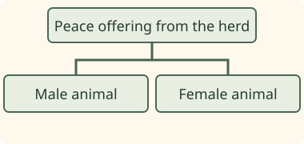

# Leviticus 3 — Bringing a peace offering

**About this chapter**

The LORD tells Israel about a gift called a peace offering. The person brings an animal. The priest burns the LORD’s share on the altar.

## A gift from the herd

## Leviticus 3:1

A person may bring the LORD a peace offering from the herd.

The animal may be male or female.

The person must choose an animal without any defect.

Whichever animal the person chose had to be free from defects.

**Reading help**

A peace offering was a gift that celebrated peace with God. A herd here is a group of cattle.

## Leviticus 3:2

The person rests a hand on the animal’s head.

Then the person kills it at the entrance to the Tent of Meeting.

Aaron’s sons are the priests.

They splash the blood on every side of the altar.

## Leviticus 3:3

The person brings part of the animal as a food offering to the LORD.

This includes the fat covering the inner parts and all the fat on them.

## Leviticus 3:4

The person brings both kidneys with the fat near the lower back.

The person removes part of the liver along with the kidneys.

**Reading help**

The kidneys and liver are organs inside the animal.

## Leviticus 3:5

Aaron’s sons place these parts on top of the burnt offering on the burning wood.

They burn them on the altar as a food offering.

Its smell pleases the LORD.

**Pause and answer**

Where did the person bring the animal from the herd?

## A lamb from the flock

## Leviticus 3:6

A person may bring the LORD a peace offering from the flock.

The animal may be male or female.

It must have no defect.

## Leviticus 3:7

If the offering is a lamb, the person brings the lamb before the LORD.

## Leviticus 3:8

The person rests a hand on the lamb’s head.

Then the person kills it in front of the Tent of Meeting.

Aaron’s sons splash its blood on every side of the altar.

## Leviticus 3:9

The person brings the fat as a food offering to the LORD.

This includes the whole fat tail, cut off close to the backbone.

It also includes the fat covering the inner parts and all the fat on them.

## Leviticus 3:10

The person brings both kidneys with the fat near the lower back.

The person removes part of the liver along with the kidneys.

## Leviticus 3:11

The priest burns these parts on the altar.

They are a food offering to the LORD.

| Who took part? | What did they do? |
| --- | --- |
| The person bringing the lamb | Brought the lamb and put a hand on its head |
| Aaron’s sons, the priests | Put the blood on the altar |
| The priest burning the offering | Burned the LORD’s share on the altar |

**Pause and answer**

Who burned the LORD’s share of the lamb?

## A goat from the flock

## Leviticus 3:12

If the offering is a goat, the person brings the goat before the LORD.

## Leviticus 3:13

The person rests a hand on the goat’s head.

Then the person kills it in front of the Tent of Meeting.

Aaron’s sons splash its blood on every side of the altar.

## Leviticus 3:14

The person brings a food offering to the LORD.

This includes the fat covering the inner parts and all the fat on them.

## Leviticus 3:15

The person brings both kidneys with the fat near the lower back.

The person removes part of the liver along with the kidneys.

**Pause and answer**

Where did the person place a hand before offering the goat?

## The LORD’s share

## Leviticus 3:16

The priest burns these parts on the altar as a food offering.

Its smell pleases the LORD.

All the fat belongs to the LORD.

## Leviticus 3:17

The LORD gave the Israelites a lasting rule.

“Wherever you live, you and your children after you must never eat fat or blood.”

**Pause and answer**

In your own words, what rule were the Israelites to pass on to their children?
