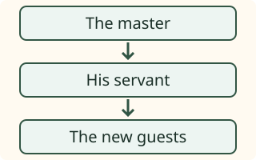

# Luke 14 — Guests at a meal and the cost of following Jesus

**About this chapter**

At a meal, Jesus talks about who gets a place at the table.

Later, Jesus tells a crowd what following him can cost.

## Jesus heals a man on the Sabbath

## Luke 14:1

One Sabbath, Jesus ate at a Pharisee’s house.

This Pharisee was a leader.

The people there watched Jesus closely.

**Help with these words**

The Sabbath is the Jewish day of rest.

The Pharisees were a Jewish group who carefully followed God’s law.

## Luke 14:2

A sick man stood in front of Jesus.

Fluid had built up in the man’s body.

It made his body swell.

## Luke 14:3

Jesus asked the law teachers and the Pharisees a question.

“Does our law let us heal on the Sabbath?”

## Luke 14:4

No one answered.

Jesus took hold of the man and healed him.

Then Jesus sent the man on his way.

## Luke 14:5

Jesus asked, “Suppose your son fell into a deep hole on the Sabbath.

Or suppose your ox fell in.

Wouldn’t you pull him out at once?”

## Luke 14:6

The people there could not answer Jesus.

**Pause and answer**

What did Jesus do for the sick man?

## A guest chooses a seat

## Luke 14:7

Jesus saw guests choosing the seats for important guests.

So Jesus told them this story.

**Help with these words**

The host is the person who invites the guests.

## Luke 14:8

“Suppose someone invites you to a wedding meal.

Do not choose the most important seat.

The host may have invited someone more important than you.

## Luke 14:9

“Then the host will say, ‘Give this guest your seat.’

You will feel ashamed as you take the lowest place.

## Luke 14:10

“Instead, take the lowest place.

Then the host can say, ‘Friend, come sit in a better place.’

All the guests will see the host honour you.

## Luke 14:11

“People who put themselves above others will be brought low.

People who take the lowest place will receive honour.”

**Pause and answer**

Which place did Jesus tell the guest to choose first?

## Jesus tells the host whom to invite

## Luke 14:12

Then Jesus spoke to the man who invited him.

“When you give a meal, do not invite your friends, family, or rich neighbours to get a meal back.

They may invite you to eat with them.

Then you will already have your reward.

## Luke 14:13

“When you give a feast, invite people who are poor.

Invite people with disabilities, including people who find walking difficult and people who are blind.

## Luke 14:14

“God will bless you because these guests cannot repay you.

God will repay you when he raises the righteous from the dead.”

**Help with these words**

The righteous are people who are right with God.

## Luke 14:15

A guest at the table heard Jesus.

The guest said, “How blessed are those who will eat at the feast in God’s kingdom!”

**Pause and answer**

Whom did Jesus ask the host to invite?

## The guests give reasons for staying away

## Luke 14:16

Jesus answered with a story.

“A man planned a great feast.

He invited many people.

## Luke 14:17

“When the meal was ready, he sent his servant to the guests.

The servant said, ‘Come! Everything is ready.’

## Luke 14:18

“But each guest gave a reason for staying away.

The first said, ‘I bought a field.

I need to go and see it.

Please excuse me.’

## Luke 14:19

“Another said, ‘I bought five pairs of oxen.

I am going to see how they work together.

Please excuse me.’

**Help with these words**

Oxen are strong cattle.

Farmers could join two oxen together to pull a plough.

## Luke 14:20

“Another said, ‘I just got married.

So I cannot come.’

**Pause and answer**

What had the first guest bought?

## There is still room

## Luke 14:21

“The servant went back and told his master.

The master was angry.

He said, ‘Hurry into the city streets and narrow lanes.

Bring people who are poor and people with disabilities.

Bring people who are blind or have trouble walking.’

## Luke 14:22

“The servant said, ‘Sir, I did what you asked.

There is still room.’

## Luke 14:23

“The master said, ‘Go out to the roads and hedges.

Urge the people there to come inside.

I want my house to be full.

**About the picture**

Follow the arrows from the master to the new guests.

## Luke 14:24

“‘I tell you, none of those first guests will taste my meal.’”

**Pause and answer**

What did the master want the servant to do while there was still room?

## Following Jesus can cost you your life

## Luke 14:25

Large crowds travelled with Jesus.

Jesus turned and spoke to them.

## Luke 14:26

“To follow me, you must put me first.

You must choose me even over your father and mother, your wife and children, your brothers and sisters.

You must choose me even over your own life.

**Help with these words**

Jesus uses the strong word “hate” for this choice.

Jesus asks people to choose him even when that choice costs them their family or their life.

## Luke 14:27

“You cannot be my follower unless you carry your cross and follow me.

**Help with these words**

A cross was a wooden frame used to put someone to death.

Jesus asks his followers to stay with him even if they face death.

**Pause and answer**

Who comes first for a follower of Jesus?

## Think before you start

## Luke 14:28

“Suppose you want to build a tower.

First you sit down and work out the cost.

Do you have enough to finish it?

## Luke 14:29

“Suppose you lay the base but cannot finish building.

Everyone who sees it will laugh at you.

## Luke 14:30

“They will say, ‘This person started to build.

But he could not finish.’

## Luke 14:31

“Suppose a king has ten thousand soldiers.

Another king comes against him with twenty thousand.

The first king sits down to think.

Can his army fight the larger army?

## Luke 14:32

“If he cannot, he sends messengers.

He sends them while the other king is far away.

They ask what the other king wants in return for peace.

## Luke 14:33

“So you must give up everything you have to be my follower.

**Pause and answer**

What does the builder work out before starting?

## Jesus asks people to listen

## Luke 14:34

“Salt is good.

But suppose salt loses its taste.

How can you make it salty again?

## Luke 14:35

“No one can use it on the soil.

No one can use it on the manure pile.

People throw it away.

If you have ears to hear, listen!”

**Pause and answer**

What do people do with salt that has lost its taste?
