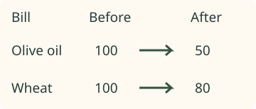

# Luke 16 — A manager, a rich man, and Lazarus

**About this chapter**

Jesus tells his followers a story about using wealth.

Later, Jesus tells of a rich man and Lazarus, a poor man who lay at his gate.

## A manager is about to lose his job

## Luke 16:1

Jesus told his followers a story.

“A rich man had a manager to look after his property.

Someone told the rich man, ‘Your manager is wasting what you own.’

## Luke 16:2

“The rich man called the manager in.

‘What is this I hear about you?’ he asked.

‘Show me the records of your work.

You cannot keep this job.’

## Luke 16:3

“The manager thought, ‘My master is taking my job away.

What will I do?

I am too weak to dig.

I am too ashamed to beg.

## Luke 16:4

“‘I know what to do!

When I lose my job, people will welcome me into their homes.’

**Pause and answer**

What does the manager want people to do for him?

## The manager changes two bills

## Luke 16:5

“The manager called in the people who owed his master something.

He asked the first, ‘How much do you owe my master?’

## Luke 16:6

“The man answered, ‘A hundred measures of olive oil.’

The manager said, ‘Take your bill.

Sit down quickly and write fifty.’

## Luke 16:7

“The manager asked another man, ‘How much do you owe?’

The man answered, ‘A hundred measures of wheat.’

The manager said, ‘Take your bill and write eighty.’

**About the picture**

Follow each arrow to see the amount on the new bill.

## Luke 16:8

“The manager had been dishonest.

But his master praised him for thinking ahead.

People who live for this world deal cleverly with each other.

They do this better than the people of light.”

**Help with these words**

“People of light” means people who follow God’s ways.

**Pause and answer**

What amount did the manager tell the man to write for the oil?

## Whom do you serve?

## Luke 16:9

Jesus told his followers, “Use the wealth you have here to make friends.

Then, when your wealth is gone, they will welcome you into homes that last forever.

## Luke 16:10

“Someone you can trust with a little can also be trusted with a lot.

Someone who cheats with a little will cheat with a lot.

## Luke 16:11

“Suppose you misuse the money you have here.

Who will trust you with true riches?

## Luke 16:12

“Suppose you misuse what belongs to someone else.

Who will give you anything of your own?

## Luke 16:13

“No servant can serve two masters.

The servant will hate one and love the other.

The servant will stay loyal to one and look down on the other.

You cannot serve both God and money.”

**Pause and answer**

What two masters does Jesus name?

## God knows what people care about

## Luke 16:14

The Pharisees loved money.

They heard all this and made fun of Jesus.

## Luke 16:15

Jesus told them, “You make yourselves look good to others.

But God knows what is in your hearts.

People prize things that God hates.

**Help with these words**

Here “your hearts” means what you really want and care about.

**Pause and answer**

Who knows what is in people’s hearts?

## Jesus speaks about God’s law

## Luke 16:16

“Until John came, people taught the Law and the Prophets.

Since then, people have announced the good news of God’s kingdom.

Everyone is pushing to get in.

**Help with these words**

John is John the Baptist.

The Law and the Prophets are writings that teach God’s people what God has said.

## Luke 16:17

“It would be easier for heaven and earth to disappear than for one pen mark to drop out of God’s law.

## Luke 16:18

“A man who divorces his wife and marries another woman commits adultery.

A man who marries a divorced woman also commits adultery.

**Help with these words**

Divorce ends a marriage.

Adultery means being sexually unfaithful in marriage.

**Pause and answer**

What small part of the written law does Jesus mention?

## Lazarus lies at a rich man’s gate

## Luke 16:19

“There was a rich man who wore fine linen and purple clothes.

Every day he enjoyed the best of everything.

## Luke 16:20

“A poor man named Lazarus lay at the rich man’s gate.

Sores covered his body.

## Luke 16:21

“Lazarus longed to eat even the crumbs that fell from the rich man’s table.

Even the dogs came and licked his sores.

**Pause and answer**

What did Lazarus hope to eat?

## The rich man asks for water

## Luke 16:22

“One day Lazarus died.

Angels carried him to Abraham’s side.

The rich man also died, and people buried him.

## Luke 16:23

“The rich man was in terrible pain in Hades.

He looked up and saw Abraham far away.

Lazarus was beside Abraham.

**Help with these words**

Hades is a Bible word for the place of the dead.

Abraham was an ancestor of the Jewish people.

## Luke 16:24

“The rich man called out, ‘Father Abraham, have mercy on me!

Send Lazarus to dip his fingertip in water.

Let him cool my tongue.

This fire hurts so much!’

## Luke 16:25

“Abraham answered, ‘Child, remember your life on earth.

You had good things then.

Lazarus suffered then.

Now Lazarus has comfort here, and you are suffering.

## Luke 16:26

“‘Besides, a deep gap separates us.

No one here can cross over to you.

No one there can cross over to us.’

**Pause and answer**

What stops people from crossing over?

## The rich man asks about his brothers

## Luke 16:27

“The rich man said, ‘Then, father, I beg you.

Send Lazarus to my father’s house.

## Luke 16:28

“‘I have five brothers.

Let Lazarus warn them.

I do not want them to suffer here too.’

## Luke 16:29

“Abraham answered, ‘Your brothers have the words of Moses and the prophets.

Let your brothers listen to them.’

## Luke 16:30

“The rich man said, ‘No, father Abraham!

If someone goes to them from the dead, they will turn back to God.’

## Luke 16:31

“Abraham answered, ‘Suppose they refuse to listen to Moses and the prophets.

Even if someone rises from the dead, they still will not believe.’”

**Pause and answer**

Whose words can the five brothers listen to?
