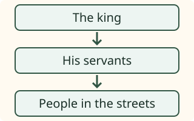

# Matthew 22 — Jesus teaches about loving God and loving others

**About this chapter**

Jesus tells a story about a wedding feast.

Then he answers questions about God’s law and life after death.

## The first guests refuse an invitation

## Matthew 22:1

Jesus taught the leaders with another story.

## Matthew 22:2

He said, “The kingdom of heaven is like this.

A king prepared a feast for his son’s wedding.

**Help with these words**

A feast is a special meal for many people.

Jesus compares God’s kingdom to a king inviting guests.

## Matthew 22:3

“The king sent servants to call the invited guests.

But the guests refused to come.

## Matthew 22:4

“The king sent more servants with this message.

‘Tell the guests I have prepared the meal.

My oxen and fat cattle have been killed for the feast.

Everything is ready.

Come to the wedding feast!’

**Pause and answer**

What did the king prepare for his son?

## The servants invite new guests

## Matthew 22:5

“The guests paid no attention.

One went to his field.

Another went back to his business.

## Matthew 22:6

“The others grabbed the servants.

They treated them cruelly and killed them.

## Matthew 22:7

“The king was furious.

He sent soldiers to kill those murderers and burn their city.

## Matthew 22:8

“Then the king told his servants, ‘The feast is ready.

The guests I invited were unworthy.

## Matthew 22:9

“‘Go to the places where the roads meet.

Invite everyone you can find.’

## Matthew 22:10

“The servants went out into the streets.

They brought back everyone they found, both bad and good.

Guests filled the wedding hall.

**About the picture**

Start at the king.

Follow the arrows to see who receives his invitation.

**Pause and answer**

Where did the king send the servants to find more guests?

## The king speaks to a guest

## Matthew 22:11

“The king came in to see the guests.

He saw a man who was not wearing wedding clothes.

## Matthew 22:12

“The king asked, ‘Friend, how did you get in without wedding clothes?’

The man had nothing to say.

## Matthew 22:13

“The king told his servants, ‘Tie his hands and feet.

Throw him outside into the dark.

There people will cry and grind their teeth.’

**Help with these words**

Grinding teeth here shows deep distress.

## Matthew 22:14

“Many receive the call, but few are chosen.”

**Pause and answer**

What did the king notice about the man’s clothes?

## A question about paying taxes

## Matthew 22:15

The Pharisees went away and made a plan.

They wanted to use Jesus’ own words against him.

## Matthew 22:16

They sent their followers and some supporters of Herod to Jesus.

These men said, “Teacher, we know you are honest.

You teach the truth about God’s way.

You do not try to please important people.

You do not judge people by how they look.

## Matthew 22:17

“Tell us what you think.

Does our law allow us to pay taxes to Caesar?”

**Help with a name**

Caesar was the title of the Roman emperor.

## Matthew 22:18

Jesus knew they wanted to trap him.

He said, “You only pretend to be sincere!

Why are you testing me?

**Pause and answer**

What were the Pharisees trying to do to Jesus?

## Jesus asks to see a coin

## Matthew 22:19

“Show me the coin you use for the tax.”

They brought Jesus a coin called a denarius.

## Matthew 22:20

Jesus asked, “Whose face is on this coin?

Whose name is written on it?”

## Matthew 22:21

They answered, “Caesar’s.”

Jesus said, “Give Caesar what belongs to Caesar.

Give God what belongs to God.”

## Matthew 22:22

The answer amazed them.

They left Jesus and went away.

**Pause and answer**

Whose face was on the coin?

## A question about seven brothers

## Matthew 22:23

That day some Sadducees came to question Jesus.

They believed the dead would never rise to life.

**Help with a word**

Resurrection means coming back to life from the dead.

## Matthew 22:24

They said, “Teacher, Moses gave us this law.

Suppose a man dies without children.

His brother must marry the widow.

Their children will carry on the dead man’s family.

## Matthew 22:25

“There were seven brothers among us.

The first brother married and died without children.

His brother then married the widow.

## Matthew 22:26

“The same thing happened to the second brother.

It happened to the third, and on down to the seventh.

## Matthew 22:27

“Last of all, the woman died.

## Matthew 22:28

“When the dead rise, whose wife will she be?

All seven brothers married her.”

**Pause and answer**

What did the Sadducees believe about people who had died?

## Jesus speaks about the living God

## Matthew 22:29

Jesus answered, “You are mistaken.

You do not know the Scriptures or God’s power.

## Matthew 22:30

“When the dead rise, people will no longer marry.

No one will give them in marriage.

In this way they will be like the angels in heaven.

## Matthew 22:31

“Think about the dead rising to life.

Have you read what God said to you?

## Matthew 22:32

“God said, ‘I am the God of Abraham.

I am the God of Isaac and the God of Jacob.’

He is the God of the living, not of the dead.”

## Matthew 22:33

The crowds heard Jesus and marvelled at his teaching.

**Pause and answer**

Whose names did God use when he spoke about himself?

## The two greatest commands

## Matthew 22:34

The Pharisees heard that Jesus had silenced the Sadducees.

So the Pharisees gathered together.

## Matthew 22:35

One Pharisee knew God’s law very well.

He asked Jesus a question to test him.

## Matthew 22:36

“Teacher, which command in God’s law is the greatest?”

## Matthew 22:37

Jesus answered, “‘Love the Lord your God with all your heart, with all your soul, and with all your mind.’

## Matthew 22:38

“This is the first and greatest command.

## Matthew 22:39

“The second command is like it.

‘Love your neighbour as you love yourself.’

## Matthew 22:40

“Everything in the Law and the Prophets depends on these two commands.”

**Help with these words**

The Law and the Prophets are writings that teach God’s ways.

**Pause and answer**

How does Jesus say to love your neighbour?

## Jesus asks about David’s words

## Matthew 22:41

The Pharisees were still together.

Now Jesus asked them a question.

## Matthew 22:42

“What do you think about the Christ?

Whose son is he?”

They answered, “David’s son.”

**Help with these names**

Christ means the King God promised to send.

“David’s son” means someone born into David’s family long after David lived.

## Matthew 22:43

Jesus asked, “Then why does David call him ‘my Lord’ when he speaks by God’s Spirit?

Listen to David’s words.

## Matthew 22:44

“‘The Lord said to my Lord, “Sit at my right hand until I put your enemies under your feet.”’

**Help with this picture**

A place at God’s right hand is a place of honour.

Enemies underfoot pictures victory over them.

## Matthew 22:45

“If David calls him ‘my Lord,’ how can he be David’s son?”

## Matthew 22:46

No one could give Jesus an answer.

From that day on, no one dared ask him more questions.

**Pause and answer**

What did David call the Christ?
