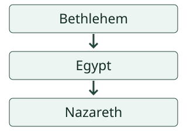

# Matthew 2 — Visitors look for Jesus

**About this chapter**

Wise men look for Jesus.

Later, Joseph takes Jesus and Mary to safety.

## Visitors ask about a king

## Matthew 2:1

Jesus was born in Bethlehem in Judea.

Herod was king then.

Wise men from the east came to Jerusalem.

## Matthew 2:2

They asked, “Where is the newborn King of the Jews?

We saw his star in the east.

We have come to worship him.”

**Help with these words**

Matthew calls these visitors Magi.

They studied the stars.

## Matthew 2:3

King Herod heard this news and felt troubled.

The people in Jerusalem felt troubled too.

**Pause and answer**

Who heard the news in Jerusalem?

## Herod asks where to look

## Matthew 2:4

Herod called the chief priests and teachers of God’s law together.

He asked where the Christ would be born.

## Matthew 2:5

They answered, “In Bethlehem in Judea.

The prophet wrote these words about Bethlehem.

## Matthew 2:6

‘Bethlehem, you are in the land of Judah.

You matter greatly among the rulers of Judah.

A ruler will come from you.

He will care for my people Israel like a shepherd.’”

**Help with this picture**

A shepherd looks after sheep.

God says the ruler will look after his people.

## Matthew 2:7

Then Herod met the wise men in secret.

He asked exactly when the star first appeared.

The wise men told him.

## Matthew 2:8

Herod sent them to Bethlehem.

He said, “Look carefully for the child.

When you find him, come and tell me.

Then I can go and worship him too.”

**Pause and answer**

Which town did Herod send the visitors to?

## The wise men find Jesus

## Matthew 2:9

The wise men listened to Herod and left.

The star they had seen went ahead of them.

It stopped over the place where the child was.

## Matthew 2:10

The wise men saw the star.

They were filled with joy.

## Matthew 2:11

They went inside the house.

They saw the child with Mary, his mother.

They bowed down and worshiped him.

They opened their treasures and gave him gifts.

They gave him gold, frankincense, and myrrh.

**Help with these words**

Frankincense and myrrh come from trees.

People valued them for their smell.

## Matthew 2:12

In a dream they received a warning.

They must stay away from Herod.

So they took another road home.

**Pause and answer**

How did the wise men get home?

## Joseph takes the family to Egypt

## Matthew 2:13

After the wise men left, Joseph had a dream.

An angel of the Lord told him, “Get up!

Take the child and his mother to Egypt.

Stay there until I tell you.

Herod will look for the child to kill him.”

## Matthew 2:14

Joseph got up that night.

He took the child and his mother to Egypt.

## Matthew 2:15

Joseph stayed in Egypt until Herod died.

The Lord’s words through the prophet came true.

The Lord had said, “I called my Son out of Egypt.”

**Pause and answer**

Where did Joseph take the family for safety?

## Families in Bethlehem grieve

## Matthew 2:16

Herod saw that the wise men had tricked him.

He became very angry.

He ordered men to kill the boys in and around Bethlehem.

They killed every boy aged two or younger.

Herod chose their ages using the time the wise men gave him.

## Matthew 2:17

Then the words of Jeremiah the prophet came true.

## Matthew 2:18

Jeremiah said, “People hear a voice in Ramah.

Someone is crying in deep sorrow.

Rachel is crying for her children.

Her children are dead.

She refuses to let anyone comfort her.”

**Help with this picture**

Rachel lived long before Jesus.

Her tears show the grief of families losing children.

**Pause and answer**

Why is Rachel crying?

## Joseph brings the family back

## Matthew 2:19

After Herod died, Joseph had a dream in Egypt.

An angel of the Lord came to him.

## Matthew 2:20

The angel said, “Get up!

Take the child and his mother to Israel.

The people who wanted to kill the child have died.”

## Matthew 2:21

So Joseph got up.

He took the child and his mother to Israel.

## Matthew 2:22

Herod’s son Archelaus now ruled Judea in his father’s place.

Joseph heard this and felt afraid to go there.

After a warning in a dream, Joseph went to Galilee.

## Matthew 2:23

Joseph made his home in a town called Nazareth.

The prophets’ words came true.

They had said, “People will call him a Nazarene.”

**Help with a word**

A Nazarene is someone from Nazareth.

**About the picture**

Follow the arrows from Bethlehem.

**Pause and answer**

In which town did Joseph make his home?
