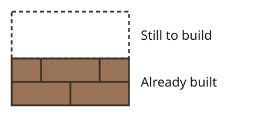

# Nehemiah 4 — The people keep building

**About this chapter**

Nehemiah tells how the people kept building Jerusalem’s wall. Their enemies wanted them to stop.

## Two men make fun of the builders

## Nehemiah 4:1

Sanballat heard we were rebuilding the wall.

He grew very angry and made fun of the Jews.

## Nehemiah 4:2

Sanballat spoke to his friends and the army of Samaria.

“What can these weak Jews do?

Can they repair the wall by themselves?

Will they offer gifts to God?

Will they finish in one day?

Can they bring those burned stones back to life?”

He meant the stones in the broken heaps looked useless.

## Nehemiah 4:3

Tobiah the Ammonite stood beside Sanballat.

Tobiah said, “Even a fox could knock their wall down just by climbing on it!”

## Nehemiah 4:4

I prayed, “God, hear us.

These men treat us as worthless.

Let others shame them as they have shamed us.

Let enemies carry them away as prisoners.

## Nehemiah 4:5

“Remember the wrong they have done.

Do not wipe away their sin.

They have insulted the builders.”

## Nehemiah 4:6

The people wanted to work.

So we joined all the sections of the wall.

The whole wall reached half its planned height.

**Pause and answer**

How high did the people build the wall?

## The workers face threats

## Nehemiah 4:7

Sanballat and Tobiah heard about our work.

So did the Arabs, Ammonites, and people of Ashdod.

They heard we were closing gaps in Jerusalem’s wall.

They grew very angry.

## Nehemiah 4:8

Together they made a secret plan.

They would fight against Jerusalem and disrupt our work.

## Nehemiah 4:9

So we prayed to our God.

We also set guards to watch day and night.

## Nehemiah 4:10

The people of Judah said, “The workers are losing strength.

Look at all these piles of broken stone!

We will never finish the wall.”

## Nehemiah 4:11

Our enemies said, “They will never see us coming.

We will kill them and stop the work.”

## Nehemiah 4:12

Jews who lived near our enemies warned us ten times.

They said, “Whichever way you turn, they will attack us.”

**Pause and answer**

What did the workers say about their strength?

## Nehemiah encourages the families

## Nehemiah 4:13

I gathered the men by families behind the wall.

They stood where the wall was low and exposed.

They had swords, spears, and bows.

## Nehemiah 4:14

I looked things over and stood up.

I told the leaders, officials, and everyone else, “Do not fear them.

Remember how great and powerful the Lord is.

Fight for your brothers, sons, daughters, wives, and homes.”

## Nehemiah 4:15

Our enemies heard that we knew their plan.

God had stopped it from working.

So we each went back to work on the wall.

**Pause and answer**

Who stopped the enemies’ plan from working?

## The builders listen for the horn

## Nehemiah 4:16

From then on, half my servants did the work.

The others held spears, shields, bows, and protective armor.

The officers stood behind the people of Judah

## Nehemiah 4:17

as they rebuilt the wall.

Workers carried supplies with one hand.

They held a weapon in the other.

## Nehemiah 4:18

Each builder wore a sword at his side.

The man who blew the horn stayed beside me.

## Nehemiah 4:19

I spoke to the leaders, officials, and everyone else.

I said, “We have a big job.

We work far apart along this wall.

## Nehemiah 4:20

“When you hear the horn, come to us there.

Our God will fight for us!”

## Nehemiah 4:21

So we kept working.

Half the men held spears from first light until the stars appeared.

## Nehemiah 4:22

I also said, “Each man and his servant should stay inside Jerusalem overnight.

Then they can stand guard at night and work during the day.”

## Nehemiah 4:23

My brothers, my servants, my guards, and I kept our clothes on.

Each of us carried his weapon, even to get water.

**Pause and answer**

What sound told the workers to come together?
