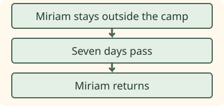

# Numbers 12 — Miriam and Aaron speak against Moses

**About this chapter**

Miriam and Aaron question why Moses speaks for the LORD. The LORD calls them to the tent. Later Moses asks God to heal Miriam.

## The LORD hears Miriam and Aaron

## Numbers 12:1

Moses had married a woman from Cush.

Miriam and Aaron spoke against Moses because he had married her.

## Numbers 12:2

They asked, “Does the LORD speak only through Moses?

Doesn’t he speak through us too?” The LORD heard them.

## Numbers 12:3

Moses was very humble.

He was more humble than anyone else on earth.

**Reading help**

A humble person does not try to seem more important than others.

**Pause and answer**

Who heard Miriam and Aaron speak against Moses?

## The LORD calls all three to the tent

## Numbers 12:4

Suddenly the LORD called Moses, Aaron and Miriam.

He said, “All three of you, come to the Tent of Meeting.” All three went out.

## Numbers 12:5

The LORD came down in a tall column of cloud.

He stood at the tent entrance.

He called Aaron and Miriam, and both stepped forward.

## Numbers 12:6

The LORD said, “Listen to me.

When there is a prophet among you, I show myself to that prophet in a vision.

I speak to the prophet in a dream.”

**Reading help**

A prophet speaks a message from God. A vision is something God shows someone.

**Pause and answer**

Who stepped forward at the tent entrance?

## The LORD speaks plainly to Moses

## Numbers 12:7

The LORD spoke differently with Moses.

He said, “My servant Moses is faithful in all my house.”

## Numbers 12:8

The LORD said, “I speak with Moses face to face.

I speak plainly, without riddles.

Moses sees the form of the LORD.

Why were you unafraid to speak against my servant Moses?”

**Reading help**

“Faithful in all my house” means God could trust Moses with the work of caring for his people. “Face to face” means the LORD spoke directly to Moses.

## Numbers 12:9

The LORD was very angry with Aaron and Miriam.

Then he left.

**Pause and answer**

How did the LORD speak with Moses?

## Moses prays for Miriam

## Numbers 12:10

The cloud lifted from the tent.

Suddenly Miriam had a skin disease.

Her skin looked as white as snow.

Aaron turned and saw what had happened to her.

## Numbers 12:11

Aaron said to Moses, “My lord, we have sinned.

We acted foolishly.

Please do not hold this sin against us.”

## Numbers 12:12

Aaron begged, “Please do not let Miriam be like a baby born dead, with half its flesh already gone.”

## Numbers 12:13

Moses cried out to the LORD, “God, please heal Miriam!”

**Pause and answer**

What did Moses ask God to do?

## The camp waits seven days

## Numbers 12:14

The LORD answered Moses, “Suppose her father had spit in her face.

She would feel shame for seven days.

Miriam must stay outside the camp for seven days.

Then the people may bring her back.”

## Numbers 12:15

Miriam stayed outside the camp for seven days.

The people waited there until they brought Miriam back.

The whole camp waited for Miriam.

**Reading help**

| Where was Miriam? | What did the people do? |
| --- | --- |
| Outside the camp for seven days | They waited. |
| Back in the camp | They could travel again. |

## Numbers 12:16

Then the people left Hazeroth.

They camped in the wilderness of Paran.

**Pause and answer**

When did the people leave Hazeroth?
