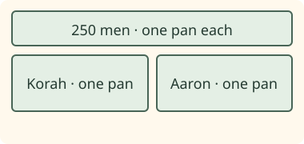

# Numbers 16 — Korah challenges Moses and Aaron

**About this chapter**

Korah and other leaders challenge Moses and Aaron. The LORD shows who may serve as priests. Later Aaron goes among the people when a plague strikes.

## The leaders challenge Moses and Aaron

## Numbers 16:1

Korah was the son of Izhar and grandson of Kohath.

Kohath was Levi’s son.

Three men from Reuben’s tribe joined Korah.

Dathan and Abiram were Eliab’s sons.

On was the son of Peleth.

## Numbers 16:2

They rose up against Moses.

Another 250 men joined them.

These well-known leaders spoke for the people at their gatherings.

## Numbers 16:3

They confronted Moses and Aaron.

They said, “You have taken too much power!

All the people are holy.

The LORD is here with us.

Why put yourselves above the LORD’s people?”

## Numbers 16:4

When Moses heard this, he fell face down.

## Numbers 16:5

Moses told Korah and his followers, “Tomorrow morning the LORD will show who belongs to him.

He will show who is holy.

He will bring the person he chooses near to him.”

**Pause and answer**

Who would show which person was holy?

## Moses answers Korah

## Numbers 16:6

Moses told Korah and his followers to take their incense pans.

**Reading help**

An incense pan held hot coals. Incense gave off sweet-smelling smoke on the coals.

## Numbers 16:7

The next day they were to put fire and incense in the pans before the LORD.

The LORD would show which man he had set apart.

Moses said, “You Levites have taken too much on yourselves!”

## Numbers 16:8

Moses spoke to Korah again.

“Listen, you men of Levi!”

## Numbers 16:9

Moses reminded them that Israel’s God had set them apart.

He had brought them near to work at his holy tent.

They had a place to serve all the people.

Moses asked whether that was enough for them.

## Numbers 16:10

God had brought Korah and the other Levites near.

Now they wanted the work of the priests too.

## Numbers 16:11

Moses said, “You and your followers have turned against the LORD.

Why complain about Aaron?”

**Pause and answer**

What work did Korah want besides serving at the tent?

## Dathan and Abiram refuse to come

## Numbers 16:12

Moses sent for Dathan and Abiram, the sons of Eliab.

They answered, “We will not come.”

## Numbers 16:13

They accused Moses of bringing them out of a land flowing with milk and honey to die in the wilderness.

They asked, “Must you make yourself our ruler too?”

**Reading help**

Dathan and Abiram used “milk and honey” to describe Egypt, the land they had left. They spoke as though Egypt had given them plenty.

## Numbers 16:14

They said, “Where is the land flowing with milk and honey?

You have given us no fields or vineyards of our own.

Will you tear out these men’s eyes?

We will not come!”

## Numbers 16:15

Moses grew very angry.

He asked the LORD to refuse their offering.

Moses said, “I have never taken a donkey from them.

I have never harmed one of them.”

**Pause and answer**

Which two men refused to come to Moses?

## The men bring their pans

## Numbers 16:16

Moses told Korah, “Tomorrow you and your followers must come before the LORD.

Aaron must come too.”

## Numbers 16:17

The 250 men must each bring a pan of incense before the LORD.

Korah and Aaron must each bring a pan too.

Each person brings his own pan of incense.

## Numbers 16:18

Each man put fire and incense in his pan.

They stood with Moses and Aaron at the entrance to the Tent of Meeting.

## Numbers 16:19

Korah gathered the people there against Moses and Aaron.

Then the LORD’s glory appeared to everyone.

**Pause and answer**

Where did the men bring their incense pans?

## Moses and Aaron plead for the people

## Numbers 16:20

The LORD spoke to Moses and Aaron.

## Numbers 16:21

He said, “Move away from these people.

I can destroy them in a moment.”

## Numbers 16:22

Moses and Aaron fell face down.

They cried, “God, you give life to every living being.

Will you be angry with everyone when one man sins?”

## Numbers 16:23

Then the LORD spoke to Moses.

## Numbers 16:24

Moses must tell everyone to move away from the tents of Korah, Dathan and Abiram.

**Pause and answer**

What did the LORD tell the people to move away from?

## The people move away

## Numbers 16:25

Moses got up and went to Dathan and Abiram.

Israel’s elders followed him.

## Numbers 16:26

Moses warned the people to leave the wicked men’s tents.

They must touch nothing that belonged to those men.

Otherwise they too would die because of the men’s sins.

## Numbers 16:27

The people moved away from the three men’s tents.

Dathan and Abiram stood outside their tent entrances with their wives, children and babies.

## Numbers 16:28

Moses told the people how they could know the LORD had sent him.

He had not done these things on his own.

## Numbers 16:29

Moses said, “If these men die an ordinary death, the LORD has not sent me.”

## Numbers 16:30

But the LORD might do something that had never happened before.

The ground might open and swallow the men and all they owned.

They would go down alive into Sheol, the place of the dead.

Then everyone would know the men had shown scorn for the LORD.

**Pause and answer**

What would an ordinary death mean in Moses’ words?

## The ground opens

## Numbers 16:31

As soon as Moses finished speaking, the ground split beneath the men.

## Numbers 16:32

The earth opened and swallowed them and their households.

It swallowed Korah’s men and everything they owned.

## Numbers 16:33

They went down alive into the place of the dead with all they owned.

The earth closed over them.

The people could no longer see them.

## Numbers 16:34

The Israelites nearby heard their cries and ran.

They said, “The earth might swallow us too!”

## Numbers 16:35

Fire came from the LORD.

It burned up the 250 men offering incense.

**Pause and answer**

Why did the Israelites nearby run?

## The bronze becomes a sign

## Numbers 16:36

Then the LORD spoke to Moses.

## Numbers 16:37

Moses must tell Eleazar, son of Aaron the priest, to collect the incense pans from the fire.

Eleazar must scatter the coals far away.

The pans were holy.

## Numbers 16:38

The men had lost their lives because of their sin.

They had presented the pans to the LORD, so the pans were holy.

The metal must be hammered into sheets to cover the altar.

This would be a sign for Israel.

## Numbers 16:39

Eleazar the priest took the bronze pans from the men who had died in the fire.

He had workers hammer the bronze into sheets for the altar.

## Numbers 16:40

Eleazar did what the LORD had commanded through Moses.

The bronze reminded Israel that only Aaron’s descendants could offer incense before the LORD.

Anyone else who came to do this risked the fate of Korah and his followers.

**Reading help**

| First | Then |
| --- | --- |
| The men presented bronze pans to the LORD. | The pans became holy. |
| Workers hammered the pans flat. | The bronze covered the altar as a reminder. |

**Pause and answer**

What did the bronze remind Israel about?

## The people blame Moses and Aaron

## Numbers 16:41

The next day everyone complained to Moses and Aaron.

They said, “You have killed the LORD’s people!”

## Numbers 16:42

The people gathered against them.

Moses and Aaron turned toward the Tent of Meeting.

Suddenly the cloud covered the tent.

The LORD’s glory appeared.

## Numbers 16:43

Moses and Aaron went to the front of the tent.

## Numbers 16:44

The LORD spoke to Moses.

## Numbers 16:45

He said, “Move away from these people.

I can destroy them in a moment.” Moses and Aaron fell face down.

**Pause and answer**

What covered the Tent of Meeting?

## Aaron runs to the people

## Numbers 16:46

Moses told Aaron to take his incense pan.

He must put fire from the altar into it and add incense.

Moses said, “Hurry to the people.

Make atonement for them.

The LORD is angry.

The plague has begun.”

**Reading help**

Here, making atonement means approaching God on behalf of people who have sinned. A plague is a disaster that strikes many people.

## Numbers 16:47

Aaron took the pan as Moses told him.

He ran into the crowd and saw the plague had begun.

Aaron offered incense and made atonement for the people.

## Numbers 16:48

Aaron stood between the people who had died and those still alive.

The plague stopped.

## Numbers 16:49

The plague killed 14,700 people.

This count was in addition to those who died because of Korah.

## Numbers 16:50

Once the plague stopped, Aaron went back to Moses at the entrance to the Tent of Meeting.

**Pause and answer**

Where did Aaron stand when the plague stopped?
