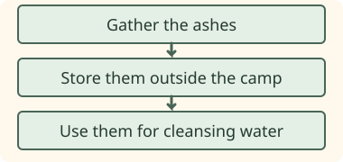

# Numbers 19 — Water for cleansing after a death

**About this chapter**

The LORD gives Israel a way to become clean for worship after contact with the dead. The chapter explains where the ashes came from and when the people used the water.

## A red heifer outside the camp

## Numbers 19:1

The LORD spoke to Moses and Aaron.

## Numbers 19:2

He gave them a rule for Israel.

The people must bring a red heifer, a young female cow.

It must have no defects.

It must never have worn a yoke.

**Reading help**

A yoke is a wooden bar an animal wears to pull a load.

## Numbers 19:3

They must give the heifer to Eleazar the priest.

Eleazar was to have someone lead it outside the camp.

There someone would kill it while Eleazar watched.

## Numbers 19:4

Eleazar was to put some blood on his finger.

He would sprinkle it seven times toward the entrance of the Tent of Meeting.

## Numbers 19:5

Someone would burn the whole heifer while Eleazar watched.

This included its hide, flesh, blood and dung.

## Numbers 19:6

Eleazar would throw cedar wood, hyssop and bright red wool onto the burning heifer.

**Reading help**

Hyssop is a plant with small branches.

**Pause and answer**

Which way did Eleazar sprinkle the blood?

## Keeping the ashes

## Numbers 19:7

The priest must wash his clothes and bathe in water.

Then he could come back into camp.

He would stay unclean until evening.

**Reading help**

In this chapter, “clean” and “unclean” describe a person or thing under Israel’s rules for worship.

## Numbers 19:8

The man who burned the heifer must also wash his clothes and bathe.

He too would stay unclean until evening.

## Numbers 19:9

A man who was clean must gather the ashes.

He would keep them in a clean place outside camp.

The people would use them to prepare water for cleansing from sin.

The people kept the ashes for water used in ceremonial cleansing.

## Numbers 19:10

The man who gathered the ashes must wash his clothes.

He would stay unclean until evening.

This rule would always apply to Israelites and foreigners living among them.

**Pause and answer**

Where did the man keep the ashes?

## After touching a dead body

## Numbers 19:11

Anyone who touched a dead person would be unclean for seven days.

## Numbers 19:12

That person needed the water for cleansing on day three and day seven.

Then the person would be clean.

Missing either day meant the person remained unclean.

## Numbers 19:13

Suppose someone touched a dead body and did not receive the cleansing water.

That person made the LORD’s holy tent unclean.

They would be cut off from Israel.

They remained unclean because no one had sprinkled the water on them.

**Reading help**

To be cut off meant losing one’s place in the community of Israel.

**Pause and answer**

On which two days did a person need the cleansing water?

## In a tent or a field

## Numbers 19:14

When someone died inside a tent, everyone there became unclean for seven days.

The same rule applied to anyone who entered the tent.

## Numbers 19:15

Any open container without a lid fastened on it also became unclean.

## Numbers 19:16

Someone out in a field might touch a dead person.

The person might have died in battle or from natural causes.

Touching that body, a human bone or a grave made someone unclean for seven days.

**Pause and answer**

What happened to an open jar in the tent?

## The third and seventh days

## Numbers 19:17

To prepare the water, someone put ashes from the burnt sin offering in a jar.

Then they poured fresh water over the ashes.

## Numbers 19:18

A man who was clean dipped a sprig of hyssop in the water.

He sprinkled the tent, its furnishings and everyone who had been there.

He also sprinkled anyone who had touched a bone, a grave or a dead person, however the person had died.

## Numbers 19:19

The clean man sprinkled the unclean person on day three and day seven.

After the sprinkling on day seven, the person being cleansed washed their clothes and bathed.

That evening they were clean.

**Follow the days**

| When | What happened to the person being cleansed? |
| --- | --- |
| Day three | A clean man sprinkled water on the person. |
| Day seven | He sprinkled the person again. The person washed their clothes and bathed. |
| That evening | The person was clean. |

**Pause and answer**

When did the person become clean after washing on day seven?

## Rules for those who touch the water

## Numbers 19:20

Anyone who stayed unclean by refusing cleansing made the LORD’s holy place unclean.

That person would be cut off from the community.

Without the sprinkling of water, the person remained unclean.

## Numbers 19:21

The people must always follow this rule.

The person who sprinkled the water must wash their clothes.

Anyone who touched the water would stay unclean until evening.

## Numbers 19:22

Anything an unclean person touched became unclean.

Anyone who then touched that thing stayed unclean until evening.

**Pause and answer**

What did the person who sprinkled the water have to wash?
