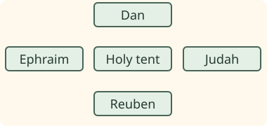

# Numbers 1 — Moses and Aaron count Israel’s men

**About this chapter**

Moses and Aaron count men from Israel’s tribes. Twelve leaders help them. The Levites have a different job in the camp.

## Who should Moses count?

## Numbers 1:1

Israel had left Egypt.

It was now the second year, on day one of month two.

In the Sinai wilderness, the LORD spoke to Moses in the Tent of Meeting.

## Numbers 1:2

The LORD told Moses to count the people of Israel.

He must list the men by clan and family.

He must write down each man's name.

## Numbers 1:3

Moses and Aaron must count the men by groups.

They must count men aged twenty or older who could serve in Israel’s army.

## Numbers 1:4

One family leader from each tribe must help them.

**Reading help**

This count is called a census. A tribe is a large family group. Each tribe has clans. Each clan includes families.

**Pause and answer**

How old must a man be for this count?

## Leaders from Reuben to Zebulun

## Numbers 1:5

Elizur was the son of Shedeur.

He would help count the tribe of Reuben.

## Numbers 1:6

Shelumiel was the son of Zurishaddai.

He would help count the tribe of Simeon.

## Numbers 1:7

Nahshon was the son of Amminadab.

He would help count the tribe of Judah.

## Numbers 1:8

Nethanel was the son of Zuar.

He would help count the tribe of Issachar.

## Numbers 1:9

Eliab was the son of Helon.

He would help count the tribe of Zebulun.

**Pause and answer**

Which tribe did Eliab represent?

## Leaders from Joseph’s family and the other tribes

## Numbers 1:10

Two leaders came from the families of Joseph’s sons.

Elishama son of Ammihud represented Ephraim.

Gamaliel son of Pedahzur represented Manasseh.

## Numbers 1:11

Abidan was the son of Gideoni.

He would help count the tribe of Benjamin.

## Numbers 1:12

Ahiezer was the son of Ammishaddai.

He would help count the tribe of Dan.

## Numbers 1:13

Pagiel was the son of Ocran.

He would help count the tribe of Asher.

## Numbers 1:14

Eliasaph was the son of Deuel.

He would help count the tribe of Gad.

## Numbers 1:15

Ahira was the son of Enan.

He would help count the tribe of Naphtali.

## Numbers 1:16

These men were leaders chosen from the people.

They led the tribes of their ancestors.

They headed the clans of Israel.

**Pause and answer**

Which two tribes came from Joseph’s sons?

## The people gather

## Numbers 1:17

Moses and Aaron brought together the leaders the LORD had named.

## Numbers 1:18

On day one of month two, they gathered everyone together.

They recorded which clan and family each man came from.

They listed the men aged twenty or older by name.

## Numbers 1:19

Moses counted the men in the Sinai wilderness.

He did as the LORD had commanded.

**Pause and answer**

Where did Moses count the men?

## Reuben, Simeon and Gad

## Numbers 1:20

Reuben was Israel’s firstborn son.

The leaders used the clan and family records for Reuben.

They counted each man aged twenty or older who could serve in the army.

## Numbers 1:21

They counted 46,500 men from Reuben.

## Numbers 1:22

The leaders used the clan and family records for Simeon.

They counted each man aged twenty or older who could serve in the army.

## Numbers 1:23

They counted 59,300 men from Simeon.

## Numbers 1:24

The leaders used the clan and family records for Gad.

They counted each man aged twenty or older who could serve in the army.

## Numbers 1:25

They counted 45,650 men from Gad.

**Pause and answer**

How many men did the leaders count from Gad?

## Judah, Issachar and Zebulun

## Numbers 1:26

The leaders used the clan and family records for Judah.

They counted each man aged twenty or older who could serve in the army.

## Numbers 1:27

They counted 74,600 men from Judah.

## Numbers 1:28

The leaders used the clan and family records for Issachar.

They counted each man aged twenty or older who could serve in the army.

## Numbers 1:29

They counted 54,400 men from Issachar.

## Numbers 1:30

The leaders used the clan and family records for Zebulun.

They counted each man aged twenty or older who could serve in the army.

## Numbers 1:31

They counted 57,400 men from Zebulun.

**Pause and answer**

Which of these three tribes had the most men in the count?

## Ephraim, Manasseh and Benjamin

## Numbers 1:32

Ephraim was one of Joseph’s sons.

The leaders used the clan and family records for Ephraim.

They counted each man aged twenty or older who could serve in the army.

## Numbers 1:33

They counted 40,500 men from Ephraim.

## Numbers 1:34

Manasseh was Joseph’s other son.

The leaders used the clan and family records for Manasseh.

They counted each man aged twenty or older who could serve in the army.

## Numbers 1:35

They counted 32,200 men from Manasseh.

## Numbers 1:36

The leaders used the clan and family records for Benjamin.

They counted each man aged twenty or older who could serve in the army.

## Numbers 1:37

They counted 35,400 men from Benjamin.

**Pause and answer**

Which son of Joseph is named in verse 34?

## Dan, Asher and Naphtali

## Numbers 1:38

The leaders used the clan and family records for Dan.

They counted each man aged twenty or older who could serve in the army.

## Numbers 1:39

They counted 62,700 men from Dan.

## Numbers 1:40

The leaders used the clan and family records for Asher.

They counted each man aged twenty or older who could serve in the army.

## Numbers 1:41

They counted 41,500 men from Asher.

## Numbers 1:42

The leaders used the clan and family records for Naphtali.

They counted each man aged twenty or older who could serve in the army.

## Numbers 1:43

They counted 53,400 men from Naphtali.

**Pause and answer**

How many men did the leaders count from Asher?

## The total count

## Numbers 1:44

Moses and Aaron counted these men.

Twelve leaders helped them.

Each leader spoke for his own family group.

## Numbers 1:45

They counted the Israelite men by family.

Each man was at least twenty years old.

Each could serve in Israel’s army.

## Numbers 1:46

In all, they counted 603,550 men.

## Numbers 1:47

They kept the tribe of Levi out of this count.

**Pause and answer**

Which tribe stayed outside this count?

## The Levites care for the holy tent

## Numbers 1:48

The LORD had given Moses this instruction.

## Numbers 1:49

Moses must leave the Levites out when counting the other tribes.

## Numbers 1:50

The Levites must look after the holy tent that held the record of God’s covenant.

They must carry the tent and everything inside it.

They must care for it and camp around it.

## Numbers 1:51

When camp moved, the Levites took the holy tent down.

At the next camp, the Levites set it up.

Under this law, anyone outside their group who approached for this work faced death.

## Numbers 1:52

The other Israelites camped with their own groups.

Each group camped under its own banner.

Each group had a banner to show where its people belonged.

**Picture the camp**

| Place | Who stayed there? |
| --- | --- |
| Around the holy tent | The Levites guarded the tent. |
| In camps marked by banners | The other Israelites stayed with their groups. |

A banner was a sign that marked a group’s camp.

## Numbers 1:53

The Levites camped around the holy tent and guarded it.

In this way they kept God’s anger from falling on Israel.

Caring for the holy tent was their work.

## Numbers 1:54

The Israelites did everything the LORD had told Moses to do.

**Pause and answer**

Who took the holy tent down when the camp moved?
