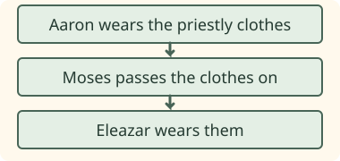

# Numbers 20 — Water from the rock and Aaron’s death

**About this chapter**

At Kadesh the people have no water. Later Israel asks to cross Edom. At Mount Hor, Aaron’s son takes on his father’s work.

## At Kadesh the people need water

## Numbers 20:1

In the first month, all Israel entered the wilderness of Zin.

The people stayed at Kadesh.

Miriam died there, and the people buried her.

## Numbers 20:2

There was no water for the people.

They gathered against Moses and Aaron.

## Numbers 20:3

They argued with Moses.

They said, “If only we had died when our brothers died before the LORD!”

## Numbers 20:4

They asked, “Why did you bring the LORD’s people into this wilderness?

Must we and our animals die here?”

## Numbers 20:5

They said, “Why did you bring us out of Egypt to this terrible place?

There is no grain here.

There are no figs, grapevines or pomegranates.

There is no water to drink!”

**Pause and answer**

What did the people and their animals need?

## The LORD speaks to Moses

## Numbers 20:6

Moses and Aaron left the people.

They went to the entrance of the Tent of Meeting.

They fell face down, and the LORD’s glory appeared to them.

## Numbers 20:7

The LORD spoke to Moses.

## Numbers 20:8

He said, “Take the staff and gather the people.

You and Aaron must speak to the rock while they watch.

Water will pour out of it.

Then the people and their animals can drink.”

**Reading help**

A staff is a long stick a person can hold.

## Numbers 20:9

Moses took the staff from the LORD’s presence, as the LORD had told him.

**Pause and answer**

What did the LORD tell the brothers to do in front of the people?

## Water pours from the rock

## Numbers 20:10

Moses and Aaron gathered the people in front of the rock.

Moses said, “Listen, you rebels!

Must we bring water out of this rock for you?”

## Numbers 20:11

Moses raised his hand.

He struck the rock twice with his staff.

Water poured out in a great stream.

The people and their animals drank.

## Numbers 20:12

The LORD told Moses and Aaron, “You did not trust me to show the Israelites that I am holy.

So you will not lead these people into the land I have given them.”

## Numbers 20:13

These waters were called Meribah.

There the Israelites argued with the LORD.

There the LORD showed the people that he was holy.

**Reading help**

| At the rock | What happened |
| --- | --- |
| The LORD’s command | Moses and Aaron were to speak to the rock. |
| Moses’ action | Moses struck the rock twice. |
| The result | Water poured out for the people and their animals. |

**Pause and answer**

What reason did the LORD give for his decision about Moses and Aaron?

## Israel asks to use Edom’s road

## Numbers 20:14

From Kadesh, Moses sent messengers to the king of Edom.

They spoke for Israel.

“We are your brothers,” they said.

“You know how much trouble we have faced.”

## Numbers 20:15

Israel’s message continued.

“Our ancestors went down to Egypt.

We lived there for many years.

The Egyptians treated our ancestors and us badly.”

## Numbers 20:16

The messengers said, “We cried out to the LORD.

He heard us and sent an angel.

He brought us out of Egypt.

Now we are at Kadesh, a city on your border.”

## Numbers 20:17

They asked, “Please let us pass through your land.

We will stay out of your fields and vineyards.

We will leave your wells alone.

We will stay on the King’s Highway until we leave your land.”

**Pause and answer**

Which road did Israel ask to use?

## Edom refuses

## Numbers 20:18

Edom refused.

“If you cross our land, we will come against you with swords.”

## Numbers 20:19

The Israelites answered, “We will stay on the main road.

If we or our animals drink your water, we will pay.

All we ask is to walk through.”

## Numbers 20:20

Edom refused again.

A large, strong army came out to face the Israelites.

## Numbers 20:21

Edom would not let Israel pass.

So the Israelites turned away.

**Pause and answer**

What did Israel do after Edom refused?

## Three men climb Mount Hor

## Numbers 20:22

All Israel left Kadesh and came to Mount Hor.

## Numbers 20:23

Mount Hor was near Edom’s border.

There the LORD spoke to Moses and Aaron.

## Numbers 20:24

The LORD said Aaron would die and join his people.

He would never enter the land God had given Israel.

At the waters of Meribah, both brothers had disobeyed the LORD’s command.

**Reading help**

To join his people means Aaron would die, as his ancestors had died.

## Numbers 20:25

The LORD told Moses to take Aaron and Aaron’s son Eleazar up Mount Hor.

## Numbers 20:26

Moses was to take off Aaron’s priestly clothes.

He was to put them on Eleazar.

There Aaron would die and join his people.

## Numbers 20:27

Moses obeyed the LORD.

Everyone watched as the three men climbed Mount Hor.

**Pause and answer**

Who climbed the mountain with Moses and Aaron?

## Eleazar wears Aaron’s priestly clothes

## Numbers 20:28

Moses took off Aaron’s priestly clothes and put them on Eleazar.

Aaron died there on the mountaintop.

Moses and Eleazar came down together.

The clothes show that Eleazar will now serve as priest in his father’s place.

**Reading help**

The clothes showed the people who would now serve as high priest.

## Numbers 20:29

The people saw that Aaron had died.

All Israel mourned him for thirty days.

**Pause and answer**

How long did Israel mourn Aaron?
