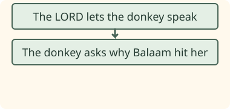

# Numbers 22 — Balak sends for Balaam

**About this chapter**

Balak is the king of Moab. He wants Balaam to curse Israel. On the way to meet the king, Balaam’s donkey sees someone Balaam cannot see.

## Moab fears Israel

## Numbers 22:1

The Israelites camped on the plains of Moab.

They were near the Jordan River, across from Jericho.

## Numbers 22:2

Balak son of Zippor saw what Israel had done to the Amorites.

## Numbers 22:3

The people of Moab saw how many Israelites there were.

They were terribly afraid.

## Numbers 22:4

They told the leaders of Midian, “An ox eats up the grass in a field.

That crowd will eat up everything around us!” Balak son of Zippor was king of Moab.

**Reading help**

The people of Moab picture Israel as a grazing ox. They fear Israel will leave them nothing to live on.

**Pause and answer**

Why were the people of Moab afraid?

## Balak asks for a curse

## Numbers 22:5

King Balak sent messengers to fetch Balaam son of Beor.

Balaam lived at Pethor by the Euphrates River in his homeland.

Balak’s message said, “People have come from Egypt.

They cover the land.

They have settled beside me.”

## Numbers 22:6

Balak asked, “Please come and curse these people.

They are too strong for me.

Then perhaps I can defeat them and drive them away.

I know your blessings and curses come true.”

## Numbers 22:7

The leaders of Moab and Midian took payment for Balaam to seek an answer through divination.

They went to Balaam and gave him Balak’s message.

**Reading help**

Here, to curse people means to call for harm to come to them. Divination means trying to discover hidden things through signs or spiritual powers.

## Numbers 22:8

Balaam said, “Stay here tonight.

I will tell you how the LORD answers me.” The leaders from Moab stayed.

**Pause and answer**

Whose answer did Balaam wait for?

## God answers Balaam

## Numbers 22:9

God came to Balaam and asked, “Who are these men staying with you?”

## Numbers 22:10

Balaam told God, “Balak son of Zippor, the king of Moab, sent me a message.”

## Numbers 22:11

Balaam repeated the message.

People from Egypt covered the land.

Balak wanted Balaam to curse them.

Then Balak hoped he could fight them and drive them away.

## Numbers 22:12

God told Balaam, “Do not go with these men.

Do not curse these people.

They already have my blessing.”

## Numbers 22:13

The next morning Balaam told Balak’s leaders to go home.

He said, “The LORD will not let me go with you.”

## Numbers 22:14

The leaders went back to Balak.

They said, “Balaam refused to come with us.”

**Pause and answer**

Why did Balaam send the first group home?

## More leaders come to Balaam

## Numbers 22:15

Balak sent more leaders.

These men held higher positions than the first group.

## Numbers 22:16

They gave Balaam another message from Balak son of Zippor.

“Please let nothing stop you from coming to me.”

## Numbers 22:17

Balak promised Balaam great honor and whatever he asked for.

Again Balak begged him to come and curse the people.

## Numbers 22:18

Balaam told the messengers, “Balak could give me his house full of silver and gold.

Even then I could only do what the LORD my God commands.

That holds for both small and great things.”

## Numbers 22:19

Balaam asked them to stay overnight like the first group.

He wanted to hear what else the LORD would say.

## Numbers 22:20

That night God came to Balaam.

God said, “These men have come for you.

Get up and go with them.

Do only what I tell you.”

**Pause and answer**

What condition did God give Balaam before he left?

## The donkey sees the angel

## Numbers 22:21

In the morning Balaam saddled his donkey.

He rode off with the leaders of Moab.

## Numbers 22:22

God was angry that Balaam was going.

The angel of the LORD stood in the road to oppose him.

Balaam rode his donkey with two servants beside him.

## Numbers 22:23

The donkey saw the angel holding a drawn sword.

She left the road and went into a field.

Balaam beat her to get her back on the road.

## Numbers 22:24

Next the angel stood on a narrow path between two vineyards.

A wall ran along each side.

## Numbers 22:25

The donkey saw the angel and pressed against a wall.

Balaam’s foot was squeezed against the wall.

Balaam beat her again.

## Numbers 22:26

The angel went ahead and stood at a narrower spot.

There was no room to turn either way.

## Numbers 22:27

The donkey saw the angel and lay down under Balaam.

Furious, Balaam beat her with his walking stick.

**Reading help**

| Where was the angel? | What did the donkey do? |
| --- | --- |
| On the open road | She turned into a field. |
| Between two walls | She pressed against a wall. |
| Where she could not turn | She lay down. |

**Pause and answer**

What did the donkey do when there was no room to turn?

## The donkey speaks

## Numbers 22:28

Then the LORD let the donkey speak.

She asked Balaam, “What have I done to you?

Why have you beaten me three times?”

Here the donkey speaks and Balaam listens.

## Numbers 22:29

Balaam answered, “You have made me look foolish!

If I had a sword, I would kill you now!”

## Numbers 22:30

The donkey asked, “Haven’t you ridden me all your life?

Have I ever acted like this before?” Balaam answered, “No.”

**Pause and answer**

How did Balaam answer the donkey’s last question?

## Balaam sees the angel

## Numbers 22:31

Then the LORD let Balaam see the angel too.

The angel stood in the road holding a drawn sword.

Balaam bowed down with his face to the ground.

## Numbers 22:32

The angel asked, “Why did you beat your donkey three times?

I came to oppose you.

The way you are going is wrong.”

## Numbers 22:33

The angel said, “Your donkey saw me.

Three times she turned away.

Otherwise I would have killed you and let her live.”

## Numbers 22:34

Balaam told the angel, “I have sinned.

I did not know you stood in my way.

If you disapprove of this journey, I will go home.”

## Numbers 22:35

The angel told Balaam to go with the men.

He must say only what the angel told him.

So Balaam went with Balak’s leaders.

**Pause and answer**

What did the angel say the donkey had done for Balaam?

## Balak meets Balaam

## Numbers 22:36

Balak heard Balaam was coming and went to meet him.

They met at a Moabite city on the Arnon border.

It stood at the edge of Balak’s land.

## Numbers 22:37

Balak asked, “Didn’t I send for you urgently?

Why didn’t you come?

Do you think I cannot reward you well?”

## Numbers 22:38

Balaam answered, “I am here now.

Can I say whatever I want?

I can say only what God tells me.”

## Numbers 22:39

Balaam went with Balak to Kiriath-huzoth.

## Numbers 22:40

Balak offered cattle and sheep as sacrifices.

He gave shares to Balaam and the leaders with him.

## Numbers 22:41

The next morning Balak took Balaam up to Bamoth-baal.

From there Balaam could see the edge of Israel’s camp.

**Pause and answer**

What could Balaam see from Bamoth-baal?
