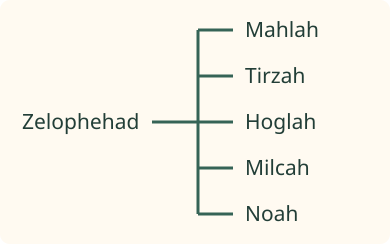

# Numbers 27 — Five sisters ask for land and Joshua becomes a leader

**About this chapter**

Five sisters ask to keep their father’s name and land in the family. Later Moses asks who will lead Israel after he dies.

## Five sisters speak up

## Numbers 27:1

Zelophehad had five daughters.

Their names were Mahlah, Noah, Hoglah, Milcah and Tirzah.

Their family came from Manasseh, Joseph’s son.

Manasseh was Machir’s father.

Machir was Gilead’s father.

Gilead was Hepher’s father, and Hepher was Zelophehad’s father.

The five sisters came forward.

Follow any line from the father to one of the five sisters.

## Numbers 27:2

They stood at the entrance to the Tent of Meeting.

Moses, Eleazar the priest, the leaders and all the people listened.

## Numbers 27:3

The sisters said, “Our father died in the wilderness.

He never joined Korah’s followers when they turned against the LORD.

He died because of his own sin.

He had no sons.

## Numbers 27:4

Why should our father’s name disappear from his clan because he had no sons?

Give us land among our father’s brothers.”

**Pause and answer**

What did the sisters ask Moses to give them?

## The LORD answers their request

## Numbers 27:5

Moses brought the sisters’ request to the LORD.

## Numbers 27:6

The LORD answered Moses.

## Numbers 27:7

He said, “Zelophehad’s daughters are right.

Give them land among their father’s brothers.

The share that would have been their father’s must go to them.”

**Reading help**

An inheritance is what someone receives when a family member dies. Here the sisters inherit their father’s share of land.

**Pause and answer**

Whose share did the LORD say the sisters should receive?

## Who receives the land?

## Numbers 27:8

The LORD gave Moses a rule for Israel.

When a man dies without a son, his daughter receives his share.

## Numbers 27:9

If the man has no daughter either, his brothers receive his share.

## Numbers 27:10

If he has no brothers, his father’s brothers receive his share.

## Numbers 27:11

If his father has no brothers, the man’s closest relative in his clan receives the share.

That relative takes possession of it.

Israel must follow this law the LORD gave Moses.

**Follow the family order**

If a man dies without a son, start at the top. Use the first row that fits his family.

| Who is there in his family? | Who receives his share? |
| --- | --- |
| A daughter | His daughter |
| No daughter, but a brother | His brothers |
| No brothers, but his father has a brother | His father’s brothers |
| His father has no brothers either | His closest relative in the clan |

**Pause and answer**

Who receives the share if the man has neither a son nor a daughter but does have brothers?

## Moses will see the land

## Numbers 27:12

The LORD told Moses to climb a mountain in the Abarim range.

From there Moses could see the land the LORD had given Israel.

## Numbers 27:13

After seeing the land, Moses would die and join his people.

His brother Aaron had died before him.

## Numbers 27:14

The LORD reminded Moses about the waters of Meribah at Kadesh in the wilderness of Zin.

The people had argued there about water.

Moses and Aaron had disobeyed the LORD’s command to show the people that he is holy.

**Pause and answer**

What would Moses see from the mountain?

## Moses asks for a shepherd

## Numbers 27:15

Moses made a request to the LORD.

## Numbers 27:16

He asked the LORD, who gives life to every living being, to choose a man to lead the people.

## Numbers 27:17

Moses wanted someone to lead them out and bring them back.

Without a leader, the LORD’s people would be like sheep without a shepherd.

**Reading help**

A shepherd stays with the sheep and guides them. Moses wants someone who will guide and care for the people.

**Pause and answer**

Why did Moses ask the LORD to choose a leader?

## Joshua receives his work

## Numbers 27:18

The LORD told Moses, “Take Joshua son of Nun.

My Spirit is in him.

Lay your hands on him.”

## Numbers 27:19

Moses must have Joshua stand before Eleazar the priest and all the people.

With everyone watching, Moses must give Joshua his new work.

## Numbers 27:20

Moses must give Joshua some of his own authority.

Then all Israel would obey Joshua.

## Numbers 27:21

Joshua would stand before Eleazar.

Eleazar would use the Urim to ask the LORD for guidance for Joshua.

At the word Eleazar gave, Joshua and all Israel would go out or come back.

**Reading help**

The Urim was something the priest used to seek God’s decision.

## Numbers 27:22

Moses obeyed the LORD.

He brought Joshua before Eleazar and all the people.

## Numbers 27:23

Moses laid his hands on Joshua.

He gave Joshua the work of leading Israel, just as the LORD had commanded.

**Pause and answer**

Who watched as Moses gave Joshua his work?
