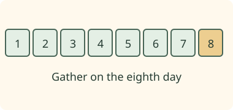

# Numbers 29 — Offerings in the seventh month

**About this chapter**

The LORD tells Israel when to gather and what to bring.

| Day of the seventh month | What Israel does |
| --- | --- |
| Day 1 | Gather and sound the trumpets. |
| Day 10 | Gather and come humbly before the LORD. |
| Days 15–21 | Keep a feast for seven days. |
| Day 22 | Gather again after the feast. |

## Day 1 — Sound the trumpets

## Numbers 29:1

Gather to worship on day 1 of month 7.

Set aside your regular work.

Sound the trumpets that day.

## Numbers 29:2

Give the LORD a burnt offering.

Bring one young bull and one ram.

Bring seven male lambs, each one year old.

Choose animals free of defects.

The smell of the offering pleases the LORD.

**Reading help**

A ram is a male sheep.

For a burnt offering, the priests burn the animal on the altar.

## Numbers 29:3

Mix fine flour with oil for the grain offering.

Bring three tenths of an ephah for the bull.

Bring two tenths of an ephah for the ram.

**Reading help**

An ephah measures dry food like flour.

One tenth means one of ten equal parts.

## Numbers 29:4

Bring one tenth of an ephah for each lamb.

## Numbers 29:5

Bring one male goat as a sin offering.

This offering makes atonement for you.

**Reading help**

Sin means doing wrong in God’s eyes.

Atonement deals with sin so people can be at peace with God.

## Numbers 29:6

Also bring the monthly and daily burnt offerings.

Bring the grain and drink offerings that go with them.

Give the LORD these food offerings.

Their smell pleases the LORD.

**Pause and answer**

What do the people sound on day 1?

## Day 10 — Gather before the LORD

## Numbers 29:7

Gather to worship on day 10 of month 7.

Come humbly before the LORD.

Show that you need him.

Do no work that day.

## Numbers 29:8

Give the LORD a burnt offering.

Bring one young bull and one ram.

Bring seven male lambs, each one year old.

Choose animals free of defects.

The smell of the offering pleases the LORD.

## Numbers 29:9

Mix fine flour with oil for the grain offering.

Bring three tenths of an ephah for the bull.

Bring two tenths of an ephah for the ram.

## Numbers 29:10

Bring one tenth of an ephah for each lamb.

## Numbers 29:11

Bring one male goat as a sin offering.

Also bring the sin offering for atonement.

Bring the regular burnt offering too.

Bring its grain offering and drink offerings.

**Pause and answer**

When do the people gather and do no work?

## The feast begins on day 15

## Numbers 29:12

Gather to worship on day 15 of month 7.

Set aside your regular work that day.

Keep a feast for the LORD for seven days.

## Numbers 29:13

Give the LORD a burnt offering as a food gift.

Bring 13 young bulls and 2 rams.

Bring 14 male lambs, each one year old.

Choose animals free of defects.

The smell of the offering pleases the LORD.

## Numbers 29:14

Mix fine flour with oil for the grain offering.

Bring three tenths of an ephah for each bull.

Bring two tenths of an ephah for each ram.

## Numbers 29:15

Bring one tenth of an ephah for each lamb.

## Numbers 29:16

Bring one male goat as a sin offering.

Also bring the regular burnt offering.

Bring its grain offering and drink offering.

**Pause and answer**

How many days does the feast last?

## Day 2 of the feast

## Numbers 29:17

Bring 12 young bulls and 2 rams.

Bring 14 male lambs, each one year old.

Choose animals free of defects.

## Numbers 29:18

Bring grain and drink offerings for each animal.

Use the amounts the LORD set for each kind.

## Numbers 29:19

Bring one male goat as a sin offering.

Also bring the regular burnt offering.

Bring its grain offering and drink offering.

## Day 3 of the feast

## Numbers 29:20

Bring 11 bulls and 2 rams.

Bring 14 male lambs, each one year old.

Choose animals free of defects.

## Numbers 29:21

Bring grain and drink offerings for each animal.

Use the amounts the LORD set for each kind.

## Numbers 29:22

Bring one male goat as a sin offering.

Also bring the regular burnt offering.

Bring its grain offering and drink offering.

## Day 4 of the feast

## Numbers 29:23

Bring 10 bulls and 2 rams.

Bring 14 male lambs, each one year old.

Choose animals free of defects.

## Numbers 29:24

Bring grain and drink offerings for each animal.

Use the amounts the LORD set for each kind.

## Numbers 29:25

Bring one male goat as a sin offering.

Also bring the regular burnt offering.

Bring its grain offering and drink offering.

## Day 5 of the feast

## Numbers 29:26

Bring 9 bulls and 2 rams.

Bring 14 male lambs, each one year old.

Choose animals free of defects.

## Numbers 29:27

Bring grain and drink offerings for each animal.

Use the amounts the LORD set for each kind.

## Numbers 29:28

Bring one male goat as a sin offering.

Also bring the regular burnt offering.

Bring its grain offering and drink offering.

## Day 6 of the feast

## Numbers 29:29

Bring 8 bulls and 2 rams.

Bring 14 male lambs, each one year old.

Choose animals free of defects.

## Numbers 29:30

Bring grain and drink offerings for each animal.

Use the amounts the LORD set for each kind.

## Numbers 29:31

Bring one male goat as a sin offering.

Also bring the regular burnt offering.

Bring its grain offering and drink offering.

## Day 7 of the feast

## Numbers 29:32

Bring 7 bulls and 2 rams.

Bring 14 male lambs, each one year old.

Choose animals free of defects.

## Numbers 29:33

Bring grain and drink offerings for each animal.

Use the amounts the LORD set for each kind.

## Numbers 29:34

Bring one male goat as a sin offering.

Also bring the regular burnt offering.

Bring its grain offering and drink offering.

**Pause and answer**

How many bulls do the people bring on the seventh day?

## Gather again on the eighth day

## Numbers 29:35

Gather for worship on the eighth day.

Set aside your regular work.

Day eight is set apart for worship and rest from regular work.

## Numbers 29:36

Give the LORD a burnt offering as a food gift.

Bring 1 bull and 1 ram.

Bring 7 male lambs, each one year old.

Choose animals free of defects.

The smell of the offering pleases the LORD.

## Numbers 29:37

Bring grain and drink offerings for each animal.

Use the amounts the LORD set for each kind.

## Numbers 29:38

Bring one male goat as a sin offering.

Also bring the regular burnt offering.

Bring its grain offering and drink offering.

## Moses tells Israel

## Numbers 29:39

Bring these offerings to the LORD at the set times.

Also bring the gifts you promised the LORD.

You may bring gifts you freely choose to give.

These gifts can be burnt, grain, drink or peace offerings.

**Reading help**

A peace offering celebrates peace with the LORD.

## Numbers 29:40

Moses told the Israelites everything the LORD had commanded.

**Pause and answer**

Who told the Israelites what the LORD said?
