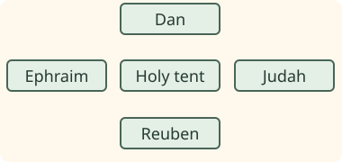

# Numbers 2 — Where the tribes camped and when they moved

**About this chapter**

Twelve tribes form four camps around the Tent of Meeting. Each camp has a place to stay and a turn to set out.

## A place for each family

## Numbers 2:1

The LORD spoke to Moses and Aaron.

## Numbers 2:2

The people must camp around the Tent of Meeting.

They must leave space between their camps and the tent.

Each person must camp under the banner of their group.

Families had banners too.

**Reading help**

A banner was a sign people could see. It helped them find their group.

**Pause and answer**

What marked the place where a family camped?

## Judah’s camp in the east

## Numbers 2:3

The camp of Judah must stay under its banner on the east side.

East is where the sun rises.

Nahshon son of Amminadab led the tribe of Judah.

## Numbers 2:4

Judah had 74,600 men in its army group.

## Numbers 2:5

The tribe of Issachar must camp alongside them.

Nethanel son of Zuar led the tribe of Issachar.

## Numbers 2:6

Issachar had 54,400 men in its army group.

## Numbers 2:7

The tribe of Zebulun must camp alongside them.

Eliab son of Helon led the tribe of Zebulun.

## Numbers 2:8

Zebulun had 57,400 men in its army group.

## Numbers 2:9

Together the three tribes in Judah’s camp had 186,400 men.

When Israel moved, this camp set out first.

**Pause and answer**

Which camp set out first?

## Reuben’s camp in the south

## Numbers 2:10

The camp of Reuben must stay under its banner on the south side.

Elizur son of Shedeur led the tribe of Reuben.

## Numbers 2:11

Reuben had 46,500 men in its army group.

## Numbers 2:12

The tribe of Simeon must camp alongside them.

Shelumiel son of Zurishaddai led the tribe of Simeon.

## Numbers 2:13

Simeon had 59,300 men in its army group.

## Numbers 2:14

The tribe of Gad must camp alongside them.

Eliasaph son of Deuel led the tribe of Gad.

## Numbers 2:15

Gad had 45,650 men in its army group.

## Numbers 2:16

Together the three tribes in Reuben’s camp had 151,450 men.

When Israel moved, this camp set out second.

**Pause and answer**

Which two tribes camped alongside Reuben?

## The holy tent travels in the middle

## Numbers 2:17

The Levites carried the Tent of Meeting between the camps.

The groups must travel in the same order they camped.

Each person must keep their place under their banner.

The holy tent was in the middle. Each outer box names the tribe that led that camp.

**Pause and answer**

Who carried the Tent of Meeting?

## Ephraim’s camp in the west

## Numbers 2:18

The camp of Ephraim must stay under its banner on the west side.

Elishama son of Ammihud led the tribe of Ephraim.

## Numbers 2:19

Ephraim had 40,500 men in its army group.

## Numbers 2:20

The tribe of Manasseh must camp alongside them.

Gamaliel son of Pedahzur led the tribe of Manasseh.

## Numbers 2:21

Manasseh had 32,200 men in its army group.

## Numbers 2:22

The tribe of Benjamin must camp alongside them.

Abidan son of Gideoni led the tribe of Benjamin.

## Numbers 2:23

Benjamin had 35,400 men in its army group.

## Numbers 2:24

Together the three tribes in Ephraim’s camp had 108,100 men.

When Israel moved, this camp set out third.

**Pause and answer**

Which camp set out third?

## Dan’s camp in the north

## Numbers 2:25

The camp of Dan must stay under its banner on the north side.

Ahiezer son of Ammishaddai led the tribe of Dan.

## Numbers 2:26

Dan had 62,700 men in its army group.

## Numbers 2:27

The tribe of Asher must camp alongside them.

Pagiel son of Ocran led the tribe of Asher.

## Numbers 2:28

Asher had 41,500 men in its army group.

## Numbers 2:29

The tribe of Naphtali must camp alongside them.

Ahira son of Enan led the tribe of Naphtali.

## Numbers 2:30

Naphtali had 53,400 men in its army group.

## Numbers 2:31

Together the three tribes in Dan’s camp had 157,600 men.

When Israel moved, this camp set out last.

The men followed their banners.

**Picture the four camps**

|   | North |   |
| --- | --- | --- |
|   | Dan, Asher, Naphtali |   |
| **West** • Ephraim, Manasseh, Benjamin | **Middle** • Levites and Tent of Meeting | **East** • Judah, Issachar, Zebulun |
|   | **South** • Reuben, Simeon, Gad |   |

**Pause and answer**

Which camp followed all the others?

## Israel follows the LORD’s instructions

## Numbers 2:32

The leaders counted the Israelites by family.

Across all the camps, they counted 603,550 men.

## Numbers 2:33

The LORD had told Moses to leave the Levites out of this count.

So the leaders counted the other tribes separately from the Levites.

## Numbers 2:34

The Israelites did everything the LORD had told Moses.

They camped under their banners.

When they moved, each person stayed with their clan and family.

**Pause and answer**

Who stayed together when Israel moved?
