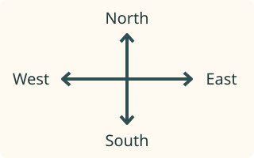

# Numbers 34 — The borders of Canaan

**About this chapter**

The LORD describes the land Israel will receive. A border marks where land ends.

Use the picture to point to each direction.

## The LORD describes the land

## Numbers 34:1

The LORD spoke to Moses.

## Numbers 34:2

The LORD told Moses to give Israel these instructions.

When the Israelites entered Canaan, they would receive land to keep.

The LORD described its borders.

## The southern border

## Numbers 34:3

The southern border would run through the Wilderness of Zin along Edom.

Its eastern end would start at the Salt Sea.

## Numbers 34:4

From there, the border would pass south of the Ascent of Akrabbim.

Then it would reach Zin and pass south of Kadesh-barnea.

Next it would reach Hazar-addar and then Azmon.

## Numbers 34:5

At Azmon the border would turn toward the Brook of Egypt.

It would follow that stream to the sea.

## The western border

## Numbers 34:6

The shore of the Great Sea would mark the western border.

**Pause and answer**

What marked the western border?

## The northern border

## Numbers 34:7

The northern border would start at the Great Sea.

It would go straight to Mount Hor.

## Numbers 34:8

From Mount Hor it would reach Lebo-hamath.

Then it would reach Zedad.

## Numbers 34:9

It would pass through Ziphron and end at Hazar-enan.

That would be the northern border.

## The eastern border

## Numbers 34:10

The eastern border would start at Hazar-enan.

It would go straight to Shepham.

## Numbers 34:11

From Shepham the border would go down to Riblah, east of Ain.

Then it would follow the slopes east of the Sea of Chinnereth.

## Numbers 34:12

It would follow the Jordan River down to the Salt Sea.

These borders marked all four sides of Israel’s land in Canaan.

**Pause and answer**

Where did the eastern border end?

## Which tribes will receive land?

## Numbers 34:13

Moses told Israel to draw lots to divide the land.

The LORD had given this land to nine and a half tribes.

**Reading help**

Drawing lots means using marked objects to make a choice. Here the lots showed which land each tribe would receive.

## Numbers 34:14

Reuben and Gad had already received their land.

Half the tribe of Manasseh had also received land.

## Numbers 34:15

Those two and a half tribes had land across the Jordan from Jericho.

Their land lay to the east, where the sun rises.

**Pause and answer**

On which side of the river did Gad receive land?

## The LORD chooses leaders

## Numbers 34:16

The LORD spoke to Moses again.

## Numbers 34:17

The LORD chose Eleazar the priest and Joshua, son of Nun.

They would give the Israelites their shares of land.

## Numbers 34:18

The LORD told Moses to appoint one leader from each tribe to help divide the land.

## Leaders from Judah through Dan

## Numbers 34:19

Caleb was the leader from Judah.

His father was Jephunneh.

## Numbers 34:20

Shemuel was the leader from Simeon.

His father was Ammihud.

## Numbers 34:21

Elidad was the leader from Benjamin.

His father was Chislon.

## Numbers 34:22

Bukki was the leader from Dan.

His father was Jogli.

## Leaders from Manasseh through Naphtali

## Numbers 34:23

Hanniel was the leader from Manasseh.

His father was Ephod.

Manasseh was Joseph’s son.

## Numbers 34:24

Kemuel was the leader from Ephraim.

His father was Shiphtan.

## Numbers 34:25

Eli-zaphan was the leader from Zebulun.

His father was Parnach.

## Numbers 34:26

Paltiel was the leader from Issachar.

His father was Azzan.

## Numbers 34:27

Ahihud was the leader from Asher.

His father was Shelomi.

## Numbers 34:28

Pedahel was the leader from Naphtali.

His father was Ammihud.

## Numbers 34:29

The LORD gave these men their task.

They would divide the land of Canaan among the Israelites.

**Pause and answer**

Who helped Eleazar and Joshua divide the land?
